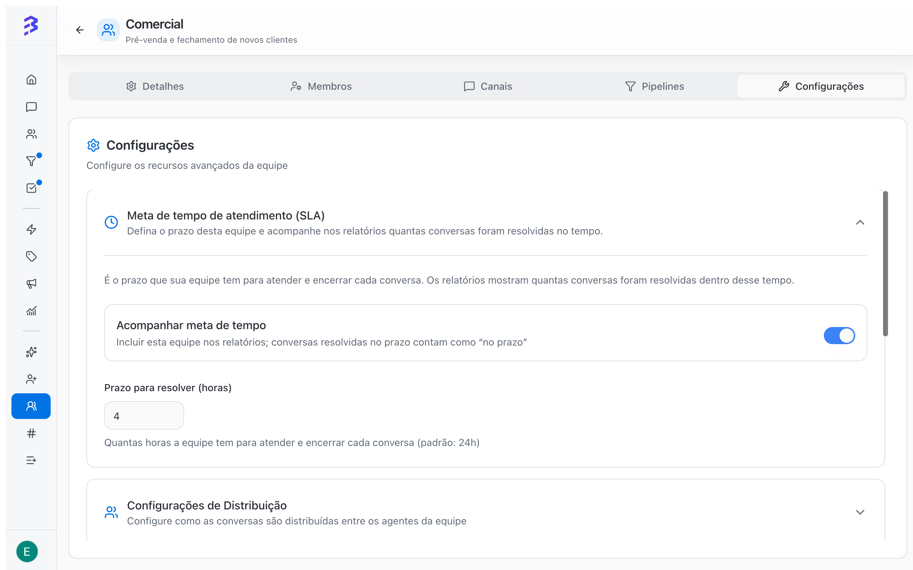
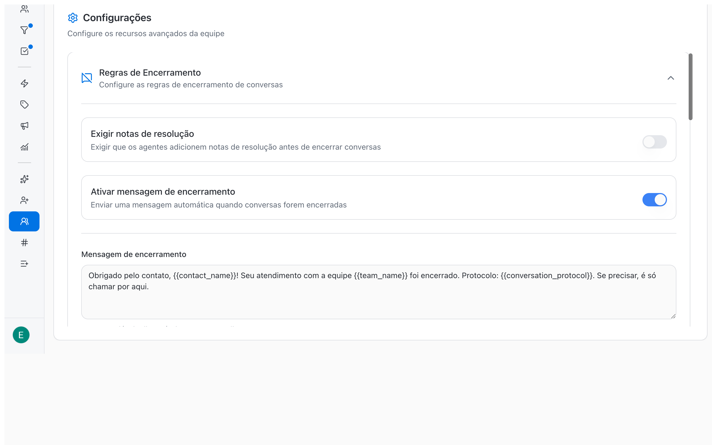
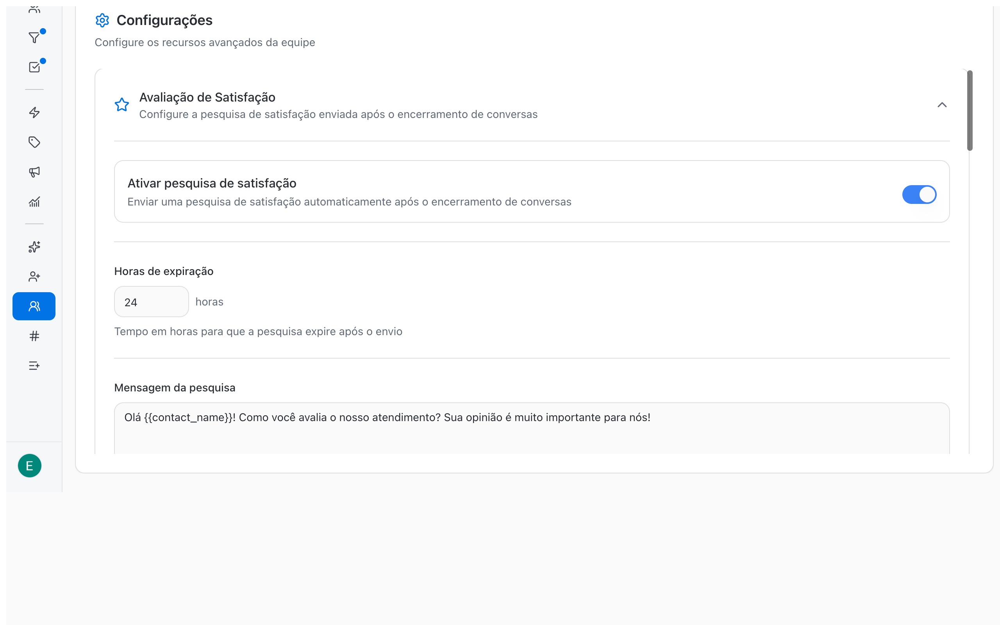
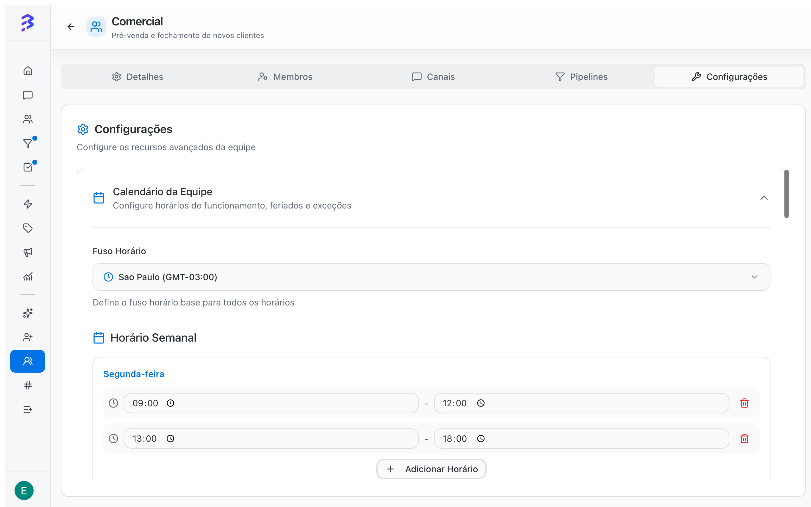

The team is the core unit of organization in BluBash. In a team you define who handles conversations, through which channels, with access to which Pipelines, during which hours, with which time goal, and how conversations are distributed. Create one team for each area of your operation, such as Sales, Support, Finance, or Legal.

<Info>
  Access comes from teams: a member sees the conversations of the channels and the deals of the Pipelines of the teams they belong to. Teams are also where the AI agent transfers conversations: each **Transfer to Team** skill points to one of them.
</Info>

<Note>
  Only **Administrators** can create, configure, and delete teams. The number of teams available depends on your plan, shown in **Billing & Usage**.
</Note>

## Configuration overview

| Where | What you define |
| --- | --- |
| **Details** tab | Team name and description |
| **Members** tab | Who belongs to the team and each person's team role (**Manager** or **Agent**) |
| **Channels** tab | Which channels the team handles |
| **Pipelines** tab | Which Pipelines the team uses |
| **Settings** tab | Conversation, ownership, SLA, distribution, closure, satisfaction, calendar, and deletion |

## Create a team

<Steps>
  <Step title="Open Teams">
    In the side menu, click **Teams**, then click **Create Team**.
  </Step>
  <Step title="Fill in the details">
    Enter the **Team Name** and, optionally, a **Description**. Use names that make sense to the people handling conversations and to whoever configures the AI agent, such as "Technical Support" or "Sales East".
  </Step>
  <Step title="Create">
    Click **Create Team**. BluBash confirms with **Team created successfully!** and opens the team page so you can continue the setup.
  </Step>
</Steps>

<Note>
  Every new team starts with **Queue** distribution and with **Show user name in messages** turned on. Adjust both in the **Settings** tab.
</Note>

## Details

In the **Details** tab, change the **Team Name** and **Description** and click **Update Team**.

<Warning>
  If you rename the team, review the AI agents' **Transfer to Team** skills. Skill instructions often mention the team by name.
</Warning>

## Team members

In the **Members** tab, search for the person, choose their team role, and click **Add**. In **Current Members**, change a person's team role or remove them.

| Team role | Use |
| --- | --- |
| **Agent** | A person who handles the team's conversations. Not to be confused with the AI agent |
| **Manager** | A person who coordinates the team |

<Warning>
  Nobody can be left without a team. BluBash blocks removing a member from their only team in the workspace.
</Warning>

To invite someone who is not in the workspace yet, see [Add a member →](/members/add-member).

## Team channels

The **Channels** tab shows two lists: **Available Channels**, with the channels you can link, and **Team Channels**, with the channels the team already handles.

| Channel | How to link it to the team |
| --- | --- |
| WhatsApp (official API and Lite) | In the **Channels** tab, click **Add** next to the channel in **Available Channels** |
| Instagram | In the channel settings, choose the team in **Default Team** |
| Webchat | In the channel settings, choose the team in **Default Team** |

Every channel has a **Default Team**, which receives the channel's conversations by default. In **Team Channels**, the **Default team** badge marks the channels where this team plays that role.

<Warning>
  You cannot unlink a channel from its default team. Change the **Default Team** in the channel settings before removing the link.
</Warning>

<Tip>
  One channel can serve several teams. A common setup is the AI agent on the main WhatsApp number and on Instagram, transferring to Sales or Support depending on the topic.
</Tip>

See how to set up each channel in [Create a channel →](/channels/create-channel), [Instagram →](/channels/configure-instagram), and [Webchat →](/channels/configure-webchat).

## Team Pipelines

In the **Pipelines** tab, add the Pipelines the team will use from **Available pipelines**. They move to **Team pipelines**, and the team's members can then see and work those deals.

A Pipeline must be linked to at least one team. That is why BluBash does not let you remove a Pipeline's last team link. See [Pipelines →](/pipelines/overview).

## Settings

The **Settings** tab groups collapsible sections. Open a section, make your change, and click **Update Team**, which appears when there are changes to save.

### Conversation Settings

| Option | Default | Effect |
| --- | --- | --- |
| **Allow initiating conversations** | On | The team's members can start new conversations with contacts |
| **Show user name in messages** | On for new teams | The name of the person handling the conversation appears in each message sent to the customer |

Turn off **Allow initiating conversations** for teams that only respond to incoming messages, such as a support team that only answers customers who reach out.

### Ownership

With **Assign contact owner when taking a conversation** turned on, whoever takes a conversation that has no team-level owner yet also becomes the contact owner for that team. Use it when each customer should have a fixed point of contact, such as sales portfolios or recurring accounts.

<Note>
  Contact ownership depends on your plan. If it is not included, turning on the option shows **Upgrade to use contact portfolio**.
</Note>

### Response time goal (SLA)

Set how long the team has to respond to and close each conversation.

| Field | Default | Description |
| --- | --- | --- |
| **Track time goal** | On | Includes the team in reports; conversations resolved on time count as "on time" |
| **Time to resolve (hours)** | 24 | How many hours the team has to respond to and close each conversation |

<Frame>
  
</Frame>

### Distribution Settings

| Distribution Type | How it works | When to use it |
| --- | --- | --- |
| **Round Robin** | Distributes conversations evenly among available team members | Teams with steady volume and team members with the same profile |
| **Queue** | Keeps conversations in the queue, without automatic assignment, until someone takes them | Teams that prefer to choose what to handle or that have different specialists |

<Note>
  Older teams configured as **Available** are shown as **Round Robin** in this section.
</Note>

In **Max Concurrent Conversations**, set how many conversations each member handles at the same time, from 1 to 50. The default is 10. When a member reaches the limit, they stop receiving conversations. If everyone reaches the limit, new conversations are queued.

<Tip>
  With an AI agent on the channel, the team receives less volume: the agent handles routine requests and only transfers what needs a person. Review the max concurrent conversations after the first weeks with AI.
</Tip>

### Closure Rules

| Option | Effect |
| --- | --- |
| **Require resolution notes** | The team member must write a resolution note before closing the conversation |
| **Enable closure message** | Sends an automatic message to the customer when the conversation is closed |

In the **Closure message**, use the variables below. Click a variable to insert or copy it, and check the result in the **Preview**.

| Variable | Content |
| --- | --- |
| `{{team_name}}` | Team name |
| `{{contact_name}}` | Contact name |
| `{{agent_name}}` | Agent name |
| `{{conversation_protocol}}` | Conversation protocol |

In **Sending conditions**, set the **Minimum conversation duration** in minutes so the message is not sent for very short conversations.

<Frame>
  
</Frame>

### Satisfaction Survey

With **Enable satisfaction survey**, the customer receives a survey with a score from 1 to 5 after the conversation is closed.

| Field | Default | Description |
| --- | --- | --- |
| **Expiration hours** | 12 | How long the survey stays valid after it is sent |
| **Survey message** | Suggested text | The question sent to the customer. Accepts the same variables |
| **Thank you message** | Suggested text | Sent after the customer answers |

Scores feed the **Average CSAT** in [Reports →](/reports/overview).

<Frame>
  
</Frame>

### Team Calendar

Click **Create Calendar** and configure:

| Item | How to configure it |
| --- | --- |
| **Timezone** | Base timezone for all of the team's schedules |
| **Weekly Schedule** | For each day, use **Add Time Slot** for one or more intervals, or leave the day as **Closed** |
| **Holidays** | **Add Holiday** with a date and **Holiday name** |
| **Exceptions** | **Add Exception** with an **Exception reason** and a **Special schedule**, or check **Closed on this day** |

To undo it, use **Remove Calendar**.

<Frame>
  
</Frame>

<Tip>
  Set the calendar to the team's real working hours before tracking time metrics. With an AI agent on the channel, customers get a first response outside those hours too.
</Tip>

## Delete a team

In **Settings**, open **Advanced actions** and click **Delete team**. BluBash shows the impact before you confirm:

| Item checked | What to do |
| --- | --- |
| **Open conversations** | Check **Automatically close this team's open conversations** or redistribute the conversations first |
| Channels with this team as default | Choose the new default team for each channel |
| Channels that would be left without a team | Choose a team for each channel |
| **Contact portfolio** | The team's contact ownership links are removed |

Click **Continue**, type the team name to confirm, and click **Delete permanently**. Deletion cannot be undone.

<Warning>
  After deleting, review the AI agents' **Transfer to Team** skills that pointed to the team, and the Pipelines that were linked to it.
</Warning>

## Best practices

- Create teams before inviting members. The invitation requires at least one team.
- One team per service area makes AI agent transfers and reports easier to read.
- Start with **Queue** while the team is small and switch to **Round Robin** as volume grows.
- Turn on SLA and the Satisfaction Survey from day one so reports have history.

## Next steps

<CardGroup cols={2}>
  <Card title="Add a member" icon="user-plus" href="/members/add-member">
    Invite the people on the team.
  </Card>

  <Card title="Configure skills" icon="zap" href="/ai-agents/configure-skills">
    Point the AI agent's **Transfer to Team** skill to the team.
  </Card>

  <Card title="Create a Pipeline" icon="kanban" href="/pipelines/create-pipeline">
    Create the Pipelines the team will use.
  </Card>

  <Card title="Close a conversation" icon="message-circle" href="/conversations/close-attendance">
    See the closure rules in practice.
  </Card>
</CardGroup>
