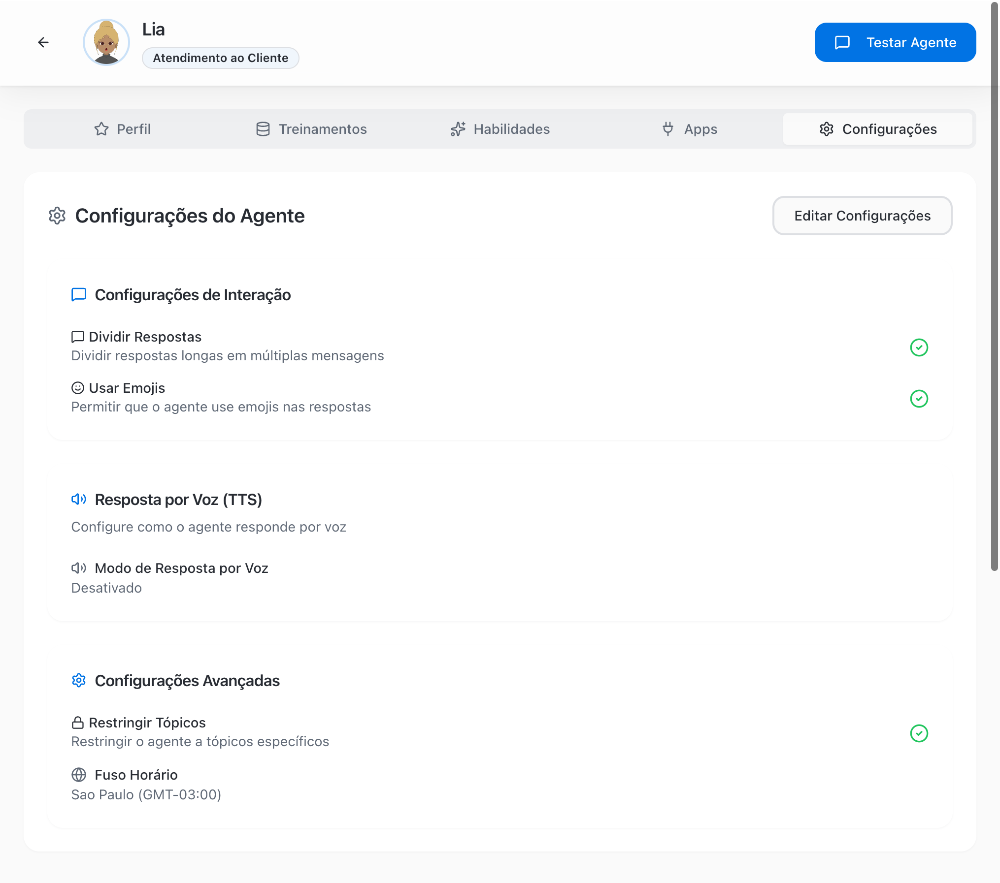
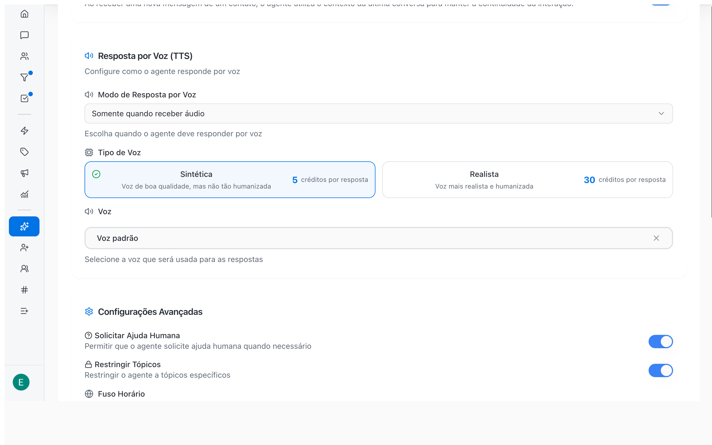

Settings define the response style of the AI agent. They apply to every channel the agent serves: WhatsApp, Instagram and Webchat.

<Note>
  What the agent does on its own in the conversation, such as updating the contact, closing the conversation, remembering the previous conversation and transferring to a human, now lives in the **Skills** tab as native skills. See [Configure skills and apps →](/ai-agents/configure-skills#native-skills).
</Note>

## Open and edit the settings

<Steps>
  <Step title="Open the agent">
    In the sidebar, click **AI Agents** and then the agent.
  </Step>
  <Step title="Click the Settings tab">
    The tab shows each option with an enabled or disabled indicator.
  </Step>
  <Step title="Click Edit Settings">
    The options become editable switches and selectors.
  </Step>
  <Step title="Save">
    Click **Save** to apply or **Cancel** to discard. Changes apply to the agent's next responses.
  </Step>
</Steps>

<Frame>
  
</Frame>

## Interaction Settings

| Setting | What it does | Default | Recommendation |
| --- | --- | --- | --- |
| **Split Responses** | Splits long responses into several short messages, the way a person would on WhatsApp or Direct | Disabled | Enable |
| **Use Emojis** | Allows the agent to use emojis in responses | Disabled | Depends on your brand's tone |

## Voice Response (TTS)

The agent can reply with audio, the way a team member would on WhatsApp.

<Frame>
  
</Frame>

### Voice Response Mode

| Mode | Behavior |
| --- | --- |
| **Disabled** | The agent always replies in text. This is the default. |
| **Always** | The agent always replies with audio |
| **Only when receiving audio** | The agent replies with audio when the customer sends audio and with text when the customer types |
| **Automatic** | The agent decides when audio makes sense in the conversation |

### Voice Type and Voice

When the mode is not **Disabled**, two more fields appear:

- **Voice Type**: **Synthetic** (good quality, less humanized) or **Realistic** (more realistic and humanized). Each option shows its cost in credits per response.
- **Voice**: the voice used in responses. Search by name and click **Listen to voice** to hear a preview. Without a choice, the agent uses the **Default voice**.

<Note>
  Audio responses consume AI credits: 5 credits per response with the **Synthetic** voice and 30 credits per response with the **Realistic** voice.
</Note>

<Tip>
  **Only when receiving audio** usually works best: customers who prefer audio get audio and those who type get text, without wasting credits.
</Tip>

## Advanced Settings

| Setting | What it does | Default |
| --- | --- | --- |
| **Restrict Topics** | Keeps the agent on your business topics and avoids off-topic answers | Disabled |
| **Timezone** | Reference for dates and times the agent mentions, such as "today" or "tomorrow at 2 PM". Search for the timezone in the list. | Browser timezone of the person who created the agent |

<Warning>
  Check the **Timezone** if your team serves customers in another timezone or if the agent schedules appointments through the Google Calendar app. A wrong timezone produces wrong times in responses.
</Warning>

## How much autonomy to give the agent

Autonomy comes from combining the settings with the agent's skills.

| Operation profile | Suggested configuration |
| --- | --- |
| Starting with AI | **Restrict Topics** enabled; one **Transfer to team** skill for each area; the native **Close conversation** skill disabled for the first weeks so you can review conversations; **Manage deals** limited to the early pipeline stages |
| Mature operation | Native **Close conversation** and **Update contact** skills enabled; **Manage deals** with won and lost allowed; periodic review in the **360° View** with AI analysis |
| High volume | **Split Responses** enabled and transfer skills with very specific guidance |

## Common errors

| Problem | Solution |
| --- | --- |
| The agent closes conversations too early | Disable the native **Close conversation** skill in the **Skills** tab or describe in **Behavior** when to close |
| The agent answers off topic | Enable **Restrict Topics** and reinforce the allowed topics in **Behavior** |
| The agent repeats questions to a returning customer | Make sure the native **Remember previous conversation** skill is enabled |
| High credit usage with audio | Switch the mode to **Only when receiving audio** or use the **Synthetic** voice |

## Next steps

- [Configure skills and apps →](/ai-agents/configure-skills)
- [Test the agent →](/ai-agents/test-ai-agent)
- [Analyze the quality of AI conversations →](/reports/ai-audit)
