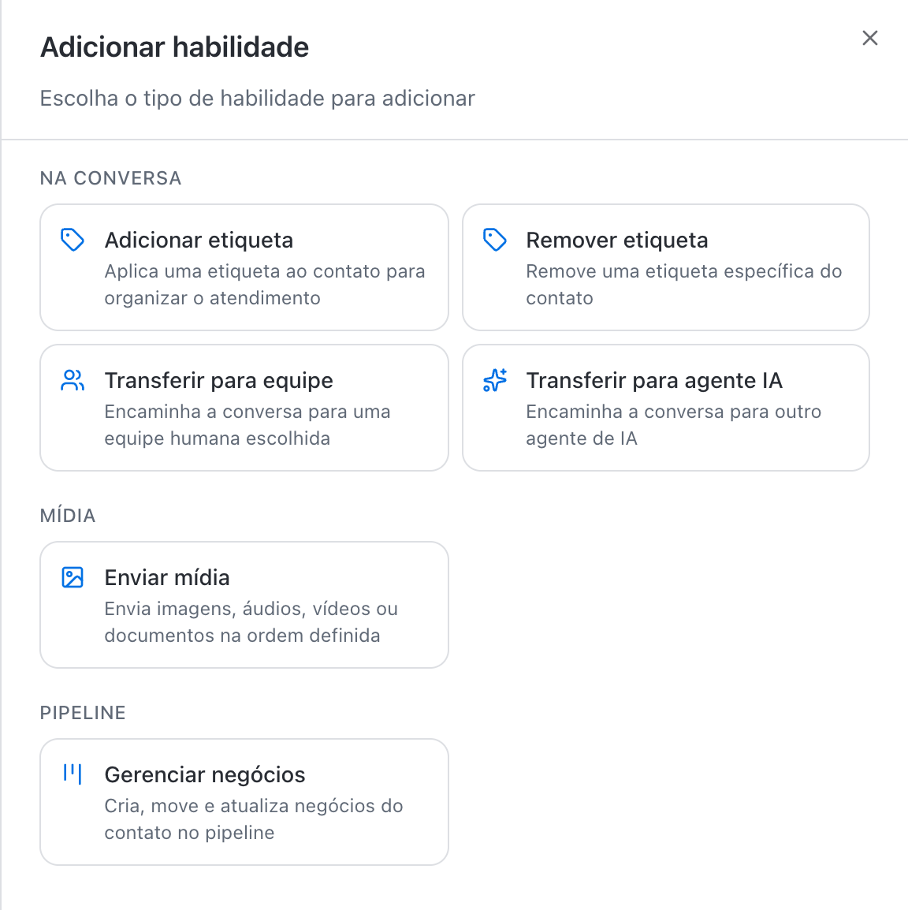
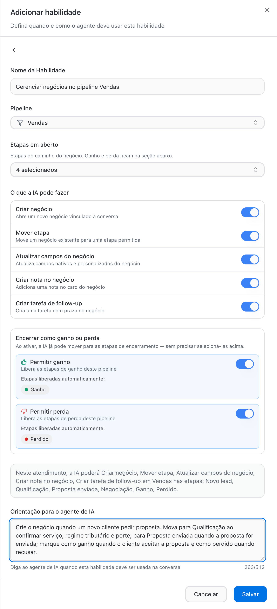
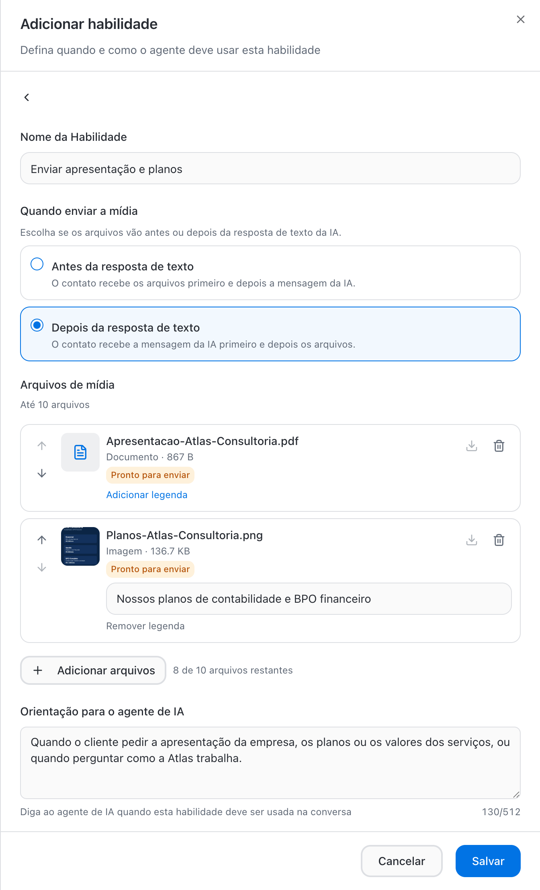
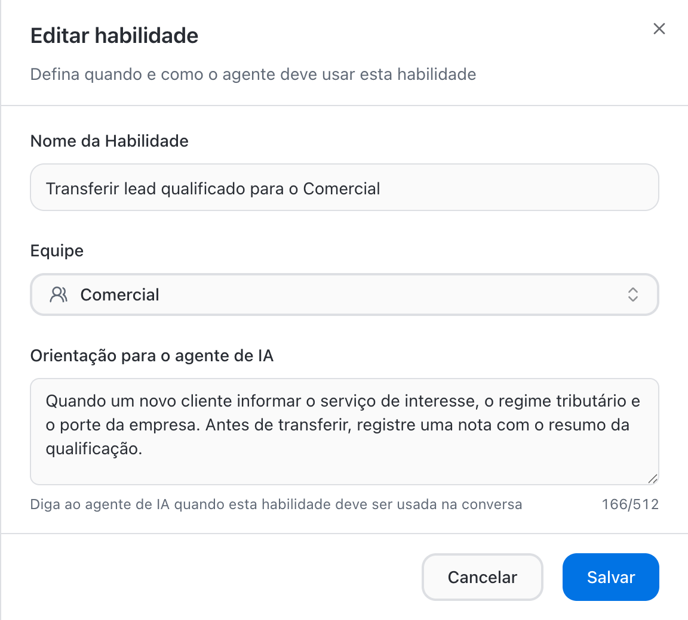
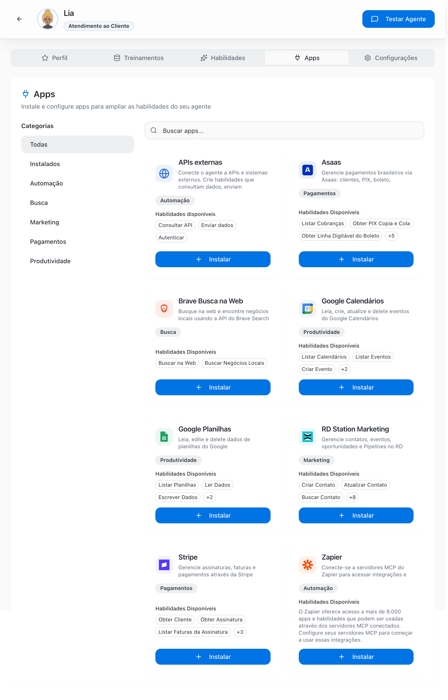
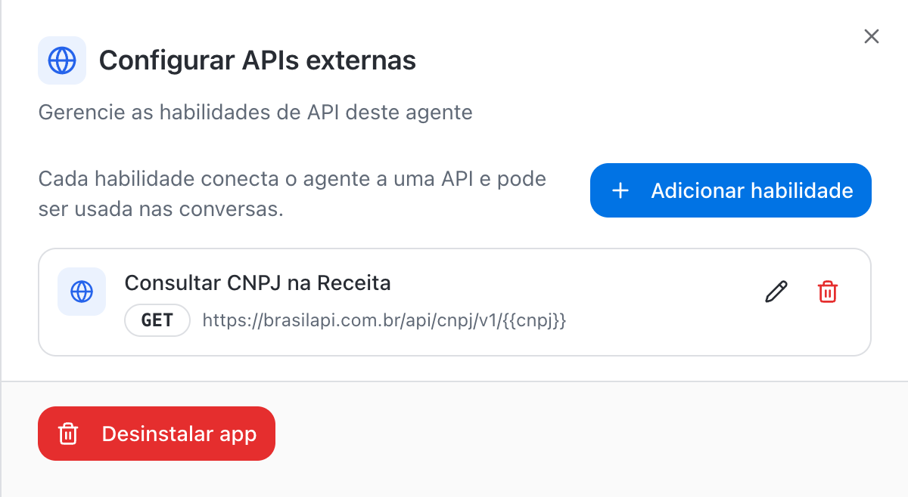
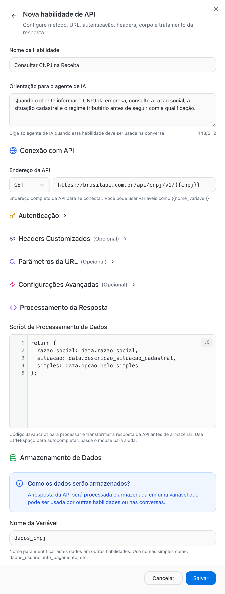

Skills are the actions the AI agent takes during the conversation, beyond answering. With them the agent organizes the conversation, sends materials, moves deals through Pipelines, queries systems and hands off to the right team at the right time. Skills work on any channel the agent serves: WhatsApp, Instagram and Webchat.

The agent has two tabs for this:

- **Skills**: native skills, which come with every agent, and the skills you configure (tags, transfers, media and Pipelines).
- **Apps**: integrations with external systems, including the **External APIs** app to connect any HTTP API.

<Frame>
  
</Frame>

## Native skills

Native skills are available on every agent. They sit at the top of the **Skills** tab, in a block you can collapse or expand.

| Skill | What the agent does | Control |
| --- | --- | --- |
| **Add note** | Records internal notes in the conversation, such as context, summaries and next steps. The customer does not see them. | Always on |
| **Transfer to human** | Hands the conversation to the channel's default team when the customer asks for a person or the AI cannot resolve it | Always on. Shows as **Replaced** when the agent has a **Transfer to team** skill |
| **Update contact** | Updates the contact's name, email, phone and additional fields when the customer provides new data | Switch |
| **Close conversation** | Closes the conversation when the service is done or the customer says they need nothing else | Switch |
| **Remember previous conversation** | On the contact's next message, checks the context of the last conversation so the customer does not repeat themselves | Switch |

<Note>
  **Update contact**, **Close conversation** and **Remember previous conversation** used to be in the **Settings** tab. They are now native skills, turned on and off directly in the **Skills** tab. The former **Request Human Help** option was replaced by the native **Transfer to human** skill.
</Note>

<Tip>
  Want to control which team the AI transfers to? Create a **Transfer to team** skill for each area. From the first one on, the native **Transfer to human** shows as **Replaced** and is no longer used.
</Tip>

## Configurable skill types

Click **Add skill** to choose the type. Types are grouped by what the AI does.

<Frame>
  
</Frame>

| Group | Type | What the agent does | Main field |
| --- | --- | --- | --- |
| In the conversation | **Add tag** | Applies a tag to the contact to organize the service | **Tag** |
| In the conversation | **Remove tag** | Removes a specific tag from the contact | **Tag** |
| In the conversation | **Transfer to team** | Hands the conversation to a chosen human team | **Team** |
| In the conversation | **Transfer to AI agent** | Hands the conversation to another AI agent | **Target Agent** and **Target Team (Optional)** |
| Media | **Send media** | Sends images, audio, videos or documents in the defined order | Media files |
| Pipeline | **Manage deals** | Creates, moves, updates and closes the contact's deals in a pipeline | **Pipeline**, stages and permissions |

Integrations with your own APIs, formerly the **HTTP Request** type, now live in the **External APIs** app, in the **Apps** tab. See [External APIs](#external-apis).

## Manage deals in Pipelines

With the **Manage deals** skill, the AI agent runs the deal in the pipeline on its own, during the conversation: it opens the deal when the lead arrives, moves it through stages as qualification progresses, updates fields, records notes, creates follow-up tasks and marks it as won or lost. The team follows everything on the pipeline board without typing anything.

<Frame>
  
</Frame>

### Set it up

<Steps>
  <Step title="Choose the Manage deals type">
    In the **Skills** tab, click **Add skill** and, in the **Pipeline** group, choose **Manage deals**.
  </Step>
  <Step title="Name it and choose the pipeline">
    In **Skill Name**, describe the action. Example: _Manage deals in the Sales pipeline_. In **Pipeline**, choose the pipeline the AI will work in.
  </Step>
  <Step title="Select the open stages">
    In **Open stages**, select the stages along the deal's path that the AI can use. Example in the Sales pipeline: **New lead**, **Qualification**, **Proposal sent** and **Negotiation**. Won and lost stages do not appear here; they are unlocked in the **Close as won or lost** section.
  </Step>
  <Step title="Define what the AI can do">
    Turn each action in the **What the AI can do** list on or off. See the table below.
  </Step>
  <Step title="Unlock won and lost, if it makes sense">
    In **Close as won or lost**, turn on **Allow won** and **Allow lost**. Once enabled, the AI can move the deal to the pipeline's closing stages, such as **Won** and **Lost**, without selecting them in the open stages.
  </Step>
  <Step title="Check the summary and write the guidance">
    The summary box shows exactly what the AI will be able to do and in which stages. In **Guidance for the AI agent**, explain when to act at each stage (up to 512 characters). Click **Save**.
  </Step>
</Steps>

### What the AI can do

| Action | What happens | Default on creation |
| --- | --- | --- |
| **Create deal** | Opens a new deal linked to the conversation | On |
| **Move stage** | Moves an existing deal to one of the allowed stages | On |
| **Update deal fields** | Updates native and custom deal fields, such as value or data gathered in the conversation | Off |
| **Create note on deal** | Adds a note to the deal card | Off |
| **Create follow-up task** | Creates a task with a due date on the deal | On |
| **Allow won** | Unlocks the pipeline's won stages | Off |
| **Allow lost** | Unlocks the pipeline's lost stages | Off |

The AI only moves the deal to the stages you unlocked. If a stage is not in **Open stages** and is not unlocked by won or lost, the AI cannot put the deal there.

### Guidance example

The guidance is what the agent uses to decide when to act. Tie each move to a fact in the conversation:

> Create the deal when a new customer asks for a proposal. Move to Qualification once service, tax regime and company size are confirmed; to Proposal sent when the proposal is sent; mark as won when the customer accepts the proposal and as lost when they decline.

| Weak | Good |
| --- | --- |
| "Move the deal when it progresses" | "Move to Qualification when the customer states the service, tax regime and number of employees" |
| "Mark as won when it closes" | "Mark as won when the customer accepts the proposal in writing in the conversation" |
| "Create tasks" | "Create a follow-up task for the next day when the customer asks for time to think" |

### Best practices

- **One skill per pipeline.** Each skill works in one pipeline. If the AI needs to open deals in **Sales** and **Onboarding**, create one skill for each, with separate guidance.
- **Start narrow.** For the first weeks, unlock only the early stages and keep **Allow won** and **Allow lost** off. Once you trust the AI's decisions, expand.
- **Use notes and tasks together.** With **Create note on deal** and **Create follow-up task**, whoever takes over the deal finds the summary and the next step with a due date.
- **Combine with transfers.** The AI can move the deal to **Proposal sent** and then transfer the conversation to Sales with **Transfer to team**.

<Warning>
  Review the skill whenever you change the pipeline's stages. A deleted or renamed stage no longer applies to the AI until you update the selection.
</Warning>

See also [Pipelines →](/pipelines/overview) and [Deals →](/pipelines/deals).

## Send media

Use **Send media** so the agent sends ready-made materials during the conversation: company presentation, price table, catalog, demo video or welcome audio.

<Frame>
  
</Frame>

| Field | Description |
| --- | --- |
| **Skill Name** | Describe the material. Example: _Send presentation and plans_. |
| **When to send the media** | **Before the text response**: the contact gets the files first and then the AI's message. **After the text response**: the contact gets the AI's message first and then the files. |
| **Media files** | Up to 10 files per skill. Use the arrows to set the sending order and **Add caption** to include text with a file. |
| **Guidance for the AI agent** | When the agent should send the files. Example: _When the customer asks for the company presentation, the plans or the service prices._ |

Size limits per file:

| Type | Limit |
| --- | --- |
| Image | 5 MB |
| Video | 20 MB |
| Audio | 10 MB |
| Document | 15 MB |

<Tip>
  Create one media skill per situation, for example one for the company presentation and another for the price catalog. That keeps the guidance specific and the AI sends only what the customer asked for.
</Tip>

## In-conversation skills

### Add and remove tag

Choose the **Tag** and write the guidance. Example: apply **Hot lead** when the customer asks for a proposal, or remove **Overdue** when they confirm payment.

### Transfer to team

Choose the **Team** that receives the conversation and describe in the guidance when to transfer.

<Frame>
  
</Frame>

### Transfer to AI agent

Use it to split service among specialized agents. Example: a triage agent serves WhatsApp, Instagram and Webchat and transfers to a billing agent when the subject is an invoice.

- **Target Agent**: the agent that takes over the conversation.
- **Target Team (Optional)**: if set, the conversation also moves to this team. Choose **Do not change team** to keep the current team.

<Warning>
  For the team change to happen, the target team must have access to the channel where the conversation is taking place. Add the channel to **Team Channels** in the team settings.
</Warning>

## Write good guidance

Every type has the **Guidance for the AI agent** field, with up to 512 characters. It is what the agent uses to decide when to run the skill. Be specific.

| Weak | Good |
| --- | --- |
| "When it is a lead" | "When a new customer states the service of interest, the tax regime and the company size" |
| "When the customer is important" | "When the customer has revenue above R\$ 1 million a year or more than 10 employees" |
| "For support" | "When an active customer asks for documents, forms, a duplicate invoice or reports a delay" |
| "When they want to talk to someone" | "When the customer asks to talk to a person, shows irritation or repeats the same question twice" |

<Tip>
  Combine skills in the agent's **Behavior**: "Before transferring, record a note with the qualification summary and move the deal to Qualification." This way whoever receives the conversation starts with the context.
</Tip>

## Manage skills

- Filter the list by **All**, **Conversation**, **Media** or **Pipeline**, or use **Search skills...**.
- Click the skill card to edit it or use the card menu: **Edit** or **Delete**.
- Review skills whenever you change teams, tags or pipeline stages. A skill that points to something deleted stops working.

## Apps tab: integrations

The **Apps** tab connects the agent to external systems. Each installed app adds skills the agent uses during the conversation, on any channel. Filter by **Categories** (**All**, **Installed**, **Automation**, **Search**, **Marketing**, **Payments** and **Productivity**) or use **Search apps...**.

<Frame>
  
</Frame>

<Note>
  Apps depend on your plan. If the feature is not available, BluBash shows the **Feature not available** notice with the **View plans and upgrade** button.
</Note>

### Available apps

| App | Category | How it connects | What the agent can do |
| --- | --- | --- | --- |
| **External APIs** | Automation | Configuration of each API (URL, method and authentication) | Query data, send information and trigger actions in any HTTP service |
| **Google Sheets** | Productivity | Google account (OAuth) | List spreadsheets, read, write, update and delete data |
| **Google Calendar** | Productivity | Google account (OAuth) | List calendars and events, create, update and delete events |
| **Stripe** | Payments | API Key (starts with `sk_` or `pk_`; use the secret `sk_` key for full access) | Get customer, subscription and invoice, list subscription invoices, create standalone invoice, update and cancel subscription |
| **Asaas** | Payments | API Key (production `$aact_prod_` or sandbox `$aact_hmlg_`) | Get and create customer, list, get and create payments, get PIX copy-and-paste and boleto digitable line, list, get and cancel subscriptions |
| **Brave Web Search** | Search | Brave Search API Key | Search the web and search local businesses |
| **Zapier** | Automation | URL of a Zapier MCP server | Use the actions configured on your Zapier MCP server, which gives access to thousands of apps |
| **RD Station Marketing** | Marketing | RD Station account (OAuth) | Create, update and get contact, add and remove tags, create and get event, list additional fields, mark, win and lose opportunity |

### External APIs

The **External APIs** app replaces the former **HTTP Request** skill. Use it to integrate the agent with your own or public systems, such as an ERP, order system, internal calendar or company registry lookup. After installing the app, all of the agent's API skills are grouped in the **Configure External APIs** panel.

<Frame>
  
</Frame>

<Steps>
  <Step title="Install the app">
    In the **Apps** tab, click **Install** on the **External APIs** card. The **Configure External APIs** panel opens next.
  </Step>
  <Step title="Add an API skill">
    Click **Add skill**. Fill in **Skill Name** and **Guidance for the AI agent**.
  </Step>
  <Step title="Configure the connection">
    In **API Connection**, choose the method and enter the **API Address**. Set up **Authentication**, **Custom Headers**, **URL Parameters** and **Advanced Settings** if the API requires them.
  </Step>
  <Step title="Process and store the response">
    In **Response Processing**, write the script that transforms the response and, in **Data Storage**, set the **Variable Name**. Click **Save**.
  </Step>
</Steps>

<Frame>
  
</Frame>

#### API Connection

| Field | Description |
| --- | --- |
| **API Address** | Full endpoint URL. Accepts variables in the `{{variable_name}}` format, for example `https://brasilapi.com.br/api/cnpj/v1/{{cnpj}}`. |
| **Method** | **GET** (Get Data), **POST** (Send Data), **PUT** (Update Data), **PATCH** (Modify Data) or **DELETE** (Delete Data) |

#### Authentication

| Authentication Type | Field requested |
| --- | --- |
| **No Authentication** | None |
| **Bearer Token** | Token (accepts a variable, such as `{{auth_token}}`) |
| **Basic Auth** | Base64 credentials |
| **Custom Header** | Value and **Header Name**, for example `X-API-Key` |

#### Headers, parameters and body

- **Custom Headers** (optional): click **Add Header** for each header.
- **URL Parameters** (optional): click **Add Parameter** for each query parameter.
- **Request Data**: appears for **POST**, **PUT** and **PATCH**, with the body type (**JSON**, **Form Data**, **URL Encoded** or **Raw Text**) and the data to send. Use `{{variable}}` for dynamic values.

#### Advanced Settings

| Field | Range | Default |
| --- | --- | --- |
| **Timeout (ms)** | 1,000 to 300,000 milliseconds | 30,000 (30 seconds) |
| **Retry Attempts** | 0 to 5 | 2 |

#### Response processing and storage

- **Data Processing Script**: optional JavaScript code to transform the response before storing it. `data`, `status`, `headers`, `variables` and `extractValue()` are available. Use **Ctrl+Space** for autocomplete.
- **Variable Name**: the name that identifies the result, such as `dados_cnpj`. The agent uses this variable in its answers and in other skills.

Example script for the CNPJ lookup:

```javascript
return {
  razao_social: data.razao_social,
  situacao: data.descricao_situacao_cadastral,
  simples: data.opcao_pelo_simples
};
```

<Warning>
  Never put tokens or passwords in the **API Address**. Use the **Authentication** section or a **Custom Header**. Test the skill in **Test Agent** before linking the agent to channels.
</Warning>

To edit or delete an API skill, open the app with **Configure** and use the pencil and trash icons on the skill card.

### Install and connect the other apps

<Steps>
  <Step title="Open the Apps tab">
    In **AI Agents**, open the agent and click the **Apps** tab.
  </Step>
  <Step title="Click Install">
    On the app card, click **Install**. The configuration panel opens next.
  </Step>
  <Step title="Authenticate">
    Follow the app's method:

    - **Google Sheets, Google Calendar and RD Station**: click the button to connect the account and authorize access in the window that opens. If the browser blocks the window, allow pop-ups for BluBash.
    - **Stripe, Asaas and Brave**: paste the API Key. BluBash validates the key and stores it encrypted.
    - **Zapier**: in **Add MCP Server**, enter the **Server Name** and the **MCP Server URL** copied from the Connect tab in Zapier MCP and click **Add Server**.
  </Step>
  <Step title="Define access">
    In Google Sheets, select the spreadsheets the agent can use, set one as default and choose the **Permission** for each. In Google Calendar, select the calendars and the permission. For the other apps, check the connected account.
  </Step>
  <Step title="Test">
    Use **Test Agent** with a question that requires the app, for example "Is there a slot tomorrow at 3 PM?" for Google Calendar.
  </Step>
</Steps>

### Google Sheets and Google Calendar permissions

| Permission | Spreadsheets | Calendars |
| --- | --- | --- |
| **Read** | View data only | View events only |
| **Write** | Read and edit data | Read and create events |
| **Admin** | Read, edit and delete data | Read, create, update and delete events |

<Warning>
  Grant the lowest permission needed. An agent that only checks the calendar does not need **Admin**. The Zapier MCP server URL works like a password: do not share it.
</Warning>

### Configure or uninstall an app

On installed apps, click **Configure** to change the key, review spreadsheets or calendars and see the available skills. To remove an app, use **Uninstall app** in the configuration panel and confirm. Uninstalling cannot be undone; to use the app again, install and authenticate it again.

## Recommended starter set

1. **Native skills**: keep **Update contact** and **Remember previous conversation** on. Turn on **Close conversation** after reviewing the first conversations.
2. **Add tag**: one for priority leads and another for active customers.
3. **Transfer to team**: one skill for each team that receives conversations from AI.
4. **Manage deals**: in the sales pipeline, with create deal, move stage and follow-up task.
5. **Send media**: the presentation or price table your team sends most.
6. **One app**, if it makes sense: Google Calendar for scheduling, Asaas for duplicate invoices or **External APIs** for your own system.

## Next steps

- [Test the agent →](/ai-agents/test-ai-agent)
- [Hybrid service →](/ai-agents/hybrid-service)
- [Agent settings →](/ai-agents/configure-agent-settings)
- [Create tags →](/account-settings/create-tags)
- [Create and configure teams →](/account-settings/create-configure-teams)
