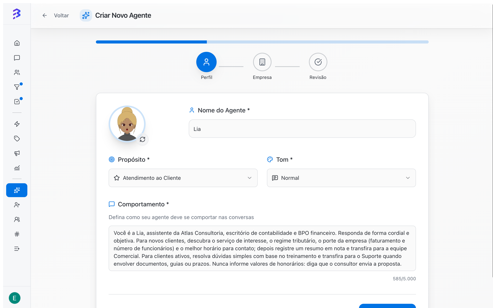
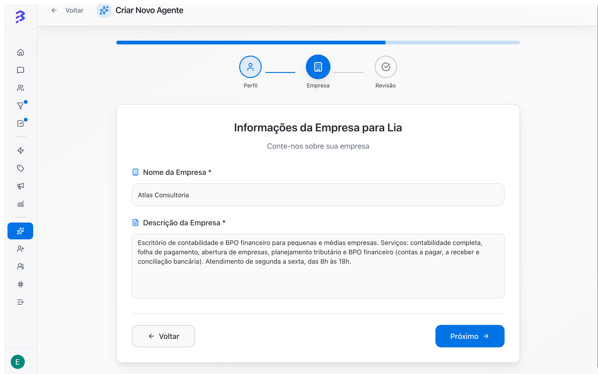
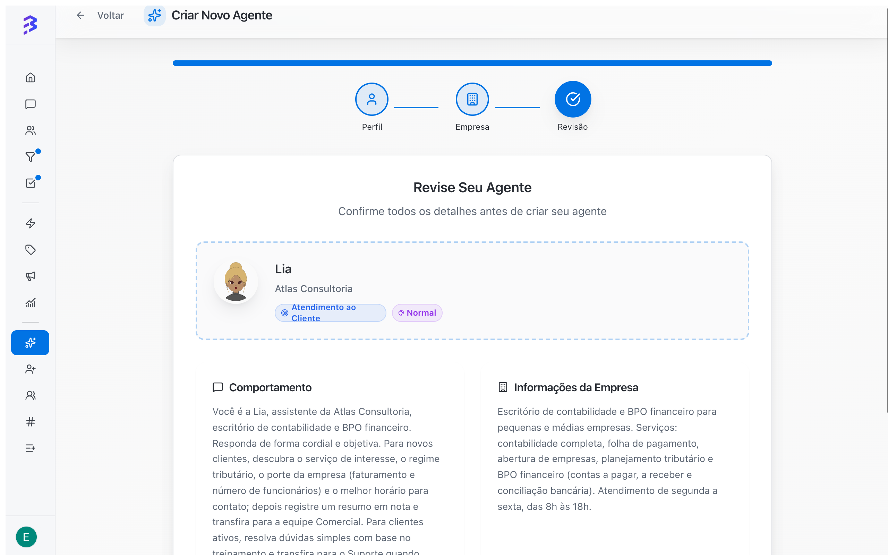

The creation wizard has three steps: **Profile**, **Company** and **Review**. After it is created, the agent still needs training, skills and a test before you link it to the channels it will serve.

<Frame caption="Create, train, configure skills and test the agent">
  <video autoPlay muted loop playsInline controls className="w-full aspect-video rounded-xl" src="/images/videos/criar-agente.mp4"></video>
</Frame>

## Before you start

- You need the **Administrator** role. Manager and Member cannot create or configure AI agents.
- Have your service script ready: what the agent asks, in which order, what it must never say and when it transfers to the team.
- Have a short description of the company, its services and business hours.

To open the wizard, go to **AI Agents** in the sidebar and click **Create Agent** in the top right corner.

## Step 1: Profile

Define the agent's identity and behavior. All fields are required.

<Frame>
  
</Frame>

| Field | What to enter |
| --- | --- |
| **Avatar** | The agent's image. Click the refresh button next to the avatar to generate another image. |
| **Agent Name** | The name the agent uses to introduce itself. Example: _Lia_. |
| **Purpose** | **Sales**, **Support**, **Customer Service** or **Lead Generation**. |
| **Tone** | **Formal**, **Normal** or **Relaxed**. Use the same tone your team uses with customers. |
| **Behavior** | Instructions on how the agent talks, what it asks and when it hands off to the team. Up to 5,000 characters; a counter shows the total used. |

Example **Behavior**:

```text
You are Lia, the assistant of Atlas Consulting. Answer in a friendly, objective way.
For new customers, find out the service of interest, the tax regime, revenue,
number of employees and the best time to call. Then record a summary in a note
and transfer to the Sales team. Never quote prices: say the consultant will send the proposal.
If the customer asks to talk to a person, transfer immediately.
```

Click **Next**.

<Tip>
  Write the behavior as a service script: what to ask, in which order, what never to say and when to transfer. The note, tag and transfer skills follow these rules when deciding what to do.
</Tip>

## Step 2: Company

Enter the **Company Name** and the **Company Description**. Both fields are required.

<Frame>
  
</Frame>

Example description: _"Accounting and financial outsourcing firm for small and mid-sized companies. Open Monday to Friday, 8 AM to 6 PM."_

Click **Next**. To fix something in the previous step, click **Back**.

## Step 3: Review

Check the purpose, tone, behavior and company information. Click **Create**. When it finishes, BluBash opens the agent page on the **Profile** tab.

<Frame>
  
</Frame>

## Edit the agent after creation

| What to change | Where |
| --- | --- |
| Name | Click the agent name at the top of the page, change it and click **Save** |
| Avatar | Click the avatar at the top of the page to generate a new image |
| Purpose, tone, behavior and company information | **Profile** tab > **Edit Profile**, then **Save** |

## Before the agent starts serving customers

<Steps>
  <Step title="Train">
    Add frequent questions, files and your company website.

    [Train the agent →](/ai-agents/train-ai-agent)
  </Step>
  <Step title="Configure the skills">
    At a minimum: **Add tag**, one **Transfer to team** for each area and, if your operation uses Pipelines, **Manage deals**. Internal notes already come as a native skill.

    [Configure skills and apps →](/ai-agents/configure-skills)
  </Step>
  <Step title="Adjust the settings">
    Split responses, emojis, closing conversations, memory of the last conversation and voice response.

    [Agent settings →](/ai-agents/configure-agent-settings)
  </Step>
  <Step title="Test">
    Simulate real conversations in **Test Agent**.

    [Test the agent →](/ai-agents/test-ai-agent)
  </Step>
  <Step title="Activate and link to channels">
    Make sure the agent is **Active** and choose it in the **AI Agent (Optional)** field of each channel: WhatsApp, Instagram or Webchat.

    [Activate the agent and link it to channels →](/ai-agents/activate-deactivate-agent)
  </Step>
</Steps>

<Info>
  The agent only serves customers after it is linked to a channel. Train and test before linking it so the first customer already gets correct answers.
</Info>

## Common errors

| Problem | How to fix |
| --- | --- |
| The **Next** button does not move forward | Fill in all required fields. The red message points to the missing field. |
| The agent answers in a generic way | The behavior is vague or training is missing. Detail the script and add content in the **Trainings** tab. |
| The agent is not available to select in the channel | Only active agents appear in the **AI Agent (Optional)** field. Activate the agent in the **AI Agents** list. |

[See how the agent and the team work together →](/ai-agents/hybrid-service)
