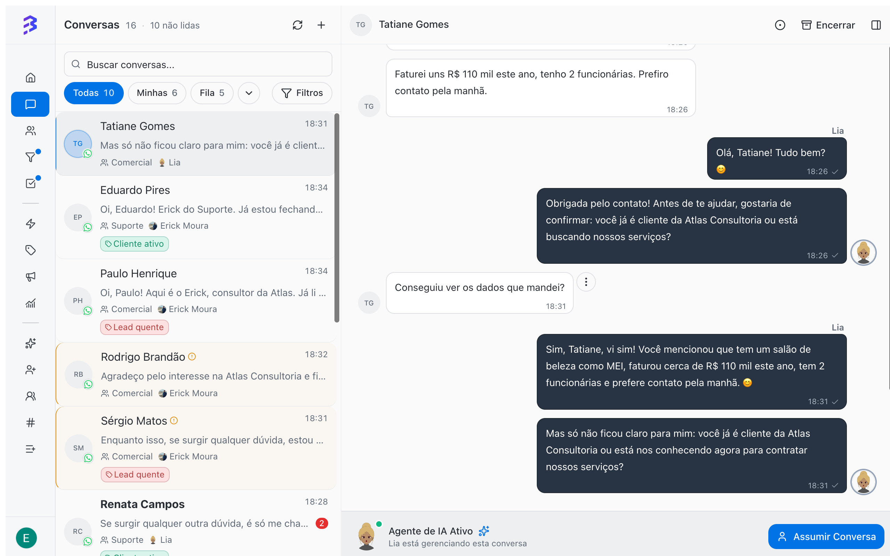

In hybrid service, the conversation goes back and forth between AI and the team. The agent transfers to the team when it needs a person. The team hands the conversation back to the agent when the human part is done and the rest is routine. This works for conversations on any channel: WhatsApp, Instagram and Webchat.

Any role that handles conversations (**Administrator**, **Manager** or **Member**) can hand a conversation off to AI and take over a conversation from AI.

## When to hand back to the AI agent

| Hand off to AI | Keep with the team |
| --- | --- |
| Collect documents and data after the negotiation | Negotiating prices and terms |
| Answer frequent questions that came up during the service | Unhappy customers or complaints |
| Schedule or confirm appointments | Complex cases that require analysis |
| Close the conversation with the final instructions | When the customer asks to talk to a person |

Example: the consultant closes the proposal and hands the conversation back to Lia, who asks for the articles of incorporation and the digital certificate and closes the conversation when everything arrives.

## Hand off a conversation to the AI agent

<Steps>
  <Step title="Open the conversation">
    In **Conversations**, open the conversation you want to pass to AI.
  </Step>
  <Step title="Click Handoff to AI">
    In the conversation header, click the sparkles icon (tooltip: **Transfer this conversation to an AI agent**). The button only appears when no AI agent is handling the conversation.
  </Step>
  <Step title="Choose the agent">
    In the **Handoff to AI** window, use **Search agents...** and click the agent that should take over. Only active agents appear. The selected agent shows **Will take over this conversation**.
  </Step>
  <Step title="Enter the reason (optional)">
    In the **Reason** field, record the context. Example: _"Proposal accepted; collect documents for registration"_.
  </Step>
  <Step title="Confirm">
    Click **Handoff to AI**. The agent takes over the conversation and the team's message field is locked.
  </Step>
</Steps>

<Note>
  The chosen agent does not need to be the one linked to the channel. For example, you can hand off a WhatsApp conversation to an agent specialized in billing.
</Note>

## What you see while AI is handling the conversation

<Frame>
  
</Frame>

- In place of the message field, the **AI Agent Active** notice appears with the text "_Agent name_ is managing this conversation" and the **Take Over** button.
- The transfer and handoff to AI buttons are hidden in the header.
- The agent's messages are identified in the conversation.
- The notes, tags and transfers the agent performs are recorded in the history.

## Take over the conversation from AI

<Steps>
  <Step title="Open the conversation">
    Go to the conversation AI is handling.
  </Step>
  <Step title="Click Take Over">
    The button is in the **AI Agent Active** notice, in place of the message field.
  </Step>
  <Step title="Enter the reason (optional)">
    In the **Reason** field, record why you are taking over.
  </Step>
  <Step title="Confirm">
    Click **Take Over**. AI stops replying and the message field is released to you.
  </Step>
</Steps>

<Warning>
  Take over the conversation before replying to the customer. While AI is handling it, you cannot send messages in the conversation.
</Warning>

## Best practices

- Use the **Reason** every time you hand off: it guides the agent and stays in the history for the team.
- Before handing back to AI, make sure the agent has the training and skills for what is left to do.
- For specific subjects, hand off to different agents, such as a triage agent and a billing agent.
- If the native **Close conversation** skill is on, the agent closes the conversation when the matter is resolved.
- Handing off does not close the conversation: it only changes who is handling it.

## Common problems

| Problem | Cause | Solution |
| --- | --- | --- |
| The window shows **No active AI agents available** | There are no active agents in the workspace | Ask an Administrator to activate an agent |
| The **Handoff to AI** button does not appear | The conversation is already with an AI agent | Use **Take Over** if you need to step in |
| After taking over an Instagram conversation, you cannot send | On Instagram, you can only reply within 7 days of the customer's last message | Wait for a new message from the customer to continue |

## Next steps

- [Hybrid service →](/ai-agents/hybrid-service)
- [Transfer conversations between teams and members →](/conversations/transfer-attendance)
- [Close a conversation →](/conversations/close-attendance)
