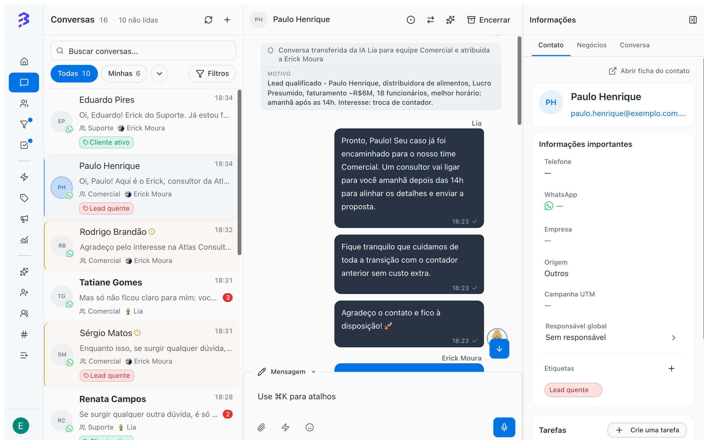
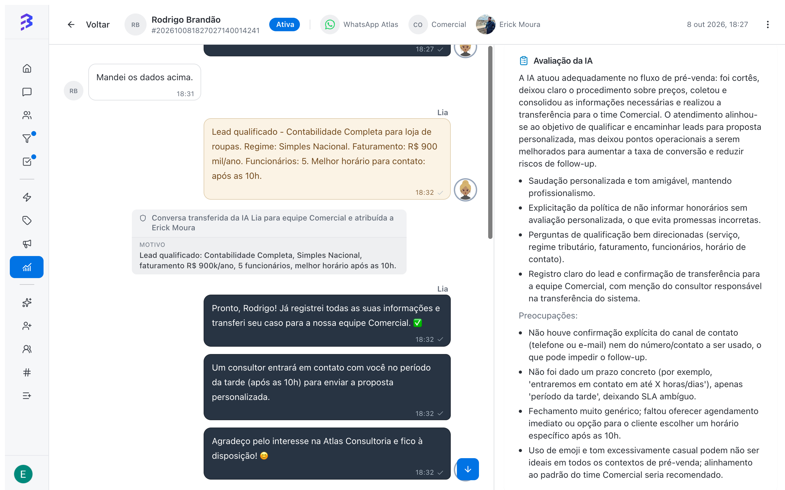

In BluBash, the AI agent and the team serve customers together. The agent answers right away, at any hour, resolves routine requests and organizes the conversation. The team takes over when the conversation requires negotiation, analysis or a decision, with the context already recorded.

Hybrid service works on every channel the agent is linked to: WhatsApp, Instagram and Webchat.

<Frame caption="The complete hybrid flow, from the first message to the Pipeline">
  <video autoPlay muted loop playsInline controls className="w-full aspect-video rounded-xl" src="/images/videos/atendimento-hibrido.mp4"></video>
</Frame>

## How it works, step by step

<Steps>
  <Step title="The customer sends a message">
    The message reaches a channel (a WhatsApp number, the Instagram Direct inbox or the website Webchat). The AI agent linked to that channel answers in seconds, using the content in **Trainings**.
  </Step>
  <Step title="The agent resolves or qualifies">
    Frequent questions (deadlines, documents, hours, procedures) are resolved by the agent itself. For a new customer, it asks the qualification questions defined in **Behavior**.
  </Step>
  <Step title="The agent records and organizes">
    With **Skills**, the agent adds a note summarizing what it gathered and applies tags such as **Hot lead** or **Active customer**. With the native **Update contact** skill on, it also updates the contact's name, email and fields. With **Manage deals**, it opens the deal in the pipeline and moves it through stages as qualification progresses.
  </Step>
  <Step title="The agent transfers to the right team">
    When the conversation needs a person, the agent runs the **Transfer to Team** skill configured for that situation (for example, **Sales** or **Support**). The transfer reason is recorded in the conversation.
  </Step>
  <Step title="The team takes over with the context ready">
    The conversation enters the team according to its distribution setting (Round Robin, Available or Queue). The team member reads the note, creates the deal in the Pipeline from the conversation itself and continues the negotiation.
  </Step>
  <Step title="The conversation can go back to AI">
    When the human part is done, the team member uses **Handoff to AI** to return the conversation to the agent, which collects documents, confirms details or closes the conversation.
  </Step>
</Steps>

## Real example: accounting firm

See how Lia, the AI agent of an accounting firm, serves a new customer on WhatsApp:

| Time | Who acts | What happens |
| --- | --- | --- |
| 2:02 PM | Customer | "I run a distribution company and want to switch accountants. Do you handle presumed profit taxation?" |
| 2:02 PM | AI agent | Confirms the service, explains the switch and asks for revenue, number of employees and best time to call |
| 2:04 PM | Customer | Reports R\$ 6 million a year, 18 employees, call tomorrow after 2 PM |
| 2:04 PM | AI agent | Records the summary in a note, applies the **Hot lead** tag and transfers to **Sales** |
| 2:05 PM | Team member | Reads the summary, creates the deal in the Sales Pipeline and schedules the call as a task |

<Frame>
  
</Frame>

The transfer note is recorded in the conversation, for example:

> Conversation transferred from AI Lia to the Sales team for the reason: Qualified lead. Food distributor, presumed profit taxation, approximate revenue of R\$ 6 million, 18 employees, best time tomorrow after 2 PM. Interest: switching accountants.

The same flow applies to a visitor who chats through the website Webchat or a follower who writes in the Instagram Direct inbox.

## What to leave to AI and what to leave to the team

| AI agent | Team |
| --- | --- |
| Answer frequent questions at any hour | Negotiate prices and terms |
| Collect qualification data | Analyze complex cases and exceptions |
| Record summaries and apply tags | Decide deadlines, discounts and priorities |
| Route to the right team | Build relationships with strategic customers |
| Collect documents after the negotiation | Create and track deals in Pipelines |
| Close resolved conversations | Handle complaints and unhappy customers |

## Set up hybrid service

<Steps>
  <Step title="Create and train the agent">
    Define purpose, tone and behavior, and train it with frequent questions, files and your company website.

    [Create an AI agent →](/ai-agents/create-ai-agent) · [Train the agent →](/ai-agents/train-ai-agent)
  </Step>
  <Step title="Prepare the teams">
    Each area that receives conversations from AI needs a team with members, a distribution rule and the channel in **Team Channels**.

    [Create and configure teams →](/account-settings/create-configure-teams)
  </Step>
  <Step title="Configure the skills">
    At a minimum: **Add Note** for the summary, **Add Tag** to classify and one **Transfer to Team** for each area.

    [Configure skills →](/ai-agents/configure-skills)
  </Step>
  <Step title="Test before going live">
    Use **Test Agent** to simulate real conversations and see which skills the agent runs.

    [Test the agent →](/ai-agents/test-ai-agent)
  </Step>
  <Step title="Link the agent to channels">
    In **Channels**, open each channel (WhatsApp, Instagram or Webchat) and choose the agent in **AI Agent (Optional)**. From then on, new conversations on that channel start with the agent.

    [Activate the agent and link it to channels →](/ai-agents/activate-deactivate-agent)
  </Step>
</Steps>

<Tip>
  Add the channel to **Team Channels** for every team that receives conversations from AI. In the **Transfer to AI Agent** skill with **Target Team (Optional)**, this access is required for the team change to happen.
</Tip>

## Track the results

In the **Conversations report**, the **Total conversations over time** chart splits conversations into **Unassigned**, **Human only**, **AI agents only** and **Hybrid (human + AI)**. Use it to track how much volume AI resolves on its own and how much goes through the team. The **Conversations by channel over time** chart shows how volume is split across WhatsApp, Instagram and Webchat.

In the **360° View**, the **AI Analysis** of each conversation evaluates the work of the agent and the team and provides coaching suggestions, including for the agent's training.

<Frame>
  
</Frame>

## Next steps

- [Hand off conversations to AI and take over from AI →](/ai-agents/handoff-to-ai)
- [Conversations report →](/reports/conversations-report)
- [360° View and AI analysis →](/reports/ai-audit)
