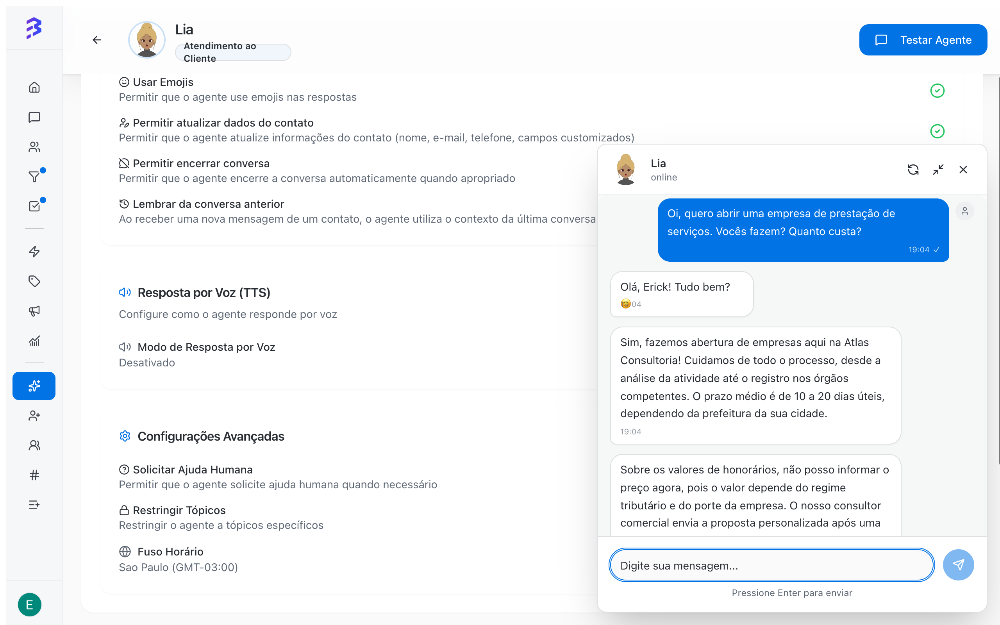

**Test Agent** opens a chat where you talk to the AI agent as if you were a customer. It uses the profile, trainings, skills, apps and settings saved at the time of the test. This lets you validate the agent before linking it to channels and after every adjustment you make later.

<Frame>
  
</Frame>

## When to test

- Before linking the agent to a channel for the first time (WhatsApp, Instagram or Webchat).
- After adding or editing trainings.
- After creating or changing skills and apps.
- After changing the **Behavior**, the tone or the settings.
- When the **AI Analysis** of a real conversation points out a wrong answer.

## Open the test chat

<Steps>
  <Step title="Open the agent">
    In the sidebar, click **AI Agents** and then the agent.
  </Step>
  <Step title="Click Test Agent">
    The button is in the top right corner of the agent page. The chat opens in a floating window in the bottom right corner of the screen.
  </Step>
  <Step title="Send the first message">
    Type in the **Type your message...** field and press **Enter**. The header shows **typing...** while the agent prepares the answer.
  </Step>
</Steps>

### Window controls

| Control | What it does |
| --- | --- |
| **New conversation** (refresh icon) | Discards the test history and starts a new conversation, like a customer arriving for the first time |
| Minimize and maximize | Shrinks the window without losing the conversation. You can browse the agent tabs and come back to the test. |
| Close | Closes the test window |

<Tip>
  Keep the window minimized while you adjust trainings or skills in another agent tab. After saving the adjustment, click **New conversation** and repeat the question.
</Tip>

## See the executed skills

When the agent runs a skill, the answer shows a **Skill Executed** card with:

- **Tool**: the skill or app tool used.
- **Parameters**: the data the agent sent, such as the tag applied, the target team, the deal created or moved in the pipeline, or the fields of an external API call.
- **Preview** badge: appears when the action was only simulated in the test.

The card appears only in the test chat. Customers never see these details.

If the agent is set to reply by voice, the answer arrives as audio and you can play it in the chat itself. The test input accepts text only.

## Recommended test script

### 1. Frequent questions

```text
What are your business hours?
Which documents do I need to register a company?
Do you work with companies under presumed profit taxation?
```

Expected: correct answers that match what is in **Trainings**.

### 2. Qualification and transfer

```text
I run a distribution company with 18 employees and want to switch accountants.
```

Expected: the agent asks the qualification questions from **Behavior**, records the note, applies the tag and runs **Transfer to Team** with the right team.

### 3. Request for a person

```text
I want to talk to a person.
```

Expected: the agent transfers without insisting.

### 4. Off-topic question

```text
Which team won yesterday's game?
```

Expected: the agent politely steers back to business topics, especially with **Restrict Topics** enabled.

### 5. Apps and HTTP requests

```text
Is there an open slot tomorrow at 3 PM?
Can you send me a copy of the invoice?
```

Expected: the **Skill Executed** card shows the app or request with the correct parameters.

### 6. Contact data update

```text
My email is john@company.com
```

Expected: with the native **Update contact** skill on, the agent records the email.

## What to evaluate in each answer

| Criterion | Question |
| --- | --- |
| **Accuracy** | Is the information correct and current? |
| **Relevance** | Does it answer what was asked? |
| **Tone** | Does it match the configured tone (Formal, Normal or Relaxed)? |
| **Length** | Is it right for chat messages? With **Split Responses** enabled, does it arrive in short parts? |
| **Action** | Did it run the right skill, at the right time, with the right parameters? |

## Fix what the test shows

| Problem in the test | Where to adjust |
| --- | --- |
| Wrong or missing information | **Trainings** tab: edit or add content |
| Skill not executed or executed at the wrong time | **Skills** tab: rewrite **When to Use** |
| Transfer to the wrong team | **Skills** tab: check the **Team** field |
| Inadequate tone or order of questions | **Profile** tab: adjust **Tone** and **Behavior** |
| Long answers, emojis or unwanted audio | **Settings** tab |
| App does not respond | **Apps** tab: click **Configure** and check authentication and permissions |

After each adjustment, click **New conversation** and repeat the same test.

## Final test on the channel

The test chat does not depend on a channel. After approving the agent there, run an end-to-end check on each linked channel:

| Channel | How to test |
| --- | --- |
| **WhatsApp** | Send a message from a phone that is not the connected number |
| **Instagram** | Send a Direct message to the connected account from another profile |
| **Webchat** | Open your website in a private window and start the chat |

Check in **Conversations** that the conversation was handled by the agent, that notes and tags were recorded and that the transfer reached the right team.

## Common errors

| Message or symptom | Likely cause |
| --- | --- |
| **Could not create conversation** | The test failed to start. Close the window and open it again. |
| **Error sending message** | Sending failed or the AI spending limit was reached. Read the message shown and try again. |
| The agent does not use a new training | The training is still **Processing**. Wait for the **Trained** status. |

## Next steps

- [Activate the agent and link it to channels →](/ai-agents/activate-deactivate-agent)
- [Configure skills and apps →](/ai-agents/configure-skills)
- [Train the agent →](/ai-agents/train-ai-agent)
