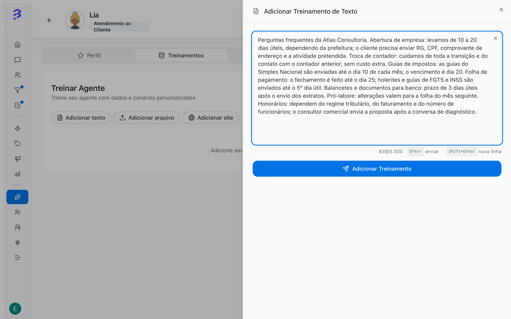

Training is the content the AI agent looks up to answer. Services, prices, deadlines, required documents, policies and frequent questions go here. The more specific and current the training, the more accurate the answers on every channel the agent serves: WhatsApp, Instagram and Webchat.

<Note>
  Training teaches **what** the agent knows. **How** it talks (tone, order of questions, when to transfer) belongs in the **Behavior** field of the **Profile** tab.
</Note>

## Open the trainings

<Steps>
  <Step title="Open the agent">
    In the sidebar, click **AI Agents** and then the agent.
  </Step>
  <Step title="Click the Trainings tab">
    The tab shows the list of all the agent's trainings and the **Add text**, **Add file** and **Add website** buttons.
  </Step>
</Steps>

## Training types

| Type | Button | Best for | Limits |
| --- | --- | --- | --- |
| **Text** | **Add text** | Frequent questions, short rules, hours, simple tables | 10 to 5,000 characters per training |
| **File** | **Add file** | Manuals, policies, catalogs, price lists, spreadsheets | PDF, DOC, DOCX, TXT, CSV, XLSX, MD, PNG, JPG, JPEG and WEBP; up to 50 MB per file |
| **Web** | **Add website** | Public website pages, help center, service pages | One URL per training; with subpages, up to 2 levels and 100 pages |

## Add a text training

<Frame>
  
</Frame>

<Steps>
  <Step title="Click Add text">
    The **Add Text Training** panel opens on the side.
  </Step>
  <Step title="Write the content">
    Fill in the **Content** field. The counter shows how many of the 5,000 characters you used.
  </Step>
  <Step title="Click Add Training">
    BluBash automatically generates a title from the content and starts processing.
  </Step>
</Steps>

Example of a good text training:

```text
Business hours: Monday to Friday, 8 AM to 6 PM. We are closed on Saturdays.
Company registration: average of 15 business days after all documents are sent.
Documents for registration: partners' ID and tax number, proof of address and property tax bill.
Switching accountants: there is no migration fee. The customer signs the contract and we handle the transition.
```

<Tip>
  Split content by subject: one training for hours and contacts, another for each service, another for policies. This makes reviews and updates easier.
</Tip>

## Add a file

<Steps>
  <Step title="Click Add file">
    The **Add File Training** panel opens on the side.
  </Step>
  <Step title="Select the file">
    Drag the file to the indicated area or click to select it. The upload starts as soon as you choose a valid file and shows the progress as a percentage.
  </Step>
  <Step title="Wait for processing">
    After the upload, BluBash extracts the file content. The training appears in the list with the **Processing** status until it finishes.
  </Step>
</Steps>

Accepted formats: PDF, DOC, DOCX, TXT, CSV, XLSX, MD, PNG, JPG, JPEG and WEBP. Files over 50 MB or in another format are rejected before upload, with the message **File is too large (max 50 MB)** or an unsupported format warning.

When you open a file training, you see **Original file name**, **File type**, **Extracted characters**, **Generated trainings** and **Processed at**. Use **Extracted characters** to confirm the content was read: a scanned PDF without text or an unreadable image yields little or no content.

## Add the website

<Steps>
  <Step title="Click Add website">
    The **Add Web Training** panel opens on the side.
  </Step>
  <Step title="Enter the website URL">
    Paste the address in **Website URL**. If you do not type `https://`, BluBash adds it automatically. A green border indicates a valid URL.
  </Step>
  <Step title="Decide on subpages">
    Turn on **Include Subpages** to also include up to 2 levels of related pages, with a maximum of 100 pages. Leave it off to train only the page you entered.
  </Step>
  <Step title="Click Add Website">
    The training enters the list as **Processing**. When it finishes, the details show **Indexed pages** and **Generated trainings**.
  </Step>
</Steps>

<Warning>
  Only public pages can be read. Pages that require login, restricted areas or content loaded only after a user action are not included. If the website is very large, processing may hit the time limit; the training details show **Time limit reached during processing** and how many pages were processed.
</Warning>

## Training status

| Status | What it means | What to do |
| --- | --- | --- |
| **Processing** | The content is being read and prepared | Wait. The status updates automatically in the list. |
| **Trained** | The content is available to the agent | Test the agent with questions about this content. |
| **Failed** | The content could not be processed | Open the training to see the error, fix the source (file, URL) and add it again. |

## Manage trainings

The list brings all types together. To find a training, use the **Search trainings...** box or the **Type** filter (Text, File, Web). Click a training to open its details.

| Action | Available for | How |
| --- | --- | --- |
| **Copy content** | Text | Hover over the item and click the copy icon |
| **Edit content** | Text | Click the pencil icon or **Edit** in the details; save to reprocess |
| **Download file** | File | Download icon on the item or in the details |
| **Open website** | Web | Opens the trained URL in another tab |
| **Delete** | All | Trash icon; confirm with **Delete** |

<Warning>
  Deleting a training is permanent. The agent stops using that content in its next answers.
</Warning>

## AI credits

Adding trainings consumes AI credits. If there are not enough credits, the tab shows the **Unable to start training** alert with the **Upgrade plan** button, which takes you to the billing page.

## Best practices

1. **Start with the essentials**: services, prices or price ranges you can share, deadlines, documents, hours and contacts.
2. **Be specific**: "15 business days" is better than "fast turnaround".
3. **Avoid contradictions**: if information changed, edit or delete the old training instead of adding another one with the new data.
4. **Use the right format**: text for rules and frequent questions, files for long material, website for content that is already published.
5. **Test after every change**: ask in **Test Agent** exactly what a customer would ask.
6. **Review with real data**: use the **AI Analysis** of conversations to find questions the agent could not answer and turn them into new trainings.

## Common errors

| Problem | Likely cause | Solution |
| --- | --- | --- |
| The agent makes things up or generalizes | Missing content on the subject | Add a specific text training |
| The agent uses an old price | An outdated training is still in the list | Edit or delete the old training |
| File with few extracted characters | Scanned PDF or low-quality image | Upload a version with selectable text or transcribe it into a text training |
| Website with **Failed** status | Private page, site offline or wrong URL | Check the URL in your browser and try again |

## Next steps

- [Configure skills and apps →](/ai-agents/configure-skills)
- [Test the agent →](/ai-agents/test-ai-agent)
- [360° View and AI analysis →](/reports/ai-audit)
