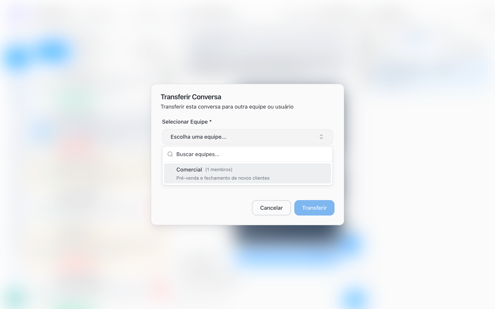
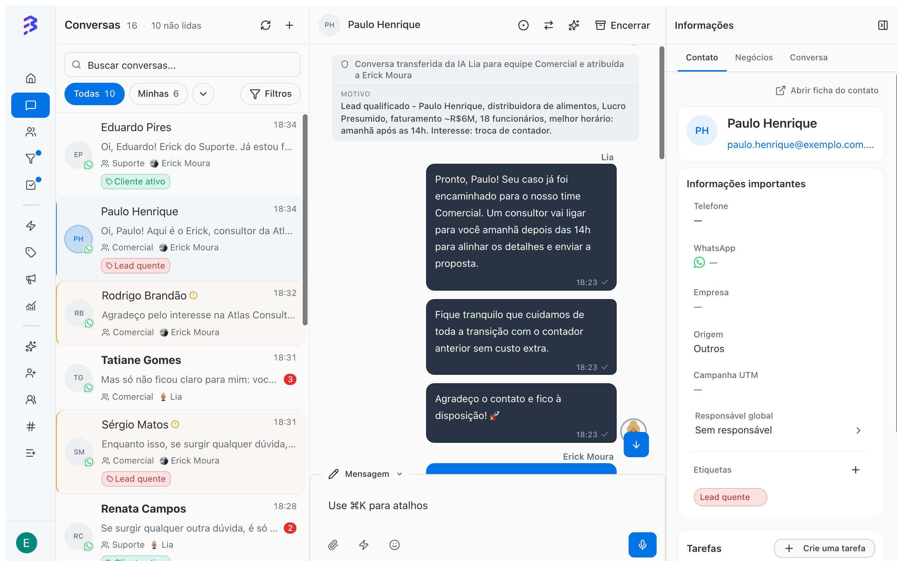

Transferring a conversation hands the service over to whoever can solve it. It is common when a customer starts with one area and needs another: someone talking to sales who needs technical support, or an invoice request that belongs to finance. BluBash has three kinds of transfer:

| Type | Who does it | When to use it |
| --- | --- | --- |
| **To another team or team member** | The team member, with the **Transfer** button | The subject belongs to another area or another person. |
| **To an AI agent** | The team member, with the **Handoff to AI** button | The human part is done and the AI can continue, for example to collect data or close. |
| **From the AI to the team** | The AI agent, through the **Transfer to Team** skill | The customer needs negotiation, a decision or human service. |

## Transfer to another team or team member

<Frame>
  
</Frame>

<Steps>
  <Step title="Open the conversation">
    In **Conversations**, open the conversation you want to transfer.
  </Step>
  <Step title="Click Transfer">
    The button with two arrows is at the top of the conversation. Hover over it to see **Transfer**. The **Transfer Conversation** window opens.
  </Step>
  <Step title="Choose the team">
    In **Select Team**, choose the destination team. The field is required and shows how many members each team has.
  </Step>
  <Step title="Choose the team member (optional)">
    In **Select User**, choose a person from the team. To leave the conversation with the team, with no specific person, choose **No specific user** (**Transfer to team only**).
  </Step>
  <Step title="Enter the reason (optional)">
    In **Reason**, answer **Why are you transferring this conversation?**. The reason is internal: the contact does not receive this text.
  </Step>
  <Step title="Click Transfer">
    The conversation leaves your hands and appears for whoever received it.
  </Step>
</Steps>

### What happens next

- The conversation status becomes **Transferred**.
- If you chose a person, they see the conversation highlighted with **Transferred to you - requires attention**. To reply, they click **Assign to me**.
- The full history, the internal notes and the contact's tags stay with the conversation.
- The contact does not receive an automatic notice about the transfer.

<Tip>
  Before transferring, leave an [internal note](/conversations/internal-notes) with a summary of the case and fill in the **Reason** field. Example: "Customer needs a copy of the September invoice. I already confirmed the company ID and email."
</Tip>

## Hand the conversation back to an AI agent

When the human part is done, you can pass the conversation to an AI agent to continue.

<Steps>
  <Step title="Click Handoff to AI">
    The button with a sparkle icon is at the top of the conversation, next to **Transfer**.
  </Step>
  <Step title="Choose the agent">
    The window lists the active AI agents. Use **Search agents...** if there are many. The selected agent shows **Will take over this conversation**.
  </Step>
  <Step title="Enter the reason (optional)">
    Describe what the AI should continue, for example "collect the documents for the proposal".
  </Step>
  <Step title="Confirm">
    Click **Handoff to AI**. The agent takes over the conversation, and the message box shows **AI Agent Active**.
  </Step>
</Steps>

<Note>
  While an AI agent is handling the conversation, the **Transfer** and **Handoff to AI** buttons are hidden. To transfer to another team, first click **Take Over**.
</Note>

[Hand off to the AI →](/ai-agents/handoff-to-ai)

## How the AI agent transfers to the team

With the **Transfer to Team** skill configured, the agent transfers the conversation when it identifies the situation you described, for example "customer asked for a quote" or "customer wants to talk to a person". The conversation reaches the team like any other transfer, and the **Add Note** skill lets the agent leave a summary first.

<Frame>
  
</Frame>

[Configure skills →](/ai-agents/configure-skills) · [Hybrid service →](/ai-agents/hybrid-service)

## Best practices

- Transfer to a person when you know who will solve it. Transfer only to the team when anyone in that area can help.
- Write the reason as if the recipient knew nothing about the case.
- Do not transfer just to pass on a difficult customer. Record the situation in a note and involve your manager.
- Let the customer know when it makes sense, for example: "I'm passing your request to our finance team, who will continue with you shortly."

## Common issues

<AccordionGroup>
  <Accordion title="The Transfer button does not appear">
    The conversation is with an AI agent. Click **Take Over** and then **Transfer**.
  </Accordion>

  <Accordion title="No teams available for transfer appears">
    There is no other team available to receive the conversation. Ask an Administrator to review the teams and their channels.
  </Accordion>

  <Accordion title="No active AI agents available appears">
    No AI agent is active. An Administrator needs to activate an agent.

    [Activate or deactivate an agent →](/ai-agents/activate-deactivate-agent)
  </Accordion>
</AccordionGroup>

## Next steps

<CardGroup cols={2}>
  <Card title="Internal notes" icon="sticky-note" href="/conversations/internal-notes">
    Share context with the team without the customer seeing it.
  </Card>

  <Card title="Close a conversation" icon="circle-check" href="/conversations/close-attendance">
    Wrap up the service when the subject is resolved.
  </Card>
</CardGroup>
