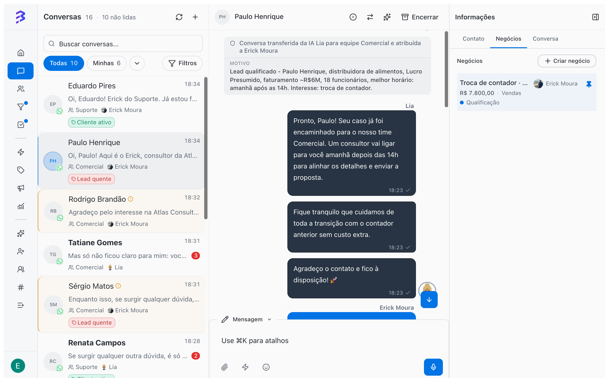

BluBash is a conversational platform with a built-in CRM and AI agents. The conversation is the starting point: it arrives through WhatsApp, Instagram or Webchat, the AI agent answers, the team takes over when needed, and the conversation gives rise to the deals you track in Pipelines. Understanding the difference between these objects prevents the most common mistakes made by people coming from other CRMs.

<Frame>
  
</Frame>

## The platform objects

<CardGroup cols={2}>
  <Card title="Contact" icon="user">
    The person or company you talk to. Stores phone, WhatsApp, email, Instagram username, tags, additional fields, owners and the full history.
  </Card>

  <Card title="Conversation" icon="message-circle">
    One service interaction about one subject, on one channel. It has a team, an assignee, a status and a protocol, and it is closed when the subject is resolved.
  </Card>

  <Card title="Deal" icon="briefcase">
    An opportunity or an ongoing process with that contact. It has a value, an owner, a stage, tasks and a history of moves.
  </Card>

  <Card title="Pipeline" icon="kanban">
    The sequence of stages a deal goes through. It fits any process: sales, support, onboarding, collections, legal cases.
  </Card>

  <Card title="Team" icon="users">
    Groups members, channels and Pipelines. Defines conversation distribution, SLA, calendar, closure rules and the satisfaction survey.
  </Card>

  <Card title="Channel" icon="radio-tower">
    The entry point for conversations: a WhatsApp number, an Instagram account or a Webchat widget. Each channel has a default team and, if you want, an AI agent.
  </Card>
</CardGroup>

The same contact can have many conversations over time, on different channels, and several open deals at once, each in its own Pipeline.

## Conversations and deals measure different things

BluBash uses two yardsticks. Mixing them up is the main cause of confusing reports.

|  | Conversation | Deal |
| --- | --- | --- |
| Answers the question | Is the customer being served well? | Where is this customer in the process? |
| Where you track it | **Conversations** and **Reports & Insights** | **Pipelines** |
| Metrics | Volume, resolution time, SLA, satisfaction, quality | Stage, value, time in stage, won or lost |
| When it ends | When the subject is resolved and you close it | When it is marked as won or lost |

<Tip>
  To find out who is waiting for a reply, use the **Conversations** inbox. To find out which processes are stuck, use the **Pipeline** filters.
</Tip>

## The conversation lifecycle

| Status | What it means |
| --- | --- |
| **Pending** | The conversation arrived and no team member has taken it yet. |
| **Active** | A team member or the AI agent is handling the conversation. |
| **Transferred** | The conversation was transferred to another team or team member and is waiting for someone to take it. |
| **Awaiting Survey** | The conversation was closed and the team's satisfaction survey was sent to the contact. |
| **Closed** | The subject was resolved. To talk to the contact again, a new conversation is created. |

## Hybrid service: AI and team in the same conversation

Each conversation can have an AI agent, a team member or both. In the conversation list, a sparkle icon next to the name indicates **Hybrid conversation (user + AI)**. While the AI agent is handling the conversation, the message box shows **AI Agent Active** and the **Take Over** button. When the team member is done, they can use **Handoff to AI** to hand the conversation back.

[Hybrid service →](/ai-agents/hybrid-service)

## Three rules that prevent rework

<AccordionGroup>
  <Accordion title="Derive the deal instead of moving it to another Pipeline">
    When a process ends in one area and starts in another (for example, the sale closes and the project begins), mark the deal as **won** and let derivation create a new deal in the next area's Pipeline. The first area's result stays on record and the history remains available. Dragging the deal to another Pipeline removes that result from the reports.

    [Set up derivation between Pipelines →](/pipelines/derive-deals)
  </Accordion>

  <Accordion title="Lost with a reason, never a discard stage">
    "Unqualified lead" or "Not interested" are not stages. Mark the deal as **lost** and choose the reason. That way you know how many deals are lost for each reason.

    [Won, lost and reasons →](/pipelines/won-lost-reasons)
  </Accordion>

  <Accordion title="One conversation is one subject">
    Did you solve what the customer needed? Close the conversation. If they come back with another subject, a new conversation starts. This shows how many times each customer reached out and why, and keeps resolution time and SLA accurate.

    [When and how to close a conversation →](/conversations/close-attendance)
  </Accordion>
</AccordionGroup>

## AI from day one, with growing autonomy

The AI agent can serve customers from day one. What changes over time is how much it does on its own.

<Steps>
  <Step title="Start: AI that answers and routes">
    The agent answers frequent questions, collects basic data, adds a summary note and transfers to the team. The team creates deals from the conversation.
  </Step>
  <Step title="Stable operation: AI that resolves">
    With training refined from real conversations, the agent starts closing routine conversations on its own with the native **Close conversation** skill, and the team keeps what requires a decision.
  </Step>
  <Step title="Mature operation: integrated AI">
    With **HTTP Request** and **Apps**, the agent queries and updates external systems during the conversation, and derivation between Pipelines moves the customer from one area to the next automatically.
  </Step>
</Steps>

<Info>
  Track progress in the **Conversations** report: the **Total conversations over time** chart separates **Unassigned**, **Human only**, **AI agents only** and **Hybrid (human + AI)**. The **AI Analysis** in the 360° View shows the quality of each conversation.
</Info>

## Next steps

<CardGroup cols={2}>
  <Card title="Implementation guide" icon="rocket" href="/implementation-guide">
    Set up your account in the right order.
  </Card>

  <Card title="FAQ" icon="circle-help" href="/faq">
    Common questions about AI, service, Pipelines and reports.
  </Card>
</CardGroup>
