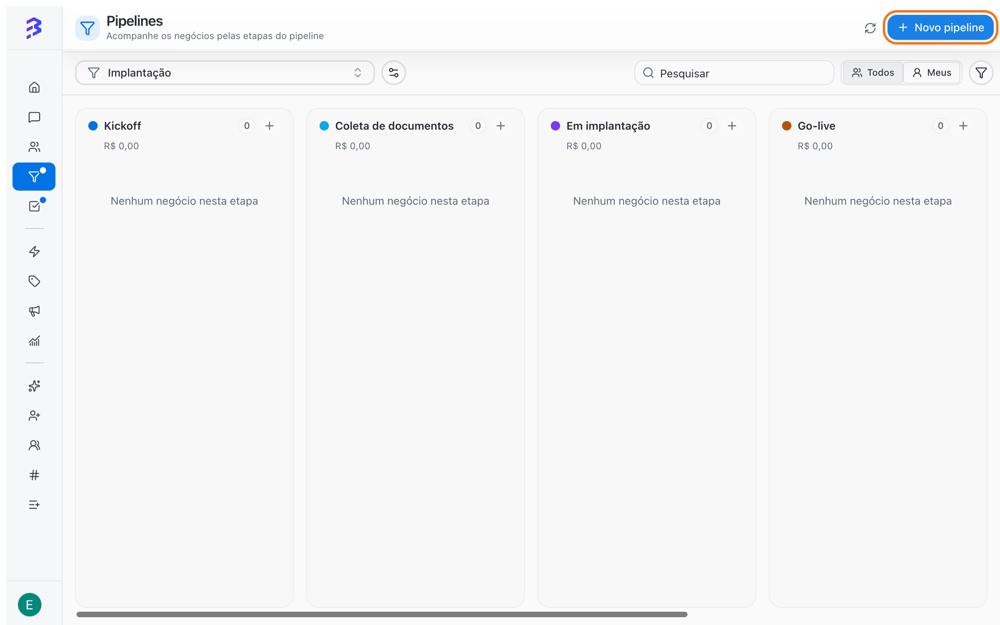
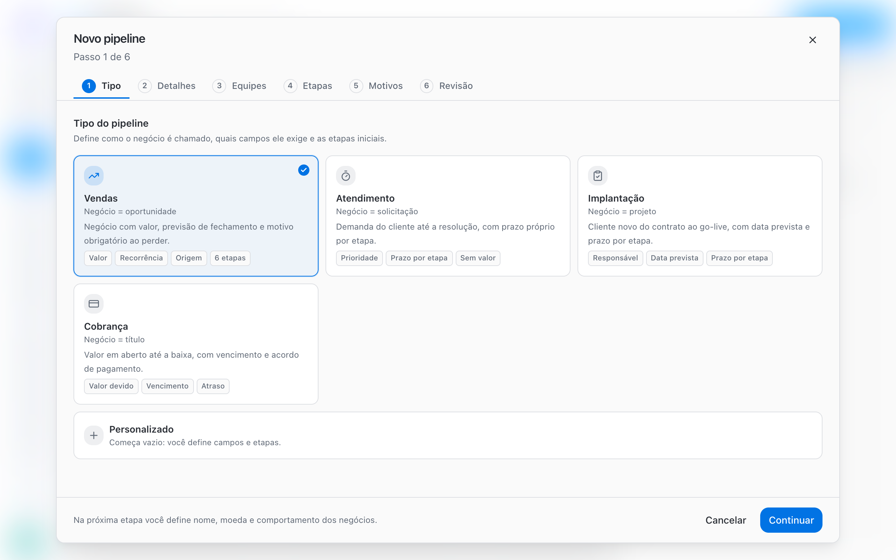
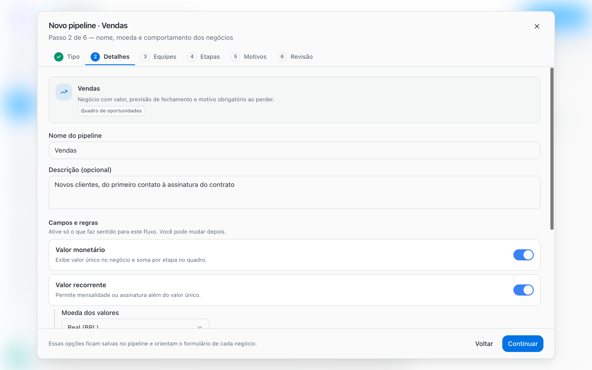
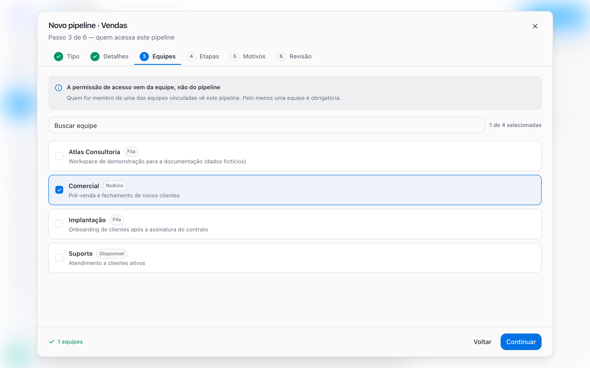
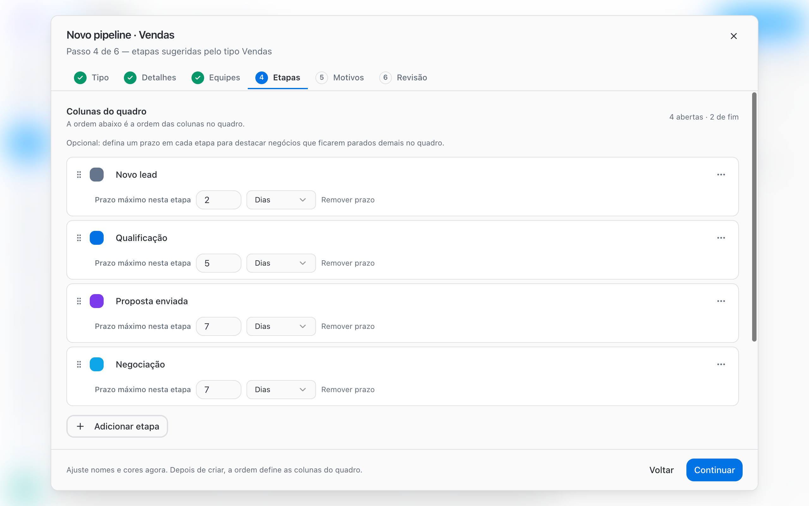
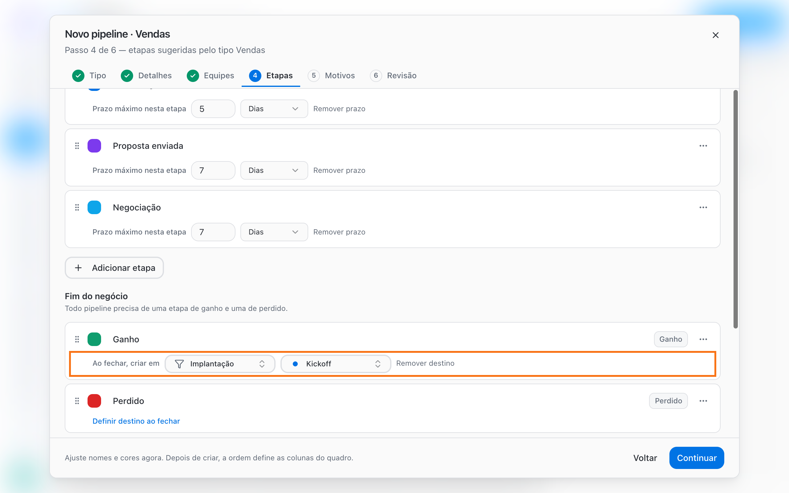
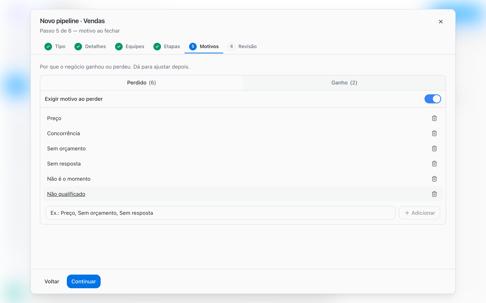
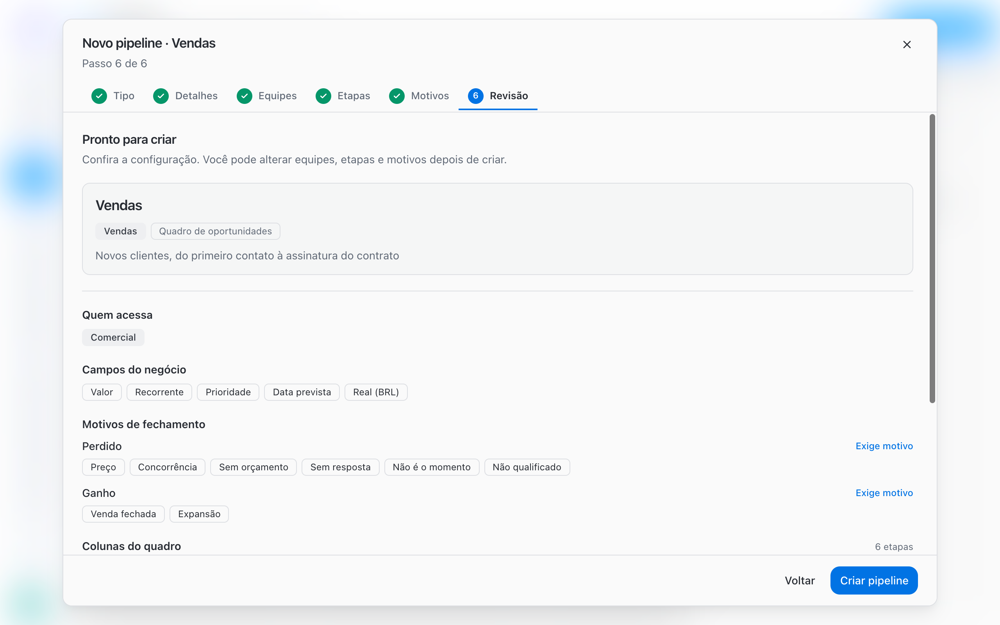

The **New pipeline** wizard has six steps: **Type**, **Details**, **Teams**, **Stages**, **Reasons** and **Review**. You can change every choice later, so you do not need to get everything right the first time.

<Note>
  Creating and editing Pipelines requires the **Admin** or **Manager** role. Members use their teams' Pipelines but do not see the **New pipeline** button.
</Note>

## Before you start

- Create the teams that will use the Pipeline. Pipeline access comes from the team. [Create and configure teams →](/account-settings/create-configure-teams)
- List the real stages of your process and the criterion for a deal to enter each one.
- Define won and lost reasons using the names your team already uses.

## Step by step

Go to **Pipelines** in the sidebar and click **New pipeline**.

<Frame>
  
</Frame>

<Steps>
  <Step title="Type: choose a template">
    Under **Pipeline type**, choose **Sales**, **Support**, **Onboarding**, **Collections** or **Custom**. The template sets the starting stages, fields and reasons. You adjust everything in the next steps.

    | Template | A deal represents | Starting point |
    | --- | --- | --- |
    | **Sales** | Opportunity | Value, recurrence and a required reason when lost |
    | **Support** | Request | Priority and stage deadlines, no value |
    | **Onboarding** | Project | Due date and stage deadlines |
    | **Collections** | Invoice | Amount due and due date |
    | **Custom** | Whatever you define | Starts empty: you set the fields and stages |

    <Frame>
      
    </Frame>
  </Step>
  <Step title="Details: name, description and deal fields">
    Enter the **Pipeline name** (required) and, if you want, a **Description (optional)** that explains what the Pipeline is for and who uses it.

    Under **Fields and rules**, enable only what fits the process:

    | Option | What it does |
    | --- | --- |
    | **Monetary value** | Shows a single value on the deal and sums values per stage on the board |
    | **Recurring value** | Lets you record a subscription or monthly amount in addition to the one-time value |
    | **Value currency** | Appears when a value field is on: Real (BRL), US Dollar (USD) or Euro (EUR) |
    | **Priority** | Shows Low, Medium, High or Urgent on each deal |
    | **Due date** | Shows the expected completion or due date on the deal |
    | **Deal additional fields** | Chooses which workspace deal fields appear on this Pipeline's deals. Empty means none |

    If there are no deal fields yet, use **Manage deal fields** to create them.

    <Frame>
      
    </Frame>
  </Step>
  <Step title="Teams: define who has access">
    Select the teams that will use the Pipeline. Access comes from the team, not the Pipeline: members of a linked team can see the Pipeline and its deals. At least one team is required to continue.

    <Frame>
      
    </Frame>
  </Step>
  <Step title="Stages: columns, deadlines and close destination">
    Under **Board columns**, adjust stage names, colors and order. The order of the list is the column order on the board. Drag to reorder and use **Add stage** to add new columns.

    On each open stage, click **Set a deadline on this stage** to enter a **Maximum time in this stage**, in **Days** or **Hours**. When a deal stays longer than that, its card is highlighted on the board.

    <Frame>
      
    </Frame>

    Under **Deal end** you find the **Won** and **Lost** stages. Every Pipeline needs at least one open stage, one Won stage and one Lost stage. To change a stage's nature, use **Stage type** in the stage menu.

    Click **Set a close destination on this stage** on an end stage so that, when a deal closes there, BluBash automatically creates a deal in another Pipeline.

    <Frame>
      
    </Frame>

    [Learn more about deal derivation →](/pipelines/derive-deals)
  </Step>
  <Step title="Reasons: why the deal was won or lost">
    Add **Won** and **Lost** reasons using names your team already uses every day. Turn on **Require reason on win** and **Require reason on loss** so nobody closes a deal without recording why. To require a reason, the list must have at least one reason.

    <Frame>
      
    </Frame>

    <Tip>
      Add **Not qualified** as a lost reason. This way you do not need a discard stage, and you can measure how many leads were not a fit.
    </Tip>
  </Step>
  <Step title="Review: check and create">
    Under **Ready to create**, check **Who can access**, **Board columns**, **Deal fields** and **Close reasons**. Click **Create pipeline**. The setup applies to the board right away.

    <Frame>
      
    </Frame>
  </Step>
</Steps>

## Edit a Pipeline after creating it

On the board, click **Pipeline options**, next to the Pipeline selector:

| Option | What it does |
| --- | --- |
| **Edit pipeline** | Opens the settings with the **General**, **Teams**, **Stages**, **Reasons** and **Delete** tabs |
| **Manage stages** | Opens the stages tab directly, to rename, reorder and set deadlines and destinations |
| **Reorder pipelines** | Sets the order of Pipelines in the selector |
| **Delete pipeline** | Removes the Pipeline from the workspace |

Save with **Save changes** or, on the stages tab, with **Save stages**.

## Limitations and cautions

- **Deleting a stage with deals**: BluBash asks for an open destination stage and moves the deals before deleting (**Move and delete**). Won or Lost stages cannot receive those deals.
- **Deleting a Pipeline**: only allowed when there are no open deals. You confirm by typing the Pipeline name, and the action cannot be undone.
- **Unlinking teams**: if you are not on a linked team, only an Admin can unlink it.
- **No team, no board**: a Pipeline only appears to members of at least one linked team.

## Best practices

- Start from a template and remove what you do not use, instead of building everything from scratch.
- Set deadlines only on stages where delays are a real problem, such as **Proposal sent**.
- Review the stages after two or three weeks of use, based on where deals get stuck.

## Next steps

<CardGroup cols={2}>
  <Card title="Work with deals" icon="briefcase" href="/pipelines/deals">
    How to create, move and track deals on the board and in the conversation.
  </Card>

  <Card title="Won, Lost and reasons" icon="flag" href="/pipelines/won-lost-reasons">
    How to set up and use close reasons.
  </Card>
</CardGroup>
