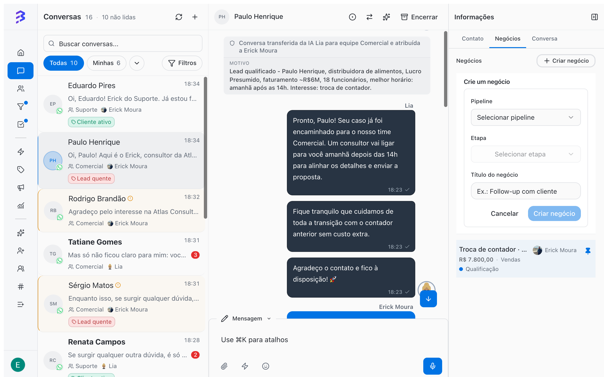
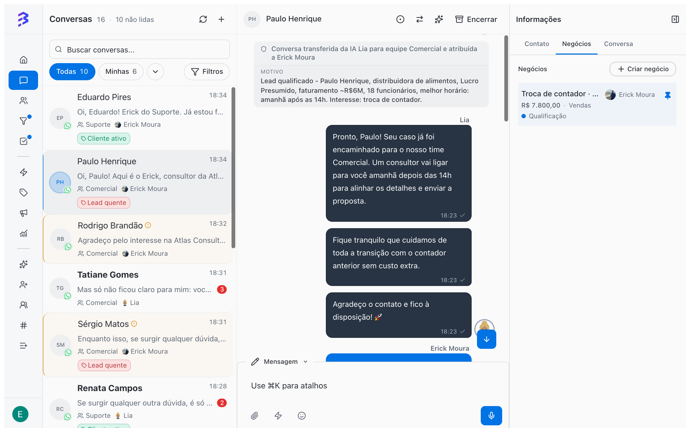
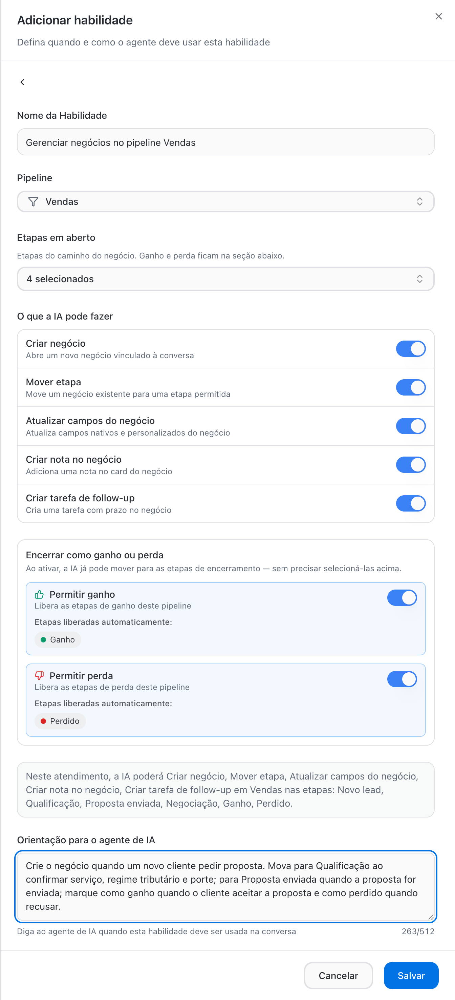
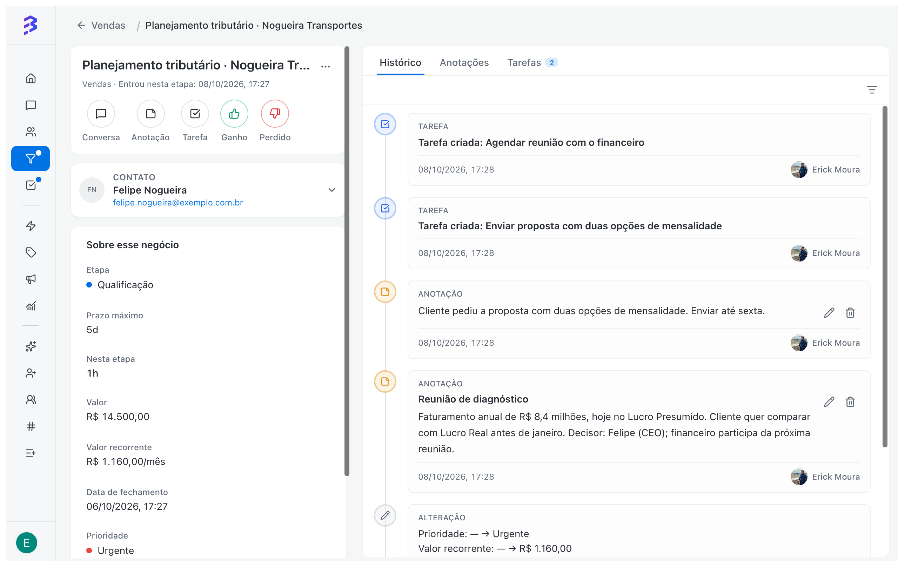

A deal represents an opportunity or an ongoing process with a contact: a sale, an onboarding project, a request, an invoice. It sits in a Pipeline stage and holds amount, owner, priority, dates, notes, tasks and the full history of changes.

## Create a deal

<Tabs>
  <Tab title="From the conversation (recommended)">
    While serving the customer, open the **Information** panel on the right side of the conversation and go to the **Deals** tab.

    1. Click **Create deal**.
    2. In **Select pipeline**, choose the Pipeline. In **Select stage**, choose the stage the customer is in.
    3. Enter the **Deal title** and click **Create deal**.

    The deal is linked to the conversation and you keep serving the customer without switching screens.

    <Frame>
      
    </Frame>
  </Tab>
  <Tab title="From the board">
    In the Pipeline, click **\+** at the top of the stage column or **Deal** at the bottom of the column.

    1. In **Search contact…**, type at least 3 letters of the name or 4 digits of the phone number and select the contact.
    2. Enter the **Deal title**.
    3. Click **Create deal**.

    If you create the deal directly in a **Won** or **Lost** column, BluBash asks for the close reason, as with any close.
  </Tab>
</Tabs>

<Frame>
  
</Frame>

### By the AI agent

With the **Manage deals** skill, the AI agent creates the deal on its own during the conversation, moves it through stages as qualification progresses, updates fields, records notes, creates follow-up tasks and can mark it as won or lost. You define which Pipeline it works in, which stages it can use and what it can do.

<Frame>
  
</Frame>

Every move made by the AI is recorded in the deal's **History**, like any other. [Set up the Manage deals skill →](/ai-agents/configure-skills#manage-deals-in-pipelines)

<Tip>
  Start with the AI creating the deal and moving it only through the early stages. Leave won and lost to the team until you trust the agent's decisions.
</Tip>

## Move deals through stages

- **On the board**: press and hold the card and drag it to the next column. A single click opens the deal.
- **On the deal record**: change the **Stage** field under **About this deal**.

Each stage change is recorded in **History** with date and author, for example "Deal moved from Qualification to Proposal sent".

To close the deal, move it to a **Won** or **Lost** stage. [See how reasons work →](/pipelines/won-lost-reasons)

## The card on the board

Each card shows the deal title, the contact, the contact's tags and, depending on the fields enabled in the Pipeline, amount, priority and due date.

| Indicator | Meaning |
| --- | --- |
| **Today**, **in 3d**, **2d overdue** | Status of the due or close date |
| **time 6d / 5d** | Time in the stage compared with the maximum time. The card is highlighted when it exceeds the limit |
| Total at the top of the column | Sum of the deal values in the stage, when **Monetary value** is on |

Columns with many deals show **Showing X of Y** and load the rest as you scroll.

## The deal record

Click a card to open the record. Use **Open deal record** to see it full screen and **Back to board** to return.

<Frame>
  
</Frame>

| Area | What you find |
| --- | --- |
| **About this deal** | Pipeline, Stage, Amount, Recurring value and Billing period, Owner, Close date, Priority and Status. Empty fields are collapsed under **Show N empty fields** |
| Quick actions | **Chat**, **Note**, **Task**, the close actions and **Contact** |
| **Stage deadline** | The stage's **Maximum time**, time **In this stage** and when the deal **Entered this stage** |
| **Deal duration** | Time from creation to close |
| **History** | Stage moves, field changes, notes and tasks, filtered by **All**, **Notes**, **Changes** or **Tasks** |
| **Notes** | Internal team records about the deal |
| **Tasks** | Next steps with due dates, linked to the deal |
| **More options** | **Move deal** to another Pipeline and **Delete deal** |

### Quick actions

| Action | What it does |
| --- | --- |
| **Chat** | Opens the conversation with the contact |
| **Note** | Creates a note on the deal |
| **Task** | Creates a task linked to the deal |
| Close actions | Move the deal to an end stage. The button shows the stage name, such as **Won** or **Lost** in the Sales template. If the Pipeline has more than one Won or Lost stage, the button becomes **Win** or **Lose** and opens the list of stages |
| **Contact** | Opens the contact record |

### Notes

Use **Note** to record what was agreed in meetings, objections and next steps. Enter a **Title (optional)** and the text and click **Create note**. Notes are not sent to the customer, stay in the deal history and are visible to everyone with access to the Pipeline. You can edit or delete a note later.

### Tasks

Use **Task** to schedule the next step: send the proposal, call to confirm, request a document. The task is linked to the deal and also appears in **Tasks** in the sidebar. Use **Complete task** when you finish and **Reopen task** if you need to go back.

[Manage tasks →](/tasks/overview)

## Filter the board

| Filter | Use |
| --- | --- |
| **All** / **Mine** | **Mine** shows only the deals you own |
| **Owner** | Deals owned by a specific person (available in the **All** view) |
| **Tags** | Deals of contacts with the selected tags, including tags applied by the AI agent |
| **Priority** | Low, Medium, High or Urgent |
| **Due date** | **Any due date**, **Overdue**, **This week** or **No date** |
| **Value** | **Min** and **Max** range, applied to the one-time or recurring value |
| **Recurring period** | Monthly, Quarterly, Semiannual or Annual, for recurring values |
| **Search** | Searches deals in the current Pipeline. Type at least 3 letters or 4 digits |

Use **Clear filters** to go back to the full view.

## Stalled deals

When a stage has a **Maximum time**, the card shows how long the deal has been there compared with the limit and is highlighted when it goes over. Combine this with the **Due date → Overdue** filter to review every day what needs action.

## Move to another Pipeline

In **More options → Move deal**, choose the **Destination pipeline** and the **Destination stage**. Use it to fix a deal created in the wrong Pipeline. To hand the customer to the next area, prefer [derivation →](/pipelines/derive-deals)

## Delete a deal

In **More options → Delete deal**, confirm the deletion. The action is permanent: the deal data, notes, linked tasks and history are no longer available. To end a deal that did not move forward, prefer **Lost** with a reason.

## Several deals for the same contact

A contact can have several open deals at once, in different Pipelines, each with its own stage, amount and owner. In the conversation, the **Deals** tab of the **Information** panel lists the contact's deals you have access to. The **Deals** tab on the contact record shows the same.

## Best practices

- Assign an owner to every deal. Deals without an owner do not appear in anyone's **Mine** view.
- Add a note after every important interaction outside the conversation, such as meetings and calls.
- End every update with a task: every open deal should have a next step with a due date.

## Next steps

<CardGroup cols={2}>
  <Card title="Won, Lost and reasons" icon="flag" href="/pipelines/won-lost-reasons">
    Close deals with the reason recorded.
  </Card>

  <Card title="Tasks" icon="list-checks" href="/tasks/overview">
    Organize your team's next steps.
  </Card>
</CardGroup>
