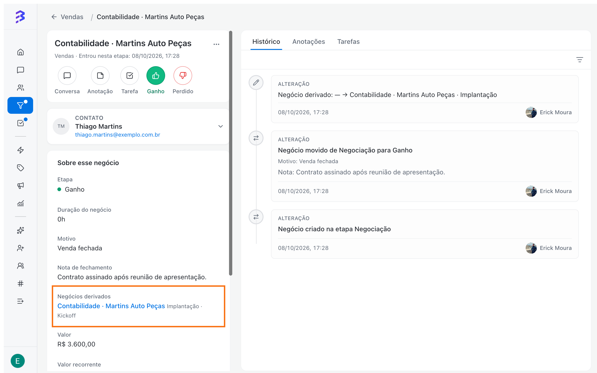
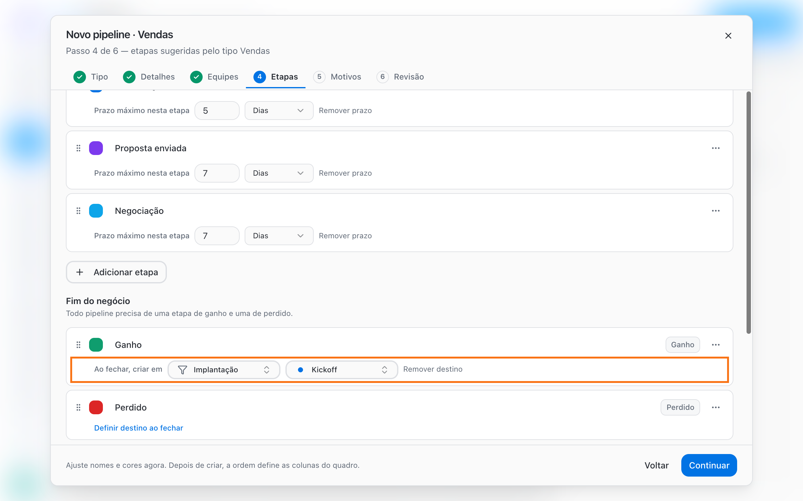

Derivation automatically creates a new deal in another Pipeline when a deal is closed. The original deal stays recorded as **Won** (or **Lost**) in the source Pipeline, and the new deal is created in the next area's Pipeline, with the same contact and linked to the source.

It is the recommended way to hand a customer from one area to another: Sales to Onboarding, Sales to Legal, Onboarding to Support.

<Frame>
  
</Frame>

## When to use it

| Situation | Suggested setup |
| --- | --- |
| A won sale needs to be onboarded | **Won** in Sales creates a deal in Onboarding, Kickoff stage |
| A completed onboarding moves to ongoing support | **Done** in Onboarding creates a deal in Support |
| A lost customer should be worked on later | **Lost** in Sales creates a deal in a win-back Pipeline |

## Why derive instead of move

You can also move a deal to another Pipeline in **More options → Move deal**, but the two paths have different effects:

|  | Derive on close | Move to another Pipeline |
| --- | --- | --- |
| Source Pipeline | The deal stays as **Won** or **Lost**, with a reason | The deal leaves the Pipeline |
| Source area's result | Remains recorded | No longer appears in the source |
| Link between deals | **Derived from** and **Derived deals** | A single deal that changes place |
| Team effort | Automatic on close | Manual, deal by deal |

<Tip>
  Use **Move deal** only to fix a deal created in the wrong Pipeline. To move the customer to the next step of the journey, use derivation.
</Tip>

## Set the close destination

<Note>
  Configuring stages requires the **Admin** or **Manager** role. The destination Pipeline must already exist.
</Note>

<Steps>
  <Step title="Open the source Pipeline's stages">
    In **Pipelines**, select the Pipeline (for example, Sales), open **Pipeline options** and choose **Manage stages**. If you are creating the Pipeline, use the wizard's **Stages** step.
  </Step>
  <Step title="Set the destination on the end stage">
    Under **Deal end**, on the **Won** stage, click **Set a close destination on this stage**. Under **On close, create in**, choose the **Target pipeline** and the **Target stage**. The Pipeline itself is not offered as a destination.

    <Frame>
      
    </Frame>
  </Step>
  <Step title="Save">
    Click **Save stages** (or continue the wizard to **Create pipeline**). From then on, every deal that reaches that stage creates the derived deal.
  </Step>
</Steps>

To turn derivation off, open the stage and click **Remove destination**.

<Info>
  **Lost** stages also accept a destination. Open stages do not have this option.
</Info>

## What happens when a deal is closed

1. The team member moves the deal to the end stage (by dragging the card or using the quick action on the deal record) and picks the reason, if the Pipeline requires one.
2. BluBash creates the new deal in the destination Pipeline and stage, with the same contact.
3. The **Deal created in [Pipeline]** notice appears, with an **Undo** option. Undoing removes the derived deal and the original stays closed.
4. The original deal record shows **Derived deals**. The new deal record shows **Derived from**, with a link to the source.

From then on, the team with access to the destination Pipeline finds the deal in the configured stage and continues the work.

<Warning>
  If the destination team does not have access to the source Pipeline, the new deal record only shows **Derived from another pipeline**, without opening the original deal or its notes. Record the important context before closing and, after the derivation, add a note to the new deal with what the next area needs to know.
</Warning>

## Example: Sales to Onboarding

| Setting | Value |
| --- | --- |
| Source Pipeline | Sales |
| Stage | Won |
| Destination Pipeline | Onboarding |
| Destination stage | Kickoff |

When the closer marks the sale as won, the customer automatically appears in **Kickoff** in the Onboarding Pipeline, and the Sales Pipeline still shows the won sale. If the Onboarding team uses an AI agent, it can greet the customer in the conversation, request the initial documents and transfer to the team when everything is ready.

## Best practices

- Set a destination only when every deal in that stage needs to continue in another area. For exceptions, create the deal manually from the conversation.
- Choose the first stage of the next area's process as the destination.
- Use several Won stages when the same Pipeline feeds different areas. [See how →](/pipelines/won-lost-reasons)

## Next steps

<CardGroup cols={2}>
  <Card title="Work with deals" icon="briefcase" href="/pipelines/deals">
    Deal record, notes and tasks.
  </Card>

  <Card title="Create a Pipeline" icon="plus" href="/pipelines/create-pipeline">
    Build the next area's destination Pipeline.
  </Card>
</CardGroup>
