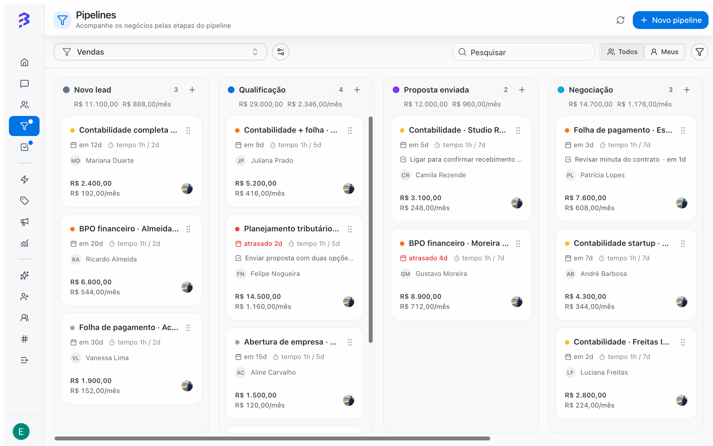

A Pipeline is a board with stages that your deals move through until they end as **Won** or **Lost**. It works for any process in your company, not only sales: customer onboarding, support requests, collections, legal cases, recruiting.

In BluBash, the Pipeline sits next to your conversations. The AI agent serves and qualifies the customer on WhatsApp, Instagram or Webchat, transfers to your team, and the team tracks the rest of the process on the board.

<Frame caption="Sales Pipeline with deals in each stage">
  
</Frame>

<Frame caption="Board, filters, deal record, reasons and derivation">
  <video autoPlay muted loop playsInline controls className="w-full aspect-video rounded-xl" src="/images/videos/pipelines.mp4"></video>
</Frame>

## When to use a Pipeline

Use a Pipeline whenever the work with a customer has a beginning, a middle and an end, and you need to know where each customer stands. Examples:

- **Sales**: from first contact to a won or lost deal.
- **Onboarding**: from signed contract to go-live.
- **Support**: from an open request to resolution.
- **Collections**: from an open invoice to payment.

If the interaction ends in the conversation itself (a question answered by the AI agent, for example), you do not need to create a deal.

## How a Pipeline is organized

<CardGroup cols={2}>
  <Card title="Stages" icon="columns-3">
    The board columns. Each open stage can have a maximum time. When a deal exceeds it, the card is highlighted.
  </Card>

  <Card title="Deals" icon="briefcase">
    The board cards. Each deal belongs to a contact and holds amount, owner, priority, close date, notes, tasks and history.
  </Card>

  <Card title="Won and Lost" icon="flag">
    The end stages. Every deal ends in one of them, with the reason recorded when the Pipeline asks for it.
  </Card>

  <Card title="Teams" icon="users">
    Who can access the Pipeline. Access comes from the team: members of a linked team can see the Pipeline and its deals.
  </Card>
</CardGroup>

## Ready-made templates

When you create a Pipeline, you choose a starting point. Templates are only suggested stages, fields and reasons. You can change everything later.

| Template | A deal represents | Suggested stages | Enabled fields |
| --- | --- | --- | --- |
| **Sales** | An opportunity | New lead, Qualification, Proposal sent, Negotiation, Won, Lost | Monetary value, Recurring value, Due date, required reason when lost |
| **Support** | A request | Open, In progress, Waiting on customer, Resolved, Cancelled | Priority |
| **Onboarding** | A project | Kickoff, In progress, Go-live, Done, Cancelled | Due date |
| **Collections** | An invoice | Open, Negotiation, Paid, Unpaid | Monetary value, Due date |
| **Custom** | Whatever you define | New, Won, Lost | None |

[See the creation walkthrough →](/pipelines/create-pipeline)

## Conversations and deals are different things

The **conversation** measures service: who is waiting for a reply, how long the customer waited, whether they were satisfied. The **deal** measures the process: which stage the customer is in, how much it is worth and how long it has been stuck.

|  | Conversation | Deal |
| --- | --- | --- |
| Where it lives | **Conversations** | **Pipelines** |
| Who takes part | AI agent and team members | AI agent, team members and managers |
| Ends when | The conversation is closed | The deal reaches **Won** or **Lost** |
| Where to analyze | **Reports & Insights** | Pipeline board, filters and close reasons |

Day to day, the AI agent qualifies the customer in the conversation and, with the **Manage deals** skill, creates the deal and moves it through the Pipeline stages on its own. When the conversation needs a person, it transfers to the team with a summary, and the team member picks up where the AI left off. The team can also create deals without leaving the conversation. The same contact can have several open deals at once, each in a Pipeline.

<Note>
  You define which Pipeline the AI works in, which stages it can use and whether it can mark deals as won or lost. [Set up the Manage deals skill →](/ai-agents/configure-skills#manage-deals-in-pipelines)
</Note>

## Who can do what

| Action | Admin | Manager | Member |
| --- | --- | --- | --- |
| View and use their teams' Pipelines | Yes | Yes | Yes |
| Create, edit and delete Pipelines | Yes | Yes | No |

[Roles and permissions →](/members/roles-permissions)

## Best practices

- Create one Pipeline per process, not per person. Use the **Mine** view so each team member sees only their own deals.
- Keep few stages, each with a clear entry criterion.
- Do not create discard stages such as "Not interested". Use **Lost** with a reason. [Learn why →](/pipelines/won-lost-reasons)
- Hand the customer from one area to the next with derivation, without losing the source area's result.

[Learn the BluBash key concepts →](/key-concepts) · [Hybrid service →](/ai-agents/hybrid-service)

## Next steps

<CardGroup cols={2}>
  <Card title="Create a Pipeline" icon="plus" href="/pipelines/create-pipeline">
    Walk through the creation wizard, from template to review.
  </Card>

  <Card title="Work with deals" icon="briefcase" href="/pipelines/deals">
    Create, move, annotate and track deals day to day.
  </Card>

  <Card title="Won, Lost and reasons" icon="flag" href="/pipelines/won-lost-reasons">
    How to close deals and why to record the reason.
  </Card>

  <Card title="Deal derivation" icon="git-branch" href="/pipelines/derive-deals">
    Hand the deal to the next area without losing its history.
  </Card>
</CardGroup>
