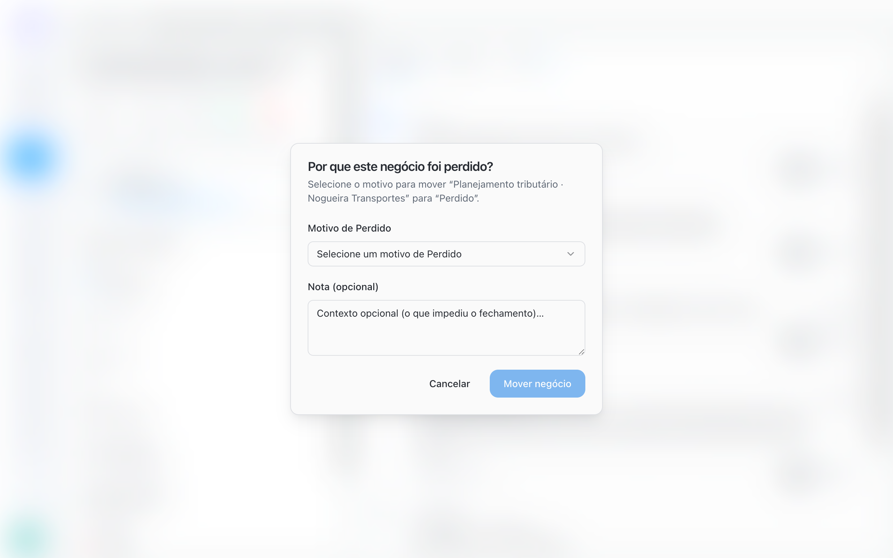
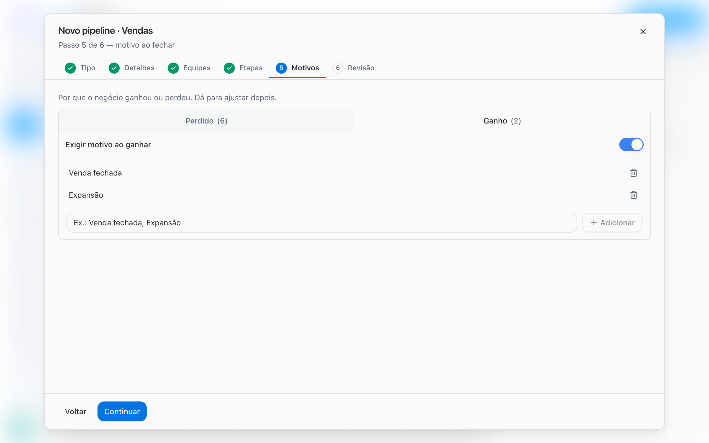

Every deal ends in a **Won** or **Lost** stage. When closing, the person picks a reason from the Pipeline's list. The reason stays on the deal and shows why each result happened: how many sales came from expansion, how many were lost on price, how many leads were not a fit.

## Close a deal

You can close a deal in three ways:

- **On the board**: drag the card to the **Won** or **Lost** column.
- **On the deal record**: use the close quick actions. The button shows the end stage name, such as **Won** or **Lost**.
- **On the deal record**: change the **Stage** field to an end stage.

If the Pipeline requires a reason, BluBash asks **Why did this deal win?** or **Why was this deal lost?**.

<Steps>
  <Step title="Choose the reason">
    Select the reason in **Won reason** or **Lost reason**.
  </Step>
  <Step title="Add context">
    In **Note (optional)**, write what closed the deal or what blocked it.
  </Step>
  <Step title="Confirm">
    Click **Move deal**.
  </Step>
</Steps>

<Frame>
  
</Frame>

The reason and the note appear on the deal record (**Close reason** and **Close note**) and in **History**.

<Info>
  If the list is empty, BluBash tells you there are no reasons yet and where to add them: **Pipeline options → Edit pipeline → Reasons**.
</Info>

## Do not create discard stages

A stage such as "Disqualified lead", "Not interested" or "Discarded" is not a step in the process: it is an outcome. Keeping it as a column distorts the board and hides the reason for the loss.

<Steps>
  <Step title="Add the reason">
    Add **Not qualified** (or the name your team uses) to the Pipeline's **Lost** reasons.
  </Step>
  <Step title="Close as Lost">
    When a lead is not a fit, move the deal to **Lost** and choose **Not qualified**.
  </Step>
  <Step title="Remove the old stage">
    If the Pipeline had a discard stage, delete it in **Manage stages**. BluBash asks for an open stage to move its deals to. Then close those deals as **Lost** with the right reason.
  </Step>
</Steps>

<Tip>
  Leave the initial screening to the AI agent: it answers leads that are not a fit and transfers only the ones with potential to your team. This way, lost reasons reflect what happens after qualification.
</Tip>

## Set up a Pipeline's reasons

Open **Pipeline options → Edit pipeline** and go to the **Reasons** tab. When creating a Pipeline, the same settings appear in the **Reasons** step.

| Setting | What it does |
| --- | --- |
| **Won** list | Reasons shown when the deal reaches a Won stage |
| **Lost** list | Reasons shown when the deal reaches a Lost stage |
| **Add** | Adds a new reason to the list |
| Reason name | Click the name to rename it |
| **Delete reason** | Removes the reason from the list |
| **Require reason on win** | Makes choosing a reason mandatory when winning |
| **Require reason on loss** | Makes choosing a reason mandatory when losing |

To require a reason, the matching list needs at least one active reason. Inactive reasons are marked **inactive**.

<Frame>
  
</Frame>

## Reasons suggested by templates

| Template | End stages (Won / Lost) | Won reasons | Lost reasons |
| --- | --- | --- | --- |
| **Sales** | Won / Lost | Won the deal, Expansion | Price, Competition, No budget, No response, Not the right time |
| **Support** | Resolved / Cancelled | Resolved | Cancelled by customer, Duplicate, No response |
| **Onboarding** | Done / Cancelled | Onboarding completed | Customer dropped out, No engagement |
| **Collections** | Paid / Unpaid | Payment regularized | Delinquency, Cancellation |
| **Custom** | Won / Lost | None | None |

In the **Sales** template, a reason is already required when losing. In the others, turn on the requirement if you want it.

<Tip>
  Use names your team already says out loud and keep the list short. Five to eight lost reasons are usually enough. Long lists make people pick any option.
</Tip>

## More than one Won or Lost stage

A Pipeline can have more than one Won stage, each with its own destination. Example for a law firm:

| Won stage | Close destination |
| --- | --- |
| Won · Debt | Liability management Pipeline |
| Won · Lawsuit | Legal Pipeline |

To do this, add a stage, change its **Stage type** to **Won** and set the destination for each one. With more than one end stage of the same type, the quick action on the record becomes **Win** or **Lose** and opens the list so you can choose the stage.

[Set up derivation →](/pipelines/derive-deals)

## Common issues

| Situation | Cause | How to fix |
| --- | --- | --- |
| BluBash does not let you turn on the reason requirement | The list has no active reason | Add at least one reason to the list |
| The reason dialog does not appear | The requirement is off for that type | Turn on **Require reason on win** or **Require reason on loss** |
| Almost every lost deal has the same generic reason | The list has a vague option, such as "Other" | Replace it with specific reasons and use the note for context |

## Next steps

<CardGroup cols={2}>
  <Card title="Deal derivation" icon="git-branch" href="/pipelines/derive-deals">
    Create the next deal automatically when you win.
  </Card>

  <Card title="Work with deals" icon="briefcase" href="/pipelines/deals">
    Deal record, filters and tasks.
  </Card>
</CardGroup>
