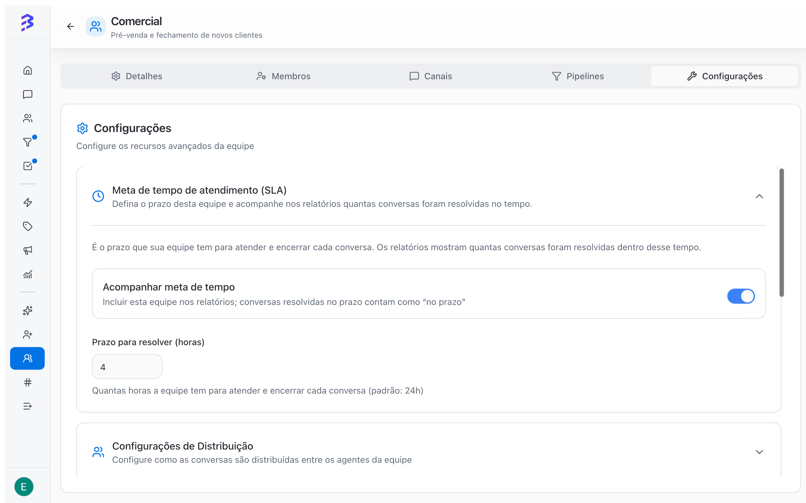
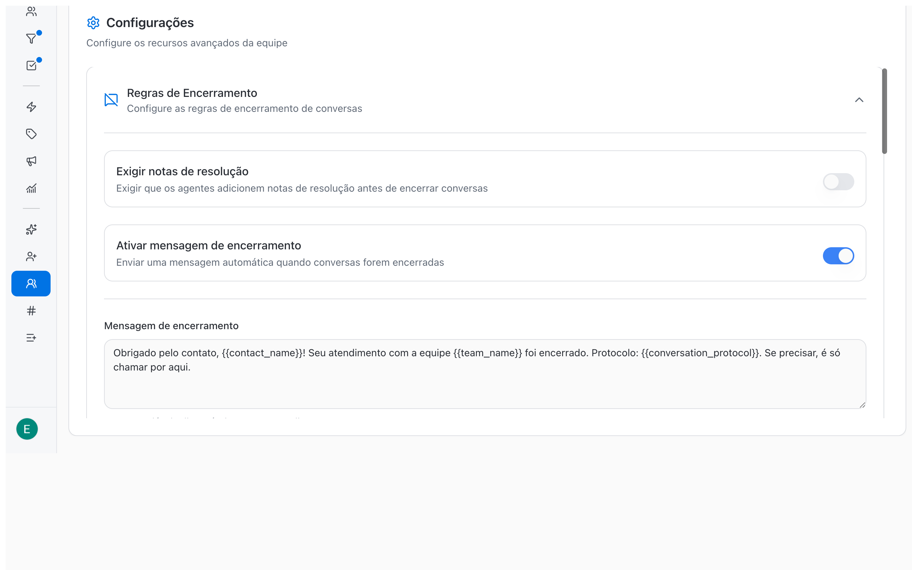
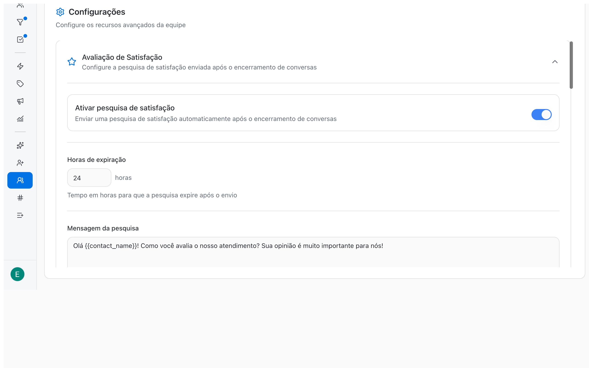
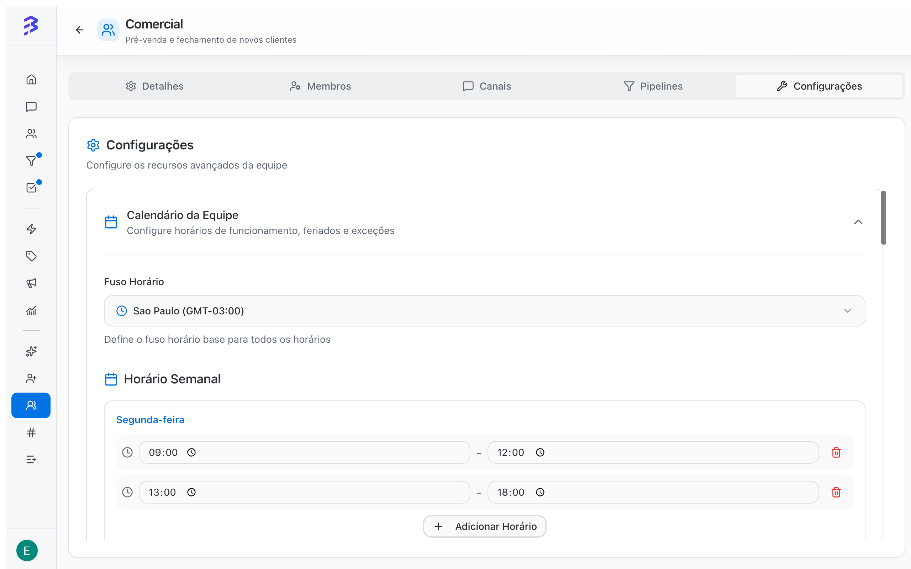

A equipe é a unidade de organização da BluBash. Nela você define quem atende, por quais canais, com acesso a quais Pipelines, em que horário, com qual meta de tempo e como as conversas são distribuídas. Crie uma equipe para cada área da operação, como Comercial, Suporte, Financeiro ou Jurídico.

<Info>
  O acesso vem da equipe: um membro vê as conversas dos canais e os negócios dos Pipelines das equipes de que participa. As equipes também são o destino das transferências do agente de IA: cada habilidade **Transferir para Equipe** aponta para uma delas.
</Info>

<Note>
  Somente **Administradores** criam, configuram e excluem equipes. O número de equipes disponíveis depende do plano, consultado em **Faturamento & Uso**.
</Note>

## Visão geral da configuração

| Onde | O que você define |
| --- | --- |
| Aba **Detalhes** | Nome e descrição da equipe |
| Aba **Membros** | Quem participa e a função de cada um na equipe (**Gerente** ou **Agente**) |
| Aba **Canais** | Por quais canais a equipe atende |
| Aba **Pipelines** | Quais Pipelines a equipe usa |
| Aba **Configurações** | Conversa, carteirização, SLA, distribuição, encerramento, satisfação, calendário e exclusão |

## Criar uma equipe

<Steps>
  <Step title="Abra Equipes">
    No menu lateral, clique em **Equipes** e depois em **Criar Equipe**.
  </Step>
  <Step title="Preencha os detalhes">
    Informe o **Nome da Equipe** e, se quiser, uma **Descrição**. Use nomes que façam sentido para quem atende e para quem configura o agente de IA, como "Suporte Técnico" ou "Comercial SP".
  </Step>
  <Step title="Crie">
    Clique em **Criar Equipe**. A BluBash confirma com **Equipe criada com sucesso!** e abre a página da equipe para você continuar a configuração.
  </Step>
</Steps>

<Note>
  Toda equipe nova começa com a distribuição **Fila** e com **Mostrar nome do agente ao enviar mensagens** ativado. Ajuste as duas opções na aba **Configurações**.
</Note>

## Detalhes

Na aba **Detalhes**, altere o **Nome da Equipe** e a **Descrição** e clique em **Atualizar Equipe**.

<Warning>
  Se o nome mudar, revise as habilidades **Transferir para Equipe** dos agentes de IA. As instruções da habilidade costumam citar a equipe pelo nome.
</Warning>

## Membros da equipe

Na aba **Membros**, busque a pessoa, escolha a função dela na equipe e clique em **Adicionar**. Em **Membros Atuais**, altere a função ou remova a pessoa.

| Função na equipe | Uso |
| --- | --- |
| **Agente** | Pessoa que atende as conversas da equipe. Não confundir com o agente de IA |
| **Gerente** | Pessoa que coordena a equipe |

<Warning>
  Ninguém pode ficar sem equipe. A BluBash bloqueia a remoção de um membro da única equipe dele no workspace.
</Warning>

Para convidar alguém que ainda não está no workspace, use [Adicionar um membro →](/pt-BR/members/add-member).

## Canais da equipe

A aba **Canais** mostra duas listas: **Canais Disponíveis**, com os canais que você pode vincular, e **Canais da Equipe**, com os canais que a equipe já atende.

| Canal | Como vincular à equipe |
| --- | --- |
| WhatsApp (API oficial e Lite) | Na aba **Canais**, clique em **Adicionar** ao lado do canal em **Canais Disponíveis** |
| Instagram | Na configuração do canal, escolha a equipe em **Equipe Padrão** |
| Webchat | Na configuração do canal, escolha a equipe em **Equipe Padrão** |

Todo canal tem uma **Equipe Padrão**, que recebe as conversas do canal por padrão. Em **Canais da Equipe**, o selo **Equipe padrão** indica os canais em que esta equipe cumpre esse papel.

<Warning>
  Não é possível desvincular um canal da sua equipe padrão. Altere a **Equipe Padrão** nas configurações do canal antes de remover o vínculo.
</Warning>

<Tip>
  Um mesmo canal pode atender várias equipes. É comum ter o agente de IA no número principal de WhatsApp e no Instagram, transferindo para Comercial ou Suporte conforme o assunto.
</Tip>

Veja como configurar cada canal em [Criar um canal →](/pt-BR/channels/create-channel), [Instagram →](/pt-BR/channels/configure-instagram) e [Webchat →](/pt-BR/channels/configure-webchat).

## Pipelines da equipe

Na aba **Pipelines**, adicione os Pipelines que a equipe vai usar a partir de **Pipelines disponíveis**. Eles passam para **Pipelines da equipe**, e os membros da equipe passam a ver e trabalhar esses negócios.

Um Pipeline precisa estar vinculado a pelo menos uma equipe. Por isso, a BluBash não deixa remover o último vínculo de equipe de um Pipeline. Veja [Pipelines →](/pt-BR/pipelines/overview).

## Configurações

A aba **Configurações** reúne seções recolhíveis. Abra a seção, faça a alteração e clique em **Atualizar Equipe**, que aparece quando há mudanças a salvar.

### Configurações de Conversa

| Opção | Padrão | Efeito |
| --- | --- | --- |
| **Permitir iniciar conversas** | Ativado | Os membros da equipe podem iniciar novas conversas com contatos |
| **Mostrar nome do agente ao enviar mensagens** | Ativado em equipes novas | O nome de quem atende aparece em cada mensagem enviada ao cliente |

Desative **Permitir iniciar conversas** em equipes que só atendem de forma receptiva, como um suporte que responde apenas a quem chama.

### Carteirização

Com **Carteirizar contato ao assumir a conversa** ativo, quem assumir uma conversa que ainda não tem responsável da equipe passa a ser também o responsável pelo contato nessa equipe. Use quando cada cliente deve ter um atendente fixo, como em carteiras comerciais ou contas recorrentes.

<Note>
  A carteirização de contatos depende do plano. Se o recurso não estiver incluído, ao ativar a opção a BluBash mostra **Faça upgrade para usar carteirização**.
</Note>

### Meta de tempo de atendimento (SLA)

Defina o prazo que a equipe tem para atender e encerrar cada conversa.

| Campo | Padrão | Descrição |
| --- | --- | --- |
| **Acompanhar meta de tempo** | Ativado | Inclui a equipe nos relatórios; conversas resolvidas no prazo contam como "no prazo" |
| **Prazo para resolver (horas)** | 24 | Quantas horas a equipe tem para atender e encerrar cada conversa |

<Frame>
  
</Frame>

### Configurações de Distribuição

| Tipo de Distribuição | Como funciona | Quando usar |
| --- | --- | --- |
| **Rodízio** | Distribui as conversas de forma equilibrada entre os membros disponíveis | Equipes com volume constante e atendentes com o mesmo perfil |
| **Fila** | Mantém as conversas na fila, sem atribuir automaticamente, até alguém assumir | Equipes que preferem escolher o que atender ou com especialistas diferentes |

<Note>
  Equipes antigas configuradas como **Disponível** aparecem como **Rodízio** nesta seção.
</Note>

Em **Máximo de Conversas Simultâneas**, defina quantas conversas cada membro atende ao mesmo tempo, de 1 a 50. O padrão é 10. Quem atinge o limite deixa de receber conversas. Se todos atingirem o limite, as novas conversas vão para a fila.

<Tip>
  Com um agente de IA no canal, a equipe recebe menos volume: o agente resolve a rotina e transfere só o que precisa de uma pessoa. Revise o máximo de conversas simultâneas depois das primeiras semanas com IA.
</Tip>

### Regras de Encerramento

| Opção | Efeito |
| --- | --- |
| **Exigir notas de resolução** | O atendente precisa escrever uma nota de resolução antes de encerrar a conversa |
| **Ativar mensagem de encerramento** | Envia uma mensagem automática ao cliente quando a conversa é encerrada |

Na **Mensagem de encerramento**, use as variáveis abaixo. Clique em uma variável para inseri-la ou copiá-la e confira o resultado na **Pré-visualização**.

| Variável | Conteúdo |
| --- | --- |
| `{{team_name}}` | Nome da equipe |
| `{{contact_name}}` | Nome do contato |
| `{{agent_name}}` | Nome do agente |
| `{{conversation_protocol}}` | Protocolo da conversa |

Em **Condições de envio**, defina a **Duração mínima da conversa** em minutos para não enviar a mensagem em conversas muito curtas.

<Frame>
  
</Frame>

### Avaliação de Satisfação

Com **Ativar pesquisa de satisfação**, o cliente recebe uma pesquisa com nota de 1 a 5 depois que a conversa é encerrada.

| Campo | Padrão | Descrição |
| --- | --- | --- |
| **Horas de expiração** | 12 | Tempo para a pesquisa expirar depois do envio |
| **Mensagem da pesquisa** | Texto sugerido | Pergunta enviada ao cliente. Aceita as mesmas variáveis |
| **Mensagem de agradecimento** | Texto sugerido | Enviada depois que o cliente responde |

As notas alimentam a **Satisfação média (CSAT)** em [Relatórios →](/pt-BR/reports/overview).

<Frame>
  
</Frame>

### Calendário da Equipe

Clique em **Criar Calendário** e configure:

| Item | Como configurar |
| --- | --- |
| **Fuso Horário** | Fuso base de todos os horários da equipe |
| **Horário Semanal** | Para cada dia, use **Adicionar Horário** para um ou mais intervalos, ou deixe o dia como **Fechado** |
| **Feriados** | **Adicionar Feriado** com data e **Nome do feriado** |
| **Exceções** | **Adicionar Exceção** com **Motivo da exceção** e um **Horário especial**, ou marque **Fechado neste dia** |

Para desfazer, use **Remover Calendário**.

<Frame>
  
</Frame>

<Tip>
  Configure o calendário com o expediente real da equipe antes de acompanhar as métricas de tempo. Com um agente de IA no canal, o cliente recebe a primeira resposta também fora desse horário.
</Tip>

## Excluir uma equipe

Em **Configurações**, abra **Ações avançadas** e clique em **Excluir equipe**. A BluBash mostra o impacto antes de confirmar:

| Item verificado | O que fazer |
| --- | --- |
| **Conversas abertas** | Marque **Encerrar automaticamente as conversas em aberto desta equipe** ou redistribua as conversas antes |
| Canais com esta equipe como padrão | Escolha a nova equipe padrão de cada canal |
| Canais que ficariam sem equipe | Escolha uma equipe para cada canal |
| **Carteirização** | Os vínculos de carteirização da equipe são removidos |

Clique em **Continuar**, digite o nome da equipe para confirmar e clique em **Excluir definitivamente**. A exclusão não pode ser desfeita.

<Warning>
  Depois de excluir, revise as habilidades **Transferir para Equipe** dos agentes de IA que apontavam para a equipe, e os Pipelines que estavam vinculados a ela.
</Warning>

## Boas práticas

- Crie as equipes antes de convidar os membros. O convite exige pelo menos uma equipe.
- Uma equipe por área de atendimento facilita as transferências do agente de IA e a leitura dos relatórios.
- Comece com **Fila** enquanto a equipe é pequena e passe para **Rodízio** quando o volume crescer.
- Ative SLA e Avaliação de Satisfação desde o início para ter histórico nos relatórios.

## Próximos passos

<CardGroup cols={2}>
  <Card title="Adicionar um membro" icon="user-plus" href="/pt-BR/members/add-member">
    Convide as pessoas da equipe.
  </Card>

  <Card title="Configurar habilidades" icon="zap" href="/pt-BR/ai-agents/configure-skills">
    Aponte o **Transferir para Equipe** do agente de IA para a equipe.
  </Card>

  <Card title="Criar um Pipeline" icon="kanban" href="/pt-BR/pipelines/create-pipeline">
    Crie os Pipelines que a equipe vai usar.
  </Card>

  <Card title="Encerrar atendimento" icon="message-circle" href="/pt-BR/conversations/close-attendance">
    Veja as regras de encerramento na prática.
  </Card>
</CardGroup>
