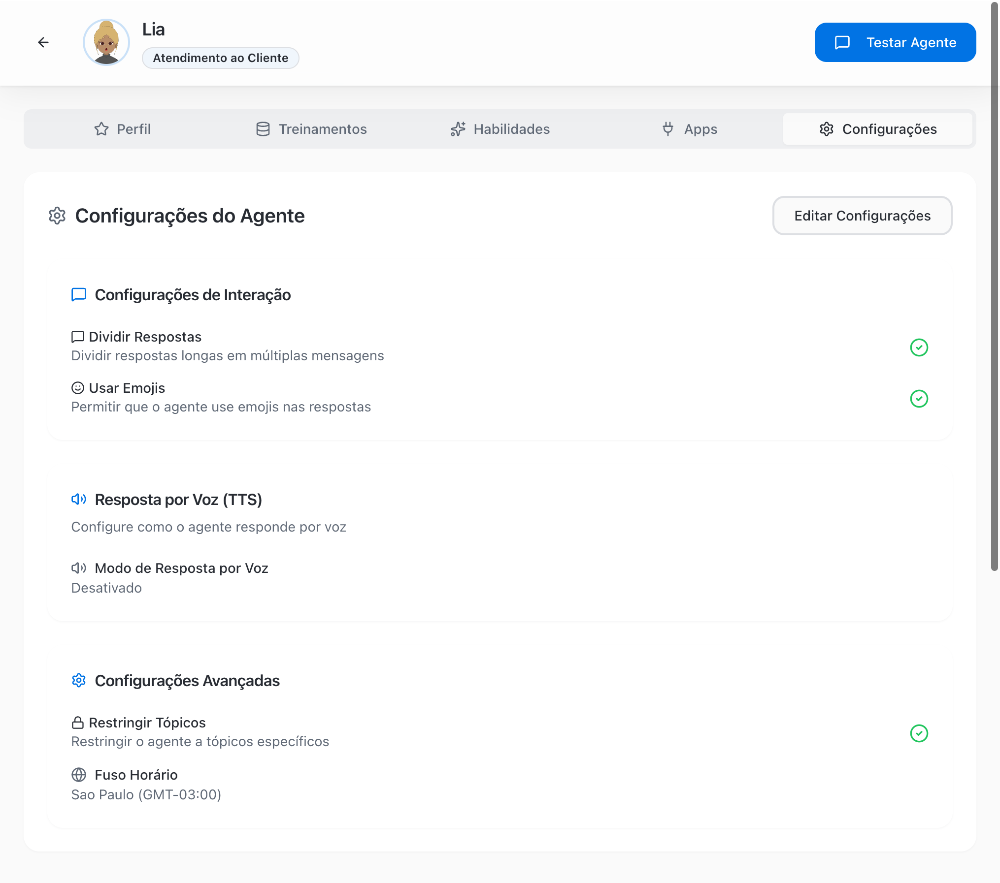
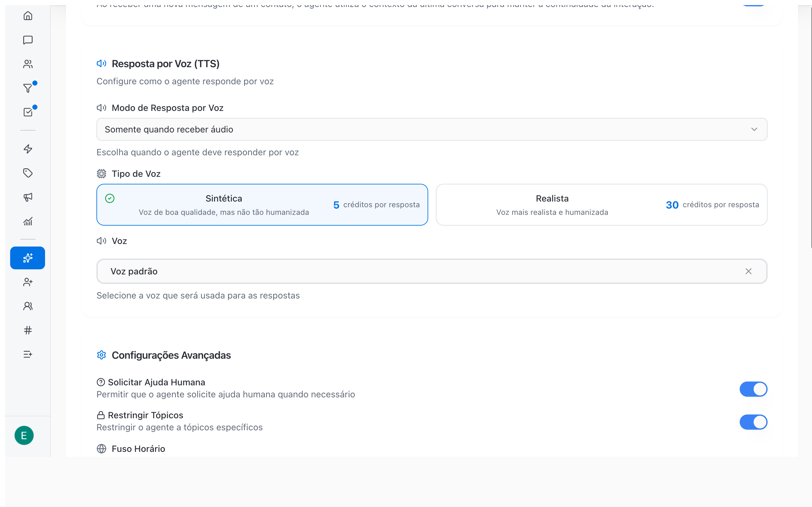

As configurações definem o estilo das respostas do agente de IA. Elas valem para todos os canais em que o agente atende: WhatsApp, Instagram e Webchat.

<Note>
  O que o agente faz sozinho na conversa, como atualizar o contato, encerrar a conversa, lembrar da conversa anterior e transferir para humano, agora fica na aba **Habilidades**, como habilidades nativas. Veja [Configurar habilidades e apps →](/pt-BR/ai-agents/configure-skills#habilidades-nativas).
</Note>

## Abrir e editar as configurações

<Steps>
  <Step title="Abra o agente">
    Na barra lateral, clique em **Agentes de IA** e depois no agente.
  </Step>
  <Step title="Clique na aba Configurações">
    A aba mostra cada opção com um indicador de ativado ou desativado.
  </Step>
  <Step title="Clique em Editar Configurações">
    As opções viram interruptores e seletores editáveis.
  </Step>
  <Step title="Salve">
    Clique em **Salvar** para aplicar ou em **Cancelar** para descartar. As mudanças valem para as próximas respostas do agente.
  </Step>
</Steps>

<Frame>
  
</Frame>

## Configurações de Interação

| Configuração | O que faz | Padrão | Recomendação |
| --- | --- | --- | --- |
| **Dividir Respostas** | Divide respostas longas em várias mensagens curtas, como uma pessoa faria no WhatsApp ou no Direct | Desativado | Ativar |
| **Usar Emojis** | Permite que o agente use emojis nas respostas | Desativado | Conforme o tom da marca |

## Resposta por Voz (TTS)

O agente pode responder com áudio, como um atendente faria no WhatsApp.

<Frame>
  
</Frame>

### Modo de Resposta por Voz

| Modo | Comportamento |
| --- | --- |
| **Desativado** | O agente responde sempre em texto. É o padrão. |
| **Sempre** | O agente responde sempre em áudio |
| **Somente quando receber áudio** | O agente responde em áudio quando o cliente envia áudio e em texto quando o cliente escreve |
| **Automático** | O agente decide quando o áudio faz sentido na conversa |

### Tipo de Voz e Voz

Quando o modo não é **Desativado**, aparecem mais dois campos:

- **Tipo de Voz**: **Sintética** (boa qualidade, menos humanizada) ou **Realista** (mais realista e humanizada). Cada opção mostra o custo em créditos por resposta.
- **Voz**: a voz usada nas respostas. Pesquise pelo nome e clique em **Ouvir voz** para ouvir uma prévia. Sem escolha, o agente usa a **Voz padrão**.

<Note>
  Respostas em áudio consomem créditos de IA: 5 créditos por resposta com voz **Sintética** e 30 créditos por resposta com voz **Realista**.
</Note>

<Tip>
  **Somente quando receber áudio** costuma funcionar melhor: o cliente que prefere áudio recebe áudio e quem escreve recebe texto, sem gastar créditos à toa.
</Tip>

## Configurações Avançadas

| Configuração | O que faz | Padrão |
| --- | --- | --- |
| **Restringir Tópicos** | Mantém o agente nos assuntos do seu negócio e evita respostas fora de contexto | Desativado |
| **Fuso Horário** | Base para datas e horários que o agente menciona, como "hoje" ou "amanhã às 14h". Pesquise o fuso na lista. | Fuso do navegador de quem criou o agente |

<Warning>
  Confira o **Fuso Horário** se a sua equipe atende clientes em outro fuso ou se o agente agenda compromissos pelo app Google Calendários. Um fuso errado gera horários errados nas respostas.
</Warning>

## Quanta autonomia dar ao agente

A autonomia é definida pela combinação das configurações com as habilidades do agente.

| Perfil da operação | Configuração sugerida |
| --- | --- |
| Começando com IA | **Restringir Tópicos** ativado; uma habilidade **Transferir para equipe** para cada área; a nativa **Encerrar conversa** desativada nas primeiras semanas para revisar os atendimentos; **Gerenciar negócios** só com as etapas iniciais do pipeline |
| Operação madura | Nativas **Encerrar conversa** e **Atualizar contato** ativadas; **Gerenciar negócios** com ganho e perda permitidos; revisão periódica na **Visão 360°** com a análise de IA |
| Alto volume | **Dividir Respostas** ativado e habilidades de transferência com orientações bem específicas |

## Erros comuns

| Problema | Solução |
| --- | --- |
| O agente encerra conversas cedo demais | Desative a habilidade nativa **Encerrar conversa** na aba **Habilidades** ou detalhe no **Comportamento** quando encerrar |
| O agente responde fora do assunto | Ative **Restringir Tópicos** e reforce no **Comportamento** os assuntos permitidos |
| O agente repete perguntas a um cliente que já atendeu | Confirme que a habilidade nativa **Lembrar da conversa anterior** está ativada |
| Gasto alto de créditos com áudio | Troque o modo para **Somente quando receber áudio** ou use a voz **Sintética** |

## Próximos passos

- [Configurar habilidades e apps →](/pt-BR/ai-agents/configure-skills)
- [Testar o agente →](/pt-BR/ai-agents/test-ai-agent)
- [Analisar a qualidade das conversas com IA →](/pt-BR/reports/ai-audit)
