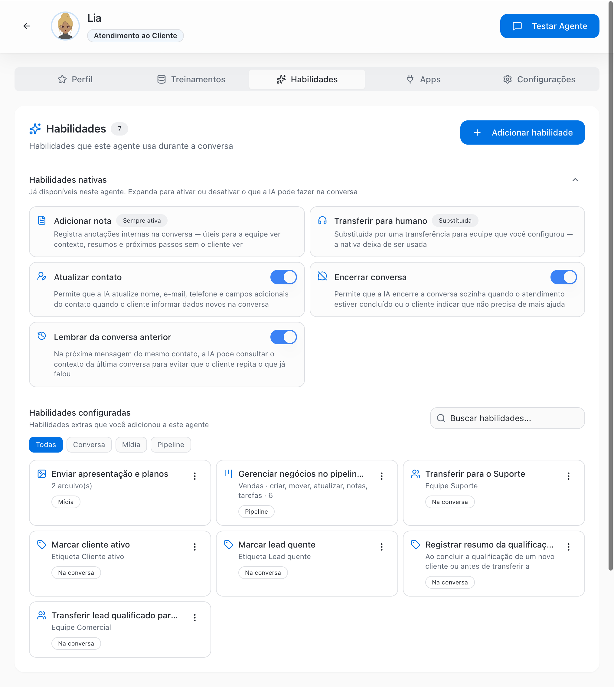
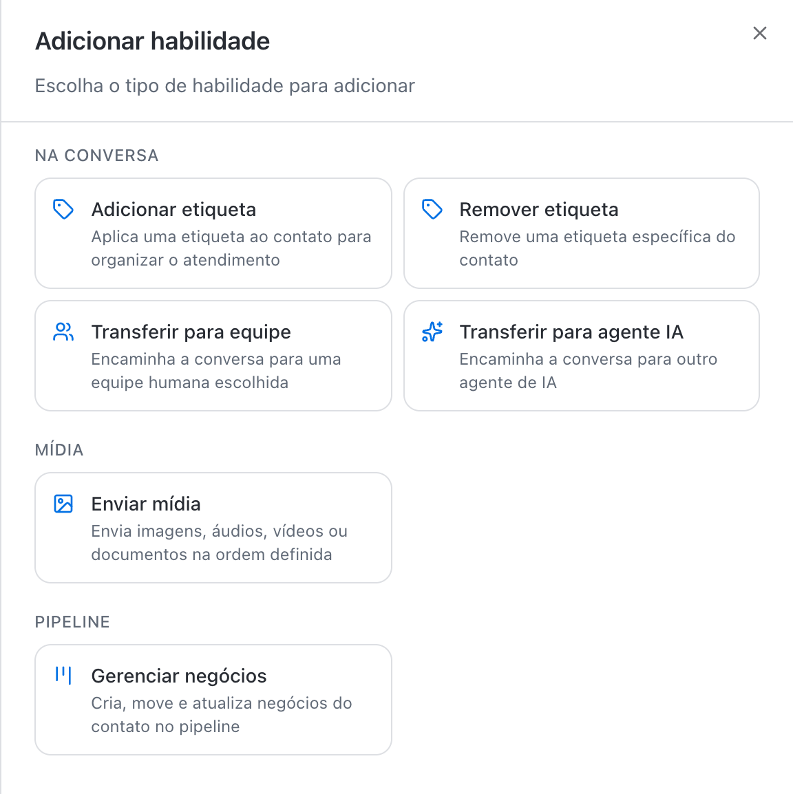
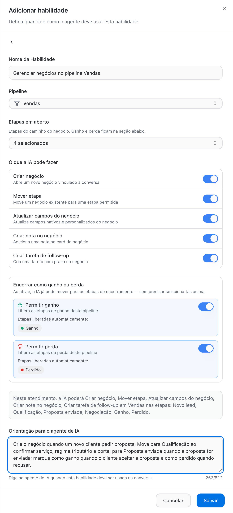
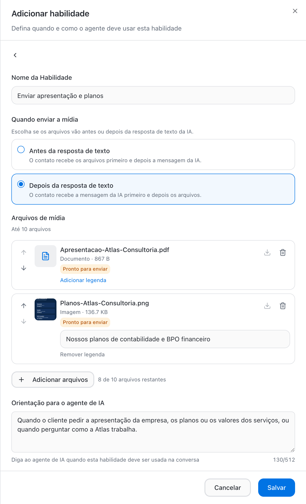
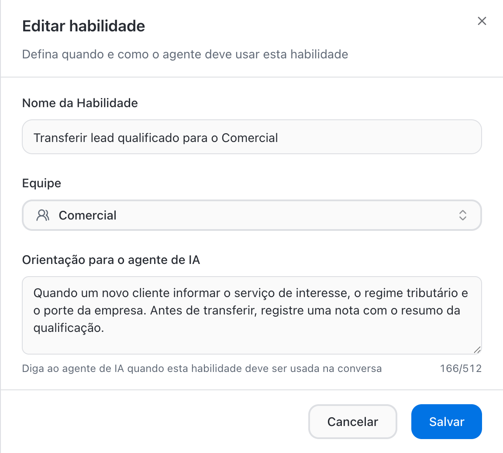
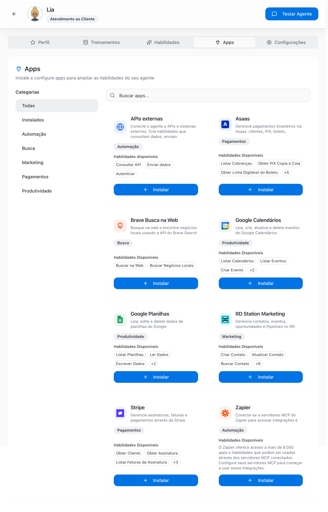
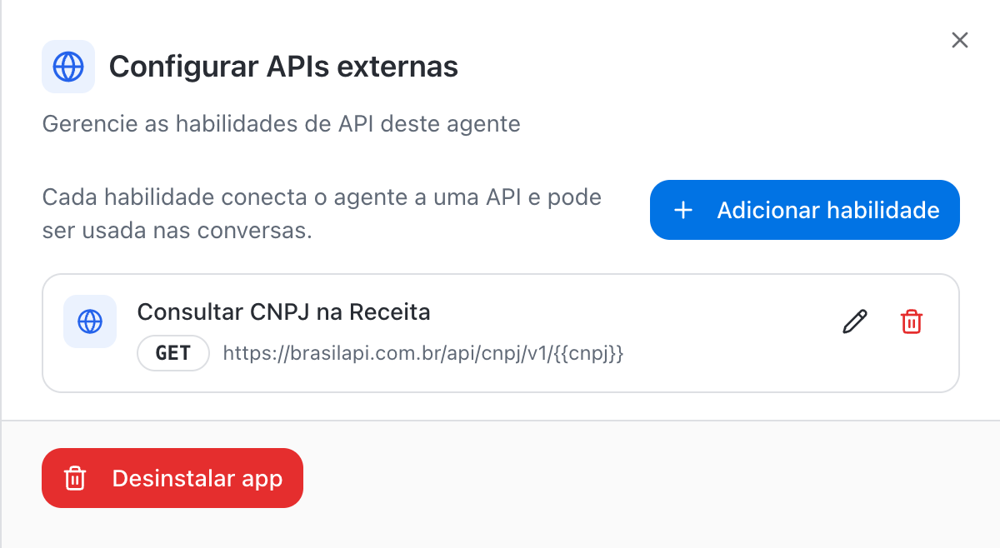
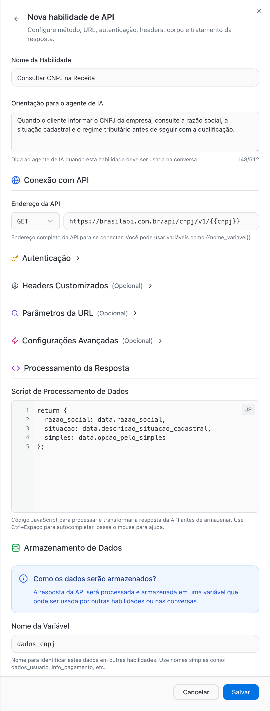

Habilidades são as ações que o agente de IA executa durante a conversa, além de responder. Com elas o agente organiza o atendimento, envia materiais, conduz negócios nos Pipelines, consulta sistemas e passa a conversa para a equipe certa no momento certo. As habilidades funcionam em qualquer canal em que o agente atende: WhatsApp, Instagram e Webchat.

O agente tem duas abas para isso:

- **Habilidades**: as habilidades nativas, que já vêm no agente, e as habilidades que você configura (etiquetas, transferências, mídias e Pipelines).
- **Apps**: integrações com sistemas externos, incluindo o app **APIs externas** para conectar qualquer API HTTP.

<Frame>
  
</Frame>

## Habilidades nativas

As habilidades nativas já estão disponíveis em todo agente. Elas ficam no topo da aba **Habilidades**, em um bloco que você pode recolher ou expandir.

| Habilidade | O que o agente faz | Controle |
| --- | --- | --- |
| **Adicionar nota** | Registra anotações internas na conversa, como contexto, resumos e próximos passos. O cliente não vê. | Sempre ativa |
| **Transferir para humano** | Encaminha a conversa para a equipe padrão do canal quando o cliente pede um humano ou a IA não consegue resolver sozinha | Sempre ativa. Fica como **Substituída** quando o agente tem uma habilidade **Transferir para equipe** |
| **Atualizar contato** | Atualiza nome, e-mail, telefone e campos adicionais do contato quando o cliente informa dados novos | Interruptor |
| **Encerrar conversa** | Encerra a conversa quando o atendimento foi concluído ou o cliente indica que não precisa de mais ajuda | Interruptor |
| **Lembrar da conversa anterior** | Na próxima mensagem do mesmo contato, consulta o contexto da última conversa para o cliente não repetir o que já falou | Interruptor |

<Note>
  **Atualizar contato**, **Encerrar conversa** e **Lembrar da conversa anterior** ficavam na aba **Configurações**. Agora são habilidades nativas e são ligadas e desligadas direto na aba **Habilidades**. A antiga opção **Solicitar Ajuda Humana** deu lugar à habilidade nativa **Transferir para humano**.
</Note>

<Tip>
  Quer controlar para qual equipe a IA transfere? Crie uma habilidade **Transferir para equipe** para cada área. A partir da primeira, a nativa **Transferir para humano** passa a aparecer como **Substituída** e deixa de ser usada.
</Tip>

## Tipos de habilidade configurável

Clique em **Adicionar habilidade** para escolher o tipo. Os tipos são agrupados pelo que a IA faz.

<Frame>
  
</Frame>

| Grupo | Tipo | O que o agente faz | Campo principal |
| --- | --- | --- | --- |
| Na conversa | **Adicionar etiqueta** | Aplica uma etiqueta ao contato para organizar o atendimento | **Etiqueta** |
| Na conversa | **Remover etiqueta** | Remove uma etiqueta específica do contato | **Etiqueta** |
| Na conversa | **Transferir para equipe** | Encaminha a conversa para uma equipe humana escolhida | **Equipe** |
| Na conversa | **Transferir para agente IA** | Encaminha a conversa para outro agente de IA | **Agente de Destino** e **Equipe de Destino (Opcional)** |
| Mídia | **Enviar mídia** | Envia imagens, áudios, vídeos ou documentos na ordem definida | Arquivos de mídia |
| Pipeline | **Gerenciar negócios** | Cria, move, atualiza e encerra negócios do contato em um pipeline | **Pipeline**, etapas e permissões |

Integrações com APIs próprias, que antes eram o tipo **Requisição HTTP**, agora ficam no app **APIs externas**, na aba **Apps**. Veja [APIs externas](#apis-externas).

## Gerenciar negócios nos Pipelines

Com a habilidade **Gerenciar negócios**, o agente de IA conduz o negócio no pipeline sozinho, durante a conversa: abre o negócio quando o lead chega, move de etapa conforme a qualificação avança, atualiza campos, registra notas, cria tarefas de follow-up e marca como ganho ou perdido. A equipe acompanha tudo no quadro do pipeline, sem digitar nada.

<Frame>
  
</Frame>

### Configurar

<Steps>
  <Step title="Escolha o tipo Gerenciar negócios">
    Na aba **Habilidades**, clique em **Adicionar habilidade** e, no grupo **Pipeline**, escolha **Gerenciar negócios**.
  </Step>
  <Step title="Dê um nome e escolha o pipeline">
    Em **Nome da Habilidade**, descreva a ação. Exemplo: _Gerenciar negócios no pipeline Vendas_. Em **Pipeline**, escolha o pipeline em que a IA vai atuar.
  </Step>
  <Step title="Selecione as etapas em aberto">
    Em **Etapas em aberto**, marque as etapas do caminho do negócio que a IA pode usar. Exemplo no pipeline Vendas: **Novo lead**, **Qualificação**, **Proposta enviada** e **Negociação**. Etapas de ganho e de perda não aparecem aqui; elas são liberadas na seção **Encerrar como ganho ou perda**.
  </Step>
  <Step title="Defina o que a IA pode fazer">
    Ligue ou desligue cada ação na lista **O que a IA pode fazer**. Veja a tabela abaixo.
  </Step>
  <Step title="Libere ganho e perda, se fizer sentido">
    Em **Encerrar como ganho ou perda**, ative **Permitir ganho** e **Permitir perda**. Ao ativar, a IA já pode mover o negócio para as etapas de encerramento do pipeline, como **Ganho** e **Perdido**, sem precisar selecioná-las nas etapas em aberto.
  </Step>
  <Step title="Confira o resumo e escreva a orientação">
    O quadro de resumo mostra exatamente o que a IA poderá fazer e em quais etapas. Em **Orientação para o agente de IA**, explique quando agir em cada etapa (até 512 caracteres). Clique em **Salvar**.
  </Step>
</Steps>

### O que a IA pode fazer

| Ação | O que acontece | Padrão ao criar |
| --- | --- | --- |
| **Criar negócio** | Abre um novo negócio vinculado à conversa | Ativada |
| **Mover etapa** | Move um negócio existente para uma das etapas permitidas | Ativada |
| **Atualizar campos do negócio** | Atualiza campos nativos e personalizados do negócio, como valor ou dados coletados na conversa | Desativada |
| **Criar nota no negócio** | Adiciona uma nota no card do negócio | Desativada |
| **Criar tarefa de follow-up** | Cria uma tarefa com prazo no negócio | Ativada |
| **Permitir ganho** | Libera as etapas de ganho do pipeline | Desativada |
| **Permitir perda** | Libera as etapas de perda do pipeline | Desativada |

A IA só move o negócio para as etapas que você liberou. Se uma etapa não estiver em **Etapas em aberto** nem for liberada por ganho ou perda, a IA não consegue colocar o negócio nela.

### Exemplo de orientação

A orientação é o que o agente usa para decidir quando agir. Amarre cada movimento a um fato da conversa:

> Crie o negócio quando um novo cliente pedir proposta. Mova para Qualificação ao confirmar serviço, regime tributário e porte; para Proposta enviada quando a proposta for enviada; marque como ganho quando o cliente aceitar a proposta e como perdido quando recusar.

| Fraca | Boa |
| --- | --- |
| "Mova o negócio quando avançar" | "Mova para Qualificação quando o cliente informar serviço, regime tributário e número de funcionários" |
| "Marque como ganho quando fechar" | "Marque como ganho quando o cliente aceitar a proposta por escrito na conversa" |
| "Crie tarefas" | "Crie uma tarefa de follow-up para o dia seguinte quando o cliente pedir para pensar" |

### Boas práticas

- **Uma habilidade por pipeline.** Cada habilidade atua em um pipeline. Se a IA precisa abrir negócios em **Vendas** e em **Implantação**, crie uma habilidade para cada um, com orientações separadas.
- **Comece restrito.** Nas primeiras semanas, libere só as etapas iniciais e deixe **Permitir ganho** e **Permitir perda** desativados. Quando confiar nas decisões da IA, amplie.
- **Use nota e tarefa juntas.** Com **Criar nota no negócio** e **Criar tarefa de follow-up**, quem assume o negócio já encontra o resumo e o próximo passo com prazo.
- **Combine com a transferência.** A IA pode mover o negócio para **Proposta enviada** e, em seguida, transferir a conversa para o Comercial com **Transferir para equipe**.

<Warning>
  Revise a habilidade sempre que mudar as etapas do pipeline. Uma etapa excluída ou renomeada deixa de valer para a IA até você atualizar a seleção.
</Warning>

Veja também [Pipelines →](/pt-BR/pipelines/overview) e [Negócios →](/pt-BR/pipelines/deals).

## Enviar mídia

Use **Enviar mídia** para que o agente envie materiais prontos durante a conversa: apresentação da empresa, tabela de planos, catálogo, vídeo de demonstração ou áudio de boas-vindas.

<Frame>
  
</Frame>

| Campo | Descrição |
| --- | --- |
| **Nome da Habilidade** | Descreva o material. Exemplo: _Enviar apresentação e planos_. |
| **Quando enviar a mídia** | **Antes da resposta de texto**: o contato recebe os arquivos primeiro e depois a mensagem da IA. **Depois da resposta de texto**: o contato recebe a mensagem da IA primeiro e depois os arquivos. |
| **Arquivos de mídia** | Até 10 arquivos por habilidade. Use as setas para definir a ordem de envio e **Adicionar legenda** para incluir um texto junto ao arquivo. |
| **Orientação para o agente de IA** | Quando o agente deve enviar os arquivos. Exemplo: _Quando o cliente pedir a apresentação da empresa, os planos ou os valores dos serviços._ |

Limites de tamanho por arquivo:

| Tipo | Limite |
| --- | --- |
| Imagem | 5 MB |
| Vídeo | 20 MB |
| Áudio | 10 MB |
| Documento | 15 MB |

<Tip>
  Crie uma habilidade de mídia para cada situação, por exemplo uma para a apresentação institucional e outra para o catálogo de preços. Assim a orientação fica específica e a IA envia só o que o cliente pediu.
</Tip>

## Habilidades na conversa

### Adicionar e remover etiqueta

Escolha a **Etiqueta** e escreva a orientação. Exemplo: aplicar **Lead quente** quando o cliente pedir proposta, ou remover **Inadimplente** quando ele confirmar o pagamento.

### Transferir para equipe

Escolha a **Equipe** que recebe a conversa e descreva na orientação em que situação transferir.

<Frame>
  
</Frame>

### Transferir para agente IA

Use para dividir o atendimento entre agentes especializados. Exemplo: um agente de triagem atende no WhatsApp, no Instagram e no Webchat e transfere para um agente de cobrança quando o assunto é boleto.

- **Agente de Destino**: o agente que assume a conversa.
- **Equipe de Destino (Opcional)**: se informada, a conversa também muda para essa equipe. Escolha **Não alterar equipe** para manter a equipe atual.

<Warning>
  Para a troca de equipe acontecer, a equipe de destino precisa ter acesso ao canal em que a conversa está. Inclua o canal em **Canais da Equipe** nas configurações da equipe.
</Warning>

## Escreva boas orientações

Todos os tipos têm o campo **Orientação para o agente de IA**, com até 512 caracteres. É o que o agente usa para decidir quando executar a habilidade. Seja específico.

| Fraca | Boa |
| --- | --- |
| "Quando for lead" | "Quando um novo cliente informar o serviço de interesse, o regime tributário e o porte da empresa" |
| "Quando o cliente for importante" | "Quando o cliente tiver faturamento acima de R\$ 1 milhão por ano ou mais de 10 funcionários" |
| "Para suporte" | "Quando um cliente ativo pedir documentos, guias, segunda via ou relatar atraso" |
| "Quando quiser falar com alguém" | "Quando o cliente pedir para falar com uma pessoa, demonstrar irritação ou repetir a mesma pergunta duas vezes" |

<Tip>
  Combine habilidades no **Comportamento** do agente: "Antes de transferir, registre uma nota com o resumo da qualificação e mova o negócio para Qualificação". Assim quem recebe a conversa já começa com o contexto.
</Tip>

## Gerenciar habilidades

- Filtre a lista por **Todas**, **Conversa**, **Mídia** ou **Pipeline**, ou use **Buscar habilidades...**.
- Clique no card da habilidade para editar ou use o menu do card: **Editar** ou **Excluir**.
- Revise as habilidades sempre que mudar equipes, etiquetas ou etapas de pipeline. Uma habilidade que aponta para algo excluído deixa de funcionar.

## Aba Apps: integrações

A aba **Apps** conecta o agente a sistemas externos. Cada app instalado adiciona habilidades que o agente usa durante a conversa, em qualquer canal. Filtre por **Categorias** (**Todas**, **Instalados**, **Automação**, **Busca**, **Marketing**, **Pagamentos** e **Produtividade**) ou use **Buscar apps...**.

<Frame>
  
</Frame>

<Note>
  Os apps dependem do seu plano. Se o recurso não estiver disponível, a BluBash mostra o aviso **Recurso não disponível** com o botão **Ver planos e fazer upgrade**.
</Note>

### Apps disponíveis

| App | Categoria | Como conecta | O que o agente pode fazer |
| --- | --- | --- | --- |
| **APIs externas** | Automação | Configuração de cada API (URL, método e autenticação) | Consultar dados, enviar informações e disparar ações em qualquer serviço HTTP |
| **Google Planilhas** | Produtividade | Conta Google (OAuth) | Listar planilhas, ler, escrever, atualizar e deletar dados |
| **Google Calendários** | Produtividade | Conta Google (OAuth) | Listar calendários e eventos, criar, atualizar e deletar eventos |
| **Stripe** | Pagamentos | API Key (começa com `sk_` ou `pk_`; use a secreta `sk_` para acesso completo) | Obter cliente, assinatura e fatura, listar faturas da assinatura, emitir fatura avulsa, atualizar e cancelar assinatura |
| **Asaas** | Pagamentos | API Key (produção `$aact_prod_` ou sandbox `$aact_hmlg_`) | Obter e criar cliente, listar, obter e criar cobranças, obter PIX Copia e Cola e linha digitável do boleto, listar, obter e cancelar assinaturas |
| **Brave Busca na Web** | Busca | API Key do Brave Search | Buscar na web e buscar negócios locais |
| **Zapier** | Automação | URL de um servidor MCP do Zapier | Usar as ações configuradas no seu servidor MCP do Zapier, que dá acesso a milhares de apps |
| **RD Station Marketing** | Marketing | Conta RD Station (OAuth) | Criar, atualizar e buscar contato, adicionar e remover tags, criar e buscar evento, listar campos adicionais, marcar, ganhar e perder oportunidade |

### APIs externas

O app **APIs externas** substitui a antiga habilidade **Requisição HTTP**. Use para integrar o agente a sistemas próprios ou públicos, como ERP, sistema de pedidos, agenda interna ou consulta de CNPJ. Depois de instalar o app, todas as habilidades de API do agente ficam reunidas no painel **Configurar APIs externas**.

<Frame>
  
</Frame>

<Steps>
  <Step title="Instale o app">
    Na aba **Apps**, clique em **Instalar** no card **APIs externas**. O painel **Configurar APIs externas** abre em seguida.
  </Step>
  <Step title="Adicione uma habilidade de API">
    Clique em **Adicionar habilidade**. Preencha **Nome da Habilidade** e **Orientação para o agente de IA**.
  </Step>
  <Step title="Configure a conexão">
    Em **Conexão com API**, escolha o método e informe o **Endereço da API**. Configure **Autenticação**, **Headers Customizados**, **Parâmetros da URL** e **Configurações Avançadas** se a API exigir.
  </Step>
  <Step title="Trate e armazene a resposta">
    Em **Processamento da Resposta**, escreva o script que transforma a resposta e, em **Armazenamento de Dados**, defina o **Nome da Variável**. Clique em **Salvar**.
  </Step>
</Steps>

<Frame>
  
</Frame>

#### Conexão com API

| Campo | Descrição |
| --- | --- |
| **Endereço da API** | URL completa do endpoint. Aceita variáveis no formato `{{nome_variavel}}`, por exemplo `https://brasilapi.com.br/api/cnpj/v1/{{cnpj}}`. |
| **Método** | **GET** (Obter Dados), **POST** (Enviar Dados), **PUT** (Atualizar Dados), **PATCH** (Modificar Dados) ou **DELETE** (Excluir Dados) |

#### Autenticação

| Tipo de Autenticação | Campo pedido |
| --- | --- |
| **Sem Autenticação** | Nenhum |
| **Bearer Token** | Token (aceita variável, como `{{auth_token}}`) |
| **Basic Auth** | Credenciais em Base64 |
| **Header Customizado** | Valor e **Nome do Header**, por exemplo `X-API-Key` |

#### Headers, parâmetros e corpo

- **Headers Customizados** (opcional): clique em **Adicionar Header** para cada cabeçalho.
- **Parâmetros da URL** (opcional): clique em **Adicionar Parâmetro** para cada parâmetro de consulta.
- **Dados da Requisição**: aparece para **POST**, **PUT** e **PATCH**, com o tipo do corpo (**JSON**, **Dados de Formulário**, **URL Codificado** ou **Texto Bruto**) e os dados a enviar. Use `{{variavel}}` para valores dinâmicos.

#### Configurações Avançadas

| Campo | Faixa | Padrão |
| --- | --- | --- |
| **Timeout (ms)** | 1.000 a 300.000 milissegundos | 30.000 (30 segundos) |
| **Tentativas de Retry** | 0 a 5 | 2 |

#### Processamento e armazenamento da resposta

- **Script de Processamento de Dados**: código JavaScript opcional para transformar a resposta antes de armazenar. Estão disponíveis `data`, `status`, `headers`, `variables` e `extractValue()`. Use **Ctrl+Espaço** para autocompletar.
- **Nome da Variável**: nome que identifica o resultado, como `dados_cnpj`. O agente usa essa variável nas respostas e em outras habilidades.

Exemplo de script para a consulta de CNPJ:

```javascript
return {
  razao_social: data.razao_social,
  situacao: data.descricao_situacao_cadastral,
  simples: data.opcao_pelo_simples
};
```

<Warning>
  Nunca coloque tokens ou senhas no **Endereço da API**. Use a seção **Autenticação** ou um **Header Customizado**. Teste a habilidade no **Testar Agente** antes de vincular o agente aos canais.
</Warning>

Para editar ou excluir uma habilidade de API, abra o app em **Configurar** e use os ícones de lápis e lixeira no card da habilidade.

### Instalar e conectar os demais apps

<Steps>
  <Step title="Abra a aba Apps">
    Em **Agentes de IA**, abra o agente e clique na aba **Apps**.
  </Step>
  <Step title="Clique em Instalar">
    No card do app, clique em **Instalar**. O painel de configuração abre em seguida.
  </Step>
  <Step title="Autentique">
    Siga o método do app:

    - **Google Planilhas, Google Calendários e RD Station**: clique no botão de conectar a conta e autorize o acesso na janela que abrir. Se o navegador bloquear a janela, permita pop-ups para a BluBash.
    - **Stripe, Asaas e Brave**: cole a API Key. A BluBash valida a chave e a armazena criptografada.
    - **Zapier**: em **Adicionar Servidor MCP**, informe o **Nome do Servidor** e a **URL do Servidor MCP** copiada da aba Connect do Zapier MCP e clique em **Adicionar Servidor**.
  </Step>
  <Step title="Defina o acesso">
    No Google Planilhas, selecione as planilhas que o agente pode usar, defina uma como padrão e escolha a **Permissão** de cada uma. No Google Calendários, selecione os calendários e a permissão. Nos demais apps, confira a conta conectada.
  </Step>
  <Step title="Teste">
    Use **Testar Agente** com uma pergunta que exija o app, por exemplo "Tem horário amanhã às 15h?" para o Google Calendários.
  </Step>
</Steps>

### Permissões do Google Planilhas e do Google Calendários

| Permissão | Planilhas | Calendários |
| --- | --- | --- |
| **Leitura** | Apenas visualizar dados | Apenas visualizar eventos |
| **Escrita** | Ler e editar dados | Ler e criar eventos |
| **Admin** | Ler, editar e excluir dados | Ler, criar, atualizar e excluir eventos |

<Warning>
  Dê a menor permissão necessária. Um agente que só consulta a agenda não precisa de **Admin**. A URL do servidor MCP do Zapier funciona como uma senha: não compartilhe.
</Warning>

### Configurar ou desinstalar um app

Nos apps instalados, clique em **Configurar** para trocar a chave, revisar planilhas ou calendários e ver as habilidades disponíveis. Para remover, use **Desinstalar app** no painel de configuração e confirme. A desinstalação não pode ser desfeita; para usar o app de novo, instale e autentique outra vez.

## Conjunto recomendado para começar

1. **Habilidades nativas**: mantenha **Atualizar contato** e **Lembrar da conversa anterior** ativadas. Ative **Encerrar conversa** depois de revisar os primeiros atendimentos.
2. **Adicionar etiqueta**: uma para leads prioritários e outra para clientes ativos.
3. **Transferir para equipe**: uma habilidade para cada equipe que recebe conversas da IA.
4. **Gerenciar negócios**: no pipeline de vendas, com criar negócio, mover etapa e tarefa de follow-up.
5. **Enviar mídia**: a apresentação ou a tabela de planos que a equipe mais envia.
6. **Um app**, se fizer sentido: Google Calendários para agendamentos, Asaas para segunda via de cobranças ou **APIs externas** para o seu sistema.

## Próximos passos

- [Testar o agente →](/pt-BR/ai-agents/test-ai-agent)
- [Atendimento híbrido →](/pt-BR/ai-agents/hybrid-service)
- [Configurações do agente →](/pt-BR/ai-agents/configure-agent-settings)
- [Criar etiquetas →](/pt-BR/account-settings/create-tags)
- [Criar e configurar equipes →](/pt-BR/account-settings/create-configure-teams)
