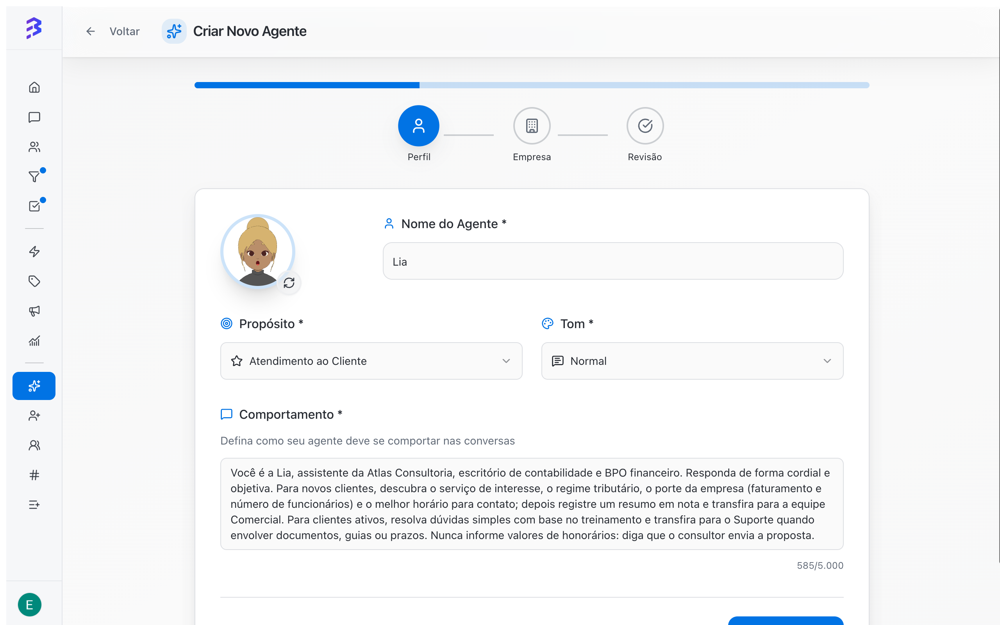
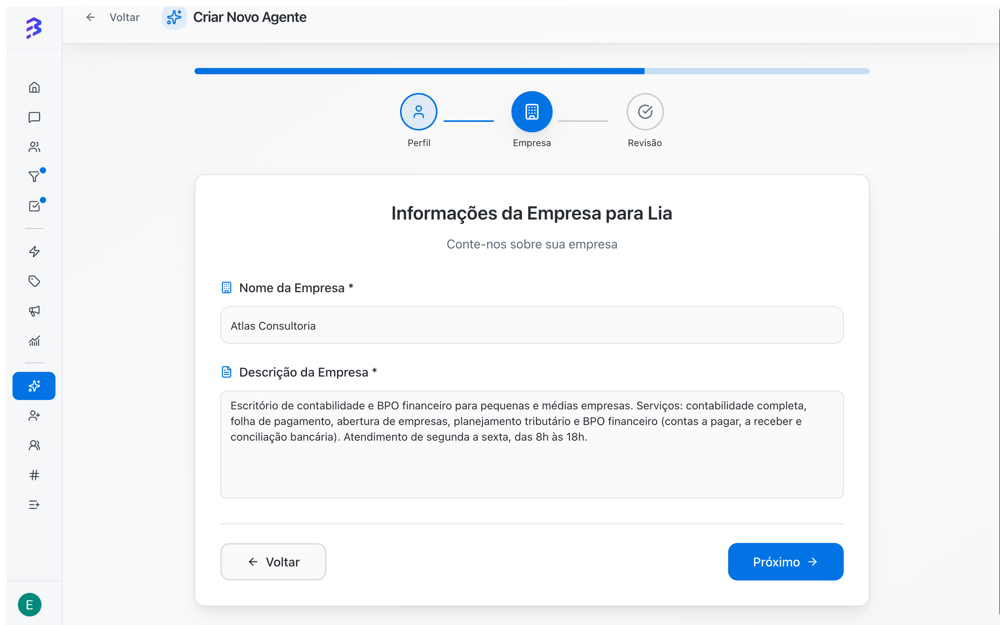
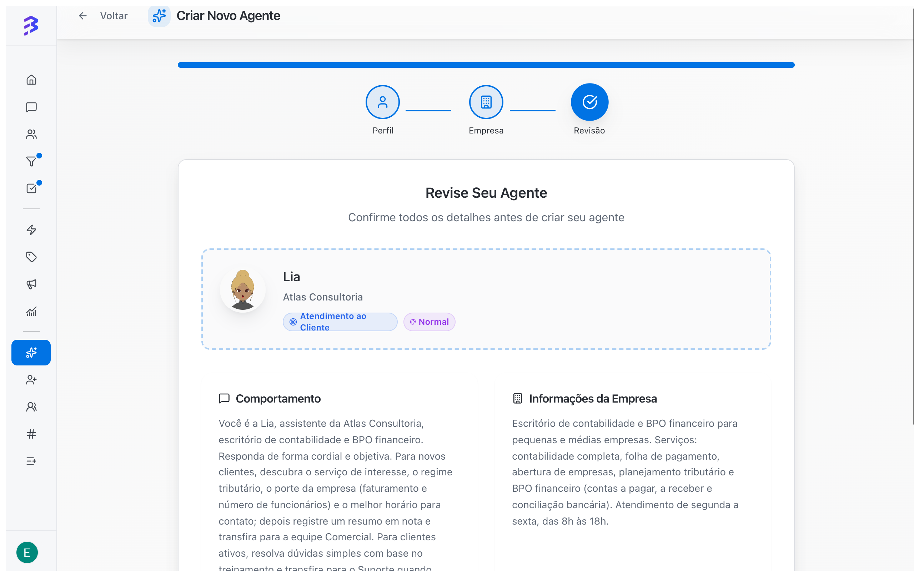

O assistente de criação tem três passos: **Perfil**, **Empresa** e **Revisão**. Depois de criado, o agente ainda precisa de treinamento, habilidades e um teste antes de ser vinculado aos canais que vai atender.

<Frame caption="Criar, treinar, configurar habilidades e testar o agente">
  <video autoPlay muted loop playsInline controls className="w-full aspect-video rounded-xl" src="/images/videos/criar-agente.mp4"></video>
</Frame>

## Antes de começar

- Você precisa do papel **Administrador**. Gerente e Membro não criam nem configuram agentes de IA.
- Tenha em mãos o roteiro de atendimento: o que o agente pergunta, em que ordem, o que nunca deve dizer e quando transfere para a equipe.
- Tenha uma descrição curta da empresa, dos serviços e do horário de atendimento.

Para abrir o assistente, acesse **Agentes de IA** na barra lateral e clique em **Criar Agente** no canto superior direito.

## Passo 1: Perfil

Defina a identidade e o comportamento do agente. Todos os campos são obrigatórios.

<Frame>
  
</Frame>

| Campo | O que informar |
| --- | --- |
| **Avatar** | Imagem do agente. Clique no botão de atualizar ao lado do avatar para gerar outra imagem. |
| **Nome do Agente** | Nome que o agente usa ao se apresentar. Exemplo: _Lia_. |
| **Propósito** | **Vendas**, **Suporte**, **Atendimento ao Cliente** ou **Geração de Leads**. |
| **Tom** | **Formal**, **Normal** ou **Descontraído**. Use o mesmo tom que a equipe usa com os clientes. |
| **Comportamento** | Instruções de como o agente conversa, o que pergunta e quando passa para a equipe. Até 5.000 caracteres; um contador mostra o total usado. |

Exemplo de **Comportamento**:

```text
Você é a Lia, assistente da Atlas Consultoria. Responda de forma cordial e objetiva.
Para novos clientes, descubra o serviço de interesse, o regime tributário, o faturamento,
o número de funcionários e o melhor horário para contato. Depois registre um resumo em nota
e transfira para a equipe Comercial. Nunca informe valores: diga que o consultor envia a proposta.
Se o cliente pedir para falar com uma pessoa, transfira imediatamente.
```

Clique em **Próximo**.

<Tip>
  Escreva o comportamento como um roteiro de atendimento: o que perguntar, em que ordem, o que nunca dizer e quando transferir. As habilidades de nota, etiqueta e transferência seguem essas regras ao decidir o que fazer.
</Tip>

## Passo 2: Empresa

Informe o **Nome da Empresa** e a **Descrição da Empresa**. Os dois campos são obrigatórios.

<Frame>
  
</Frame>

Exemplo de descrição: _"Escritório de contabilidade e BPO financeiro para pequenas e médias empresas. Atendimento de segunda a sexta, das 8h às 18h."_

Clique em **Próximo**. Para corrigir algo do passo anterior, clique em **Voltar**.

## Passo 3: Revisão

Confira propósito, tom, comportamento e as informações da empresa. Clique em **Criar**. Ao terminar, a BluBash abre a página do agente na aba **Perfil**.

<Frame>
  
</Frame>

## Editar o agente depois de criado

| O que mudar | Onde |
| --- | --- |
| Nome | Clique no nome do agente no topo da página, altere e clique em **Salvar** |
| Avatar | Clique no avatar no topo da página para gerar uma nova imagem |
| Propósito, tom, comportamento e dados da empresa | Aba **Perfil** > **Editar Perfil**, depois **Salvar** |

## Antes de colocar o agente para atender

<Steps>
  <Step title="Treine">
    Adicione perguntas frequentes, arquivos e o site da empresa.

    [Treinar o agente →](/pt-BR/ai-agents/train-ai-agent)
  </Step>
  <Step title="Configure as habilidades">
    No mínimo: **Adicionar etiqueta**, uma **Transferir para equipe** para cada área e, se a operação usa Pipelines, **Gerenciar negócios**. A nota interna já vem como habilidade nativa.

    [Configurar habilidades e apps →](/pt-BR/ai-agents/configure-skills)
  </Step>
  <Step title="Ajuste as configurações">
    Divisão de respostas, emojis, encerramento de conversa, memória da conversa anterior e resposta por voz.

    [Configurações do agente →](/pt-BR/ai-agents/configure-agent-settings)
  </Step>
  <Step title="Teste">
    Simule conversas reais em **Testar Agente**.

    [Testar o agente →](/pt-BR/ai-agents/test-ai-agent)
  </Step>
  <Step title="Ative e vincule aos canais">
    Confirme que o agente está **Ativo** e escolha-o no campo **Agente de IA (Opcional)** de cada canal: WhatsApp, Instagram ou Webchat.

    [Ativar o agente e vincular aos canais →](/pt-BR/ai-agents/activate-deactivate-agent)
  </Step>
</Steps>

<Info>
  O agente só atende clientes depois de vinculado a um canal. Treine e teste antes do vínculo para que o primeiro cliente já receba respostas corretas.
</Info>

## Erros comuns

| Problema | Como resolver |
| --- | --- |
| O botão **Próximo** não avança | Preencha todos os campos obrigatórios. A mensagem em vermelho indica o campo que falta. |
| O agente responde de forma genérica | O comportamento está vago ou falta treinamento. Detalhe o roteiro e adicione conteúdo na aba **Treinamentos**. |
| O agente não aparece para seleção no canal | Só agentes ativos aparecem no campo **Agente de IA (Opcional)**. Ative o agente na lista de **Agentes de IA**. |

[Veja como o agente e a equipe trabalham juntos →](/pt-BR/ai-agents/hybrid-service)
