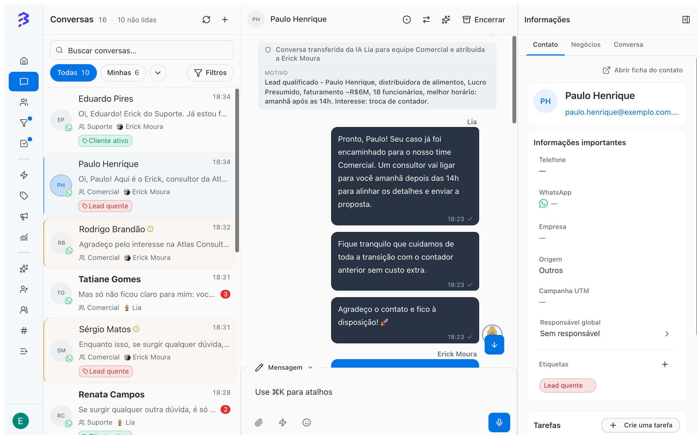
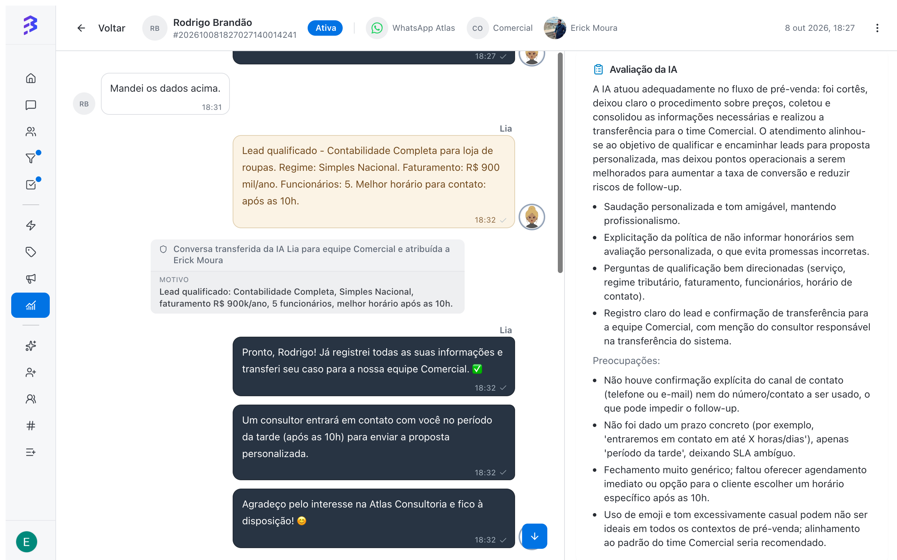

Na BluBash, o agente de IA e a equipe atendem juntos. O agente responde na hora, a qualquer horário, resolve o que é rotina e organiza a conversa. A equipe assume quando a conversa exige negociação, análise ou decisão, já com o contexto registrado.

O atendimento híbrido funciona em todos os canais em que o agente está vinculado: WhatsApp, Instagram e Webchat.

<Frame caption="O fluxo híbrido completo, da primeira mensagem ao Pipeline">
  <video autoPlay muted loop playsInline controls className="w-full aspect-video rounded-xl" src="/images/videos/atendimento-hibrido.mp4"></video>
</Frame>

## Como funciona, passo a passo

<Steps>
  <Step title="O cliente envia uma mensagem">
    A mensagem chega a um canal (um número de WhatsApp, o Direct do Instagram ou o Webchat do site). O agente de IA vinculado a esse canal responde em segundos, usando o conteúdo dos **Treinamentos**.
  </Step>

  <Step title="O agente resolve ou qualifica">
    Dúvidas frequentes (prazos, documentos, horários, procedimentos) são resolvidas pelo próprio agente. Para um novo cliente, ele faz as perguntas de qualificação definidas no **Comportamento**.
  </Step>

  <Step title="O agente registra e organiza">
    Com as **Habilidades**, o agente adiciona uma nota com o resumo do que foi levantado e aplica etiquetas como **Lead quente** ou **Cliente ativo**. Com a habilidade nativa **Atualizar contato** ativada, ele também atualiza nome, e-mail e campos do contato. Com **Gerenciar negócios**, abre o negócio no pipeline e o move de etapa conforme a qualificação avança.
  </Step>

  <Step title="O agente transfere para a equipe certa">
    Quando a conversa precisa de uma pessoa, o agente executa a habilidade **Transferir para Equipe** configurada para aquela situação (por exemplo, **Comercial** ou **Suporte**). O motivo da transferência fica registrado na conversa.
  </Step>

  <Step title="A equipe assume com o contexto pronto">
    A conversa entra na equipe conforme a distribuição configurada (Rodízio, Disponível ou Fila). O atendente lê a nota, cria o negócio no Pipeline pela própria conversa e segue a negociação.
  </Step>

  <Step title="A conversa pode voltar para a IA">
    Quando a parte humana termina, o atendente usa **Transferir para IA** para devolver a conversa ao agente, que coleta documentos, confirma dados ou encerra o atendimento.
  </Step>
</Steps>

## Exemplo real: escritório de contabilidade

Veja como a Lia, agente de IA de um escritório de contabilidade, atende um novo cliente pelo WhatsApp:

| Momento | Quem atua | O que acontece |
| --- | --- | --- |
| 14h02 | Cliente | "Tenho uma distribuidora e quero trocar de contador. Vocês atendem Lucro Presumido?" |
| 14h02 | Agente de IA | Confirma o atendimento, explica a troca e pergunta faturamento, número de funcionários e melhor horário |
| 14h04 | Cliente | Informa R$ 6 milhões por ano, 18 funcionários, contato amanhã depois das 14h |
| 14h04 | Agente de IA | Registra o resumo em nota, aplica a etiqueta **Lead quente** e transfere para **Comercial** |
| 14h05 | Atendente | Lê o resumo, cria o negócio no Pipeline de Vendas e agenda a ligação como tarefa |

<Frame>
  
</Frame>

A nota de transferência fica registrada na conversa, por exemplo:

> Conversa transferida da IA Lia para equipe Comercial pelo motivo: Lead qualificado. Distribuidora de alimentos, Lucro Presumido, faturamento aproximado de R$ 6 milhões, 18 funcionários, melhor horário amanhã após as 14h. Interesse: troca de contador.

O mesmo fluxo vale para um visitante que chama pelo Webchat do site ou para um seguidor que escreve no Direct do Instagram.

## O que deixar com a IA e o que deixar com a equipe

| Agente de IA | Equipe |
| --- | --- |
| Responder dúvidas frequentes a qualquer hora | Negociar valores e condições |
| Coletar dados de qualificação | Analisar casos complexos e exceções |
| Registrar resumos e aplicar etiquetas | Decidir prazos, descontos e prioridades |
| Encaminhar para a equipe certa | Construir relacionamento com clientes estratégicos |
| Coletar documentos depois da negociação | Criar e acompanhar negócios nos Pipelines |
| Encerrar conversas resolvidas | Tratar reclamações e clientes insatisfeitos |

## Configurar o atendimento híbrido

<Steps>
  <Step title="Crie e treine o agente">
    Defina propósito, tom e comportamento e treine com perguntas frequentes, arquivos e o site da empresa.

    [Criar um agente de IA →](/pt-BR/ai-agents/create-ai-agent) · [Treinar o agente →](/pt-BR/ai-agents/train-ai-agent)
  </Step>

  <Step title="Prepare as equipes">
    Cada área que recebe conversas da IA precisa de uma equipe com membros, regra de distribuição e o canal em **Canais da Equipe**.

    [Criar e configurar equipes →](/pt-BR/account-settings/create-configure-teams)
  </Step>

  <Step title="Configure as habilidades">
    No mínimo: **Adicionar Nota** para o resumo, **Adicionar Etiqueta** para classificar e uma **Transferir para Equipe** para cada área.

    [Configurar habilidades →](/pt-BR/ai-agents/configure-skills)
  </Step>

  <Step title="Teste antes de colocar no ar">
    Use **Testar Agente** para simular conversas reais e ver quais habilidades o agente executa.

    [Testar o agente →](/pt-BR/ai-agents/test-ai-agent)
  </Step>

  <Step title="Vincule o agente aos canais">
    Em **Canais**, abra cada canal (WhatsApp, Instagram ou Webchat) e escolha o agente em **Agente de IA (Opcional)**. A partir daí, as novas conversas desse canal começam com o agente.

    [Ativar o agente e vincular aos canais →](/pt-BR/ai-agents/activate-deactivate-agent)
  </Step>
</Steps>

<Tip>
  Inclua o canal em **Canais da Equipe** de cada equipe que recebe conversas da IA. Na habilidade **Transferir para Agente IA** com **Equipe de Destino (Opcional)**, esse acesso é obrigatório para a troca de equipe acontecer.
</Tip>

## Acompanhe os resultados

No **Relatório de conversas**, o gráfico **Total de conversas ao longo do tempo** separa as conversas em **Sem responsável**, **Só humanos**, **Só agentes de IA** e **Híbrido (humano + IA)**. Use o gráfico para acompanhar a parte do volume que a IA resolve sozinha e a parte que passa pela equipe. O gráfico **Conversas por canal ao longo do tempo** mostra como o volume se divide entre WhatsApp, Instagram e Webchat.

Na **Visão 360°**, a **Análise de IA** de cada conversa avalia o atendimento do agente e da equipe e traz sugestões de coaching, inclusive para o treinamento do agente.

<Frame>
  
</Frame>

## Próximos passos

- [Transferir conversas para a IA e assumir conversas da IA →](/pt-BR/ai-agents/handoff-to-ai)
- [Relatório de conversas →](/pt-BR/reports/conversations-report)
- [Visão 360° e análise de IA →](/pt-BR/reports/ai-audit)
