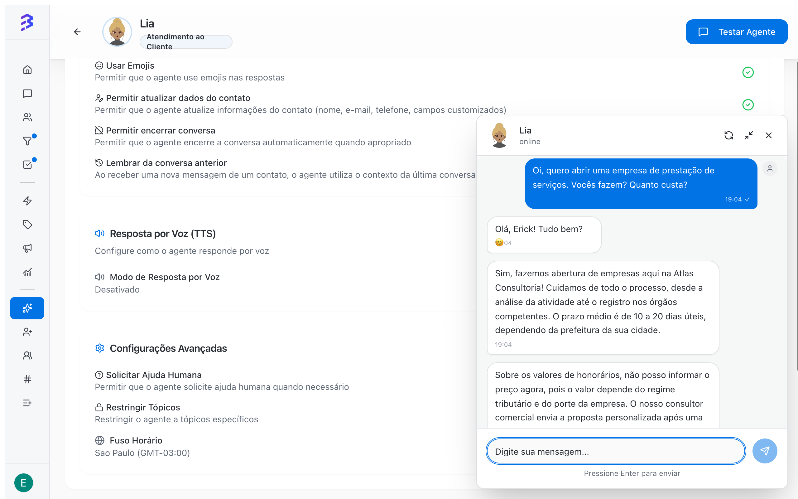

O **Testar Agente** abre um chat em que você conversa com o agente de IA como se fosse um cliente. Ele usa o perfil, os treinamentos, as habilidades, os apps e as configurações salvos no momento do teste. Assim você valida o agente antes de vinculá-lo aos canais e a cada ajuste que fizer depois.

<Frame>
  
</Frame>

## Quando testar

- Antes de vincular o agente pela primeira vez a um canal (WhatsApp, Instagram ou Webchat).
- Depois de adicionar ou editar treinamentos.
- Depois de criar ou alterar habilidades e apps.
- Depois de mudar o **Comportamento**, o tom ou as configurações.
- Quando a **Análise de IA** de uma conversa real apontar uma resposta errada.

## Abrir o chat de teste

<Steps>
  <Step title="Abra o agente">
    Na barra lateral, clique em **Agentes de IA** e depois no agente.
  </Step>
  <Step title="Clique em Testar Agente">
    O botão fica no canto superior direito da página do agente. O chat abre em uma janela flutuante no canto inferior direito da tela.
  </Step>
  <Step title="Envie a primeira mensagem">
    Digite no campo **Digite sua mensagem...** e pressione **Enter**. O cabeçalho mostra **digitando...** enquanto o agente prepara a resposta.
  </Step>
</Steps>

### Controles da janela

| Controle | O que faz |
| --- | --- |
| **Nova conversa** (ícone de atualizar) | Descarta o histórico do teste e começa uma conversa nova, como um cliente que chega pela primeira vez |
| Minimizar e maximizar | Reduz a janela sem perder a conversa. Você pode navegar pelas abas do agente e voltar ao teste. |
| Fechar | Fecha a janela de teste |

<Tip>
  Mantenha a janela minimizada enquanto ajusta treinamentos ou habilidades em outra aba do agente. Depois de salvar o ajuste, clique em **Nova conversa** e repita a pergunta.
</Tip>

## Ver as habilidades executadas

Quando o agente executa uma habilidade, a resposta mostra um cartão **Habilidade Executada** com:

- **Nome da Habilidade**: a habilidade ou ferramenta de app usada.
- **Parâmetros**: os dados que o agente enviou, como a etiqueta aplicada, a equipe de destino, o negócio criado ou movido no pipeline, ou os campos de uma chamada de API externa.
- Selo **Simulação**: aparece quando a ação foi apenas simulada no teste.

O cartão aparece só no chat de teste. Os clientes nunca veem esses detalhes.

Se o agente estiver configurado para responder por voz, a resposta chega como áudio e você pode ouvir no próprio chat. O campo de envio do teste aceita apenas texto.

## Roteiro de teste recomendado

### 1. Perguntas frequentes

```text
Qual é o horário de atendimento?
Quais documentos preciso para abrir uma empresa?
Vocês atendem empresas do Lucro Presumido?
```

Esperado: respostas corretas, iguais ao que está nos **Treinamentos**.

### 2. Qualificação e transferência

```text
Tenho uma distribuidora com 18 funcionários e quero trocar de contador.
```

Esperado: o agente faz as perguntas de qualificação do **Comportamento**, registra a nota, aplica a etiqueta e executa **Transferir para Equipe** com a equipe certa.

### 3. Pedido de atendimento humano

```text
Quero falar com uma pessoa.
```

Esperado: o agente transfere sem insistir.

### 4. Pergunta fora do escopo

```text
Qual time ganhou o jogo de ontem?
```

Esperado: o agente volta educadamente para os assuntos do negócio, principalmente com **Restringir Tópicos** ativado.

### 5. Apps e requisições HTTP

```text
Tem horário livre amanhã às 15h?
Pode me mandar a segunda via do boleto?
```

Esperado: o cartão **Habilidade Executada** mostra o app ou a requisição com os parâmetros corretos.

### 6. Atualização de dados do contato

```text
Meu e-mail é joao@empresa.com.br
```

Esperado: com a habilidade nativa **Atualizar contato** ativada, o agente registra o e-mail.

## O que avaliar em cada resposta

| Critério | Pergunta |
| --- | --- |
| **Precisão** | A informação está correta e atualizada? |
| **Relevância** | Responde ao que foi perguntado? |
| **Tom** | Corresponde ao tom configurado (Formal, Normal ou Descontraído)? |
| **Tamanho** | Está adequado para mensagens de chat? Com **Dividir Respostas** ativado, chega em partes curtas? |
| **Ação** | Executou a habilidade certa, no momento certo, com os parâmetros certos? |

## Corrigir o que o teste mostrar

| Problema no teste | Onde ajustar |
| --- | --- |
| Informação errada ou ausente | Aba **Treinamentos**: edite ou adicione conteúdo |
| Habilidade não executada ou executada fora de hora | Aba **Habilidades**: reescreva **Quando Usar** |
| Transferência para a equipe errada | Aba **Habilidades**: confira o campo **Equipe** |
| Tom ou ordem das perguntas inadequados | Aba **Perfil**: ajuste **Tom** e **Comportamento** |
| Respostas longas, emojis ou áudio indesejados | Aba **Configurações** |
| App não responde | Aba **Apps**: clique em **Configurar** e confira a autenticação e as permissões |

Depois de cada ajuste, clique em **Nova conversa** e repita o mesmo teste.

## Teste final no canal

O chat de teste não depende de canal. Depois de aprovar o agente nele, faça uma validação de ponta a ponta em cada canal vinculado:

| Canal | Como testar |
| --- | --- |
| **WhatsApp** | Envie uma mensagem de um celular que não seja o número conectado |
| **Instagram** | Envie uma mensagem no Direct da conta conectada a partir de outro perfil |
| **Webchat** | Abra o site em uma janela anônima e inicie o chat |

Confira em **Conversas** se a conversa foi atendida pelo agente, se as notas e etiquetas foram registradas e se a transferência chegou à equipe certa.

## Erros comuns

| Mensagem ou sintoma | Causa provável |
| --- | --- |
| **Não foi possível criar a conversa** | Falha ao iniciar o teste. Feche a janela e abra de novo. |
| **Erro ao enviar mensagem** | Falha no envio ou limite de gastos de IA atingido. Leia a mensagem exibida e tente novamente. |
| O agente não usa um treinamento novo | O treinamento ainda está **Processando**. Aguarde o status **Treinado**. |

## Próximos passos

- [Ativar o agente e vincular aos canais →](/pt-BR/ai-agents/activate-deactivate-agent)
- [Configurar habilidades e apps →](/pt-BR/ai-agents/configure-skills)
- [Treinar o agente →](/pt-BR/ai-agents/train-ai-agent)
