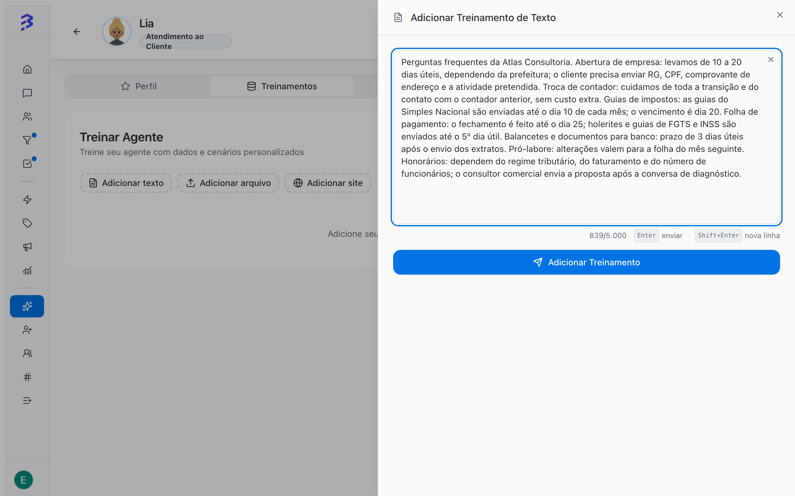

O treinamento é o conteúdo que o agente de IA consulta para responder. Serviços, preços, prazos, documentos exigidos, políticas e perguntas frequentes entram aqui. Quanto mais específico e atualizado o treinamento, mais precisas as respostas em todos os canais em que o agente atende: WhatsApp, Instagram e Webchat.

<Note>
  O treinamento ensina **o que** o agente sabe. **Como** ele conversa (tom, ordem das perguntas, quando transferir) fica no campo **Comportamento** da aba **Perfil**.
</Note>

## Abrir os treinamentos

<Steps>
  <Step title="Abra o agente">
    Na barra lateral, clique em **Agentes de IA** e depois no agente.
  </Step>
  <Step title="Clique na aba Treinamentos">
    A aba mostra a lista de todos os treinamentos do agente e os botões **Adicionar texto**, **Adicionar arquivo** e **Adicionar site**.
  </Step>
</Steps>

## Tipos de treinamento

| Tipo | Botão | Melhor para | Limites |
| --- | --- | --- | --- |
| **Texto** | **Adicionar texto** | Perguntas frequentes, regras curtas, horários, tabelas simples | De 10 a 5.000 caracteres por treinamento |
| **Arquivo** | **Adicionar arquivo** | Manuais, políticas, catálogos, tabelas de preços, planilhas | PDF, DOC, DOCX, TXT, CSV, XLSX, MD, PNG, JPG, JPEG e WEBP; até 50 MB por arquivo |
| **Web** | **Adicionar site** | Páginas públicas do site, central de ajuda, páginas de serviço | Uma URL por treinamento; com subpáginas, até 2 níveis e 100 páginas |

## Adicionar um treinamento de texto

<Frame>
  
</Frame>

<Steps>
  <Step title="Clique em Adicionar texto">
    O painel **Adicionar Treinamento de Texto** abre ao lado.
  </Step>
  <Step title="Escreva o conteúdo">
    Preencha o campo **Conteúdo**. O contador mostra quantos caracteres você usou do limite de 5.000.
  </Step>
  <Step title="Clique em Adicionar Treinamento">
    A BluBash gera um título automaticamente com base no conteúdo e inicia o processamento.
  </Step>
</Steps>

Exemplo de bom treinamento de texto:

```text
Horário de atendimento: segunda a sexta, das 8h às 18h. Não abrimos aos sábados.
Abertura de empresa: prazo médio de 15 dias úteis após o envio de todos os documentos.
Documentos para abertura: RG e CPF dos sócios, comprovante de endereço e IPTU do imóvel.
Troca de contador: não há custo de migração. O cliente assina o contrato e nós cuidamos da transição.
```

<Tip>
  Separe o conteúdo por assunto: um treinamento para horários e contatos, outro para cada serviço, outro para políticas. Fica mais fácil revisar e atualizar.
</Tip>

## Adicionar um arquivo

<Steps>
  <Step title="Clique em Adicionar arquivo">
    O painel **Adicionar Treinamento de Arquivo** abre ao lado.
  </Step>
  <Step title="Selecione o arquivo">
    Arraste o arquivo para a área indicada ou clique para selecionar. O envio começa assim que você escolhe um arquivo válido e mostra o progresso em porcentagem.
  </Step>
  <Step title="Aguarde o processamento">
    Depois do envio, a BluBash extrai o conteúdo do arquivo. O treinamento aparece na lista com o status **Processando** até terminar.
  </Step>
</Steps>

Formatos aceitos: PDF, DOC, DOCX, TXT, CSV, XLSX, MD, PNG, JPG, JPEG e WEBP. Arquivos acima de 50 MB ou em outro formato são recusados antes do envio, com a mensagem **Arquivo muito grande (máx. 50 MB)** ou um aviso de formato não suportado.

Ao abrir um treinamento de arquivo, você vê **Nome original**, **Tipo do arquivo**, **Caracteres extraídos**, **Treinamentos gerados** e **Processado em**. Use **Caracteres extraídos** para confirmar que o conteúdo foi lido: um PDF escaneado sem texto ou uma imagem ilegível gera pouco ou nenhum conteúdo.

## Adicionar o site

<Steps>
  <Step title="Clique em Adicionar site">
    O painel **Adicionar Treinamento Web** abre ao lado.
  </Step>
  <Step title="Informe a URL do site">
    Cole o endereço em **URL do Site**. Se você não digitar `https://`, a BluBash completa automaticamente. A borda verde indica uma URL válida.
  </Step>
  <Step title="Decida sobre as subpáginas">
    Ative **Incluir Subpáginas** para incluir também até 2 níveis de páginas relacionadas, com máximo de 100 páginas. Deixe desativado para treinar só a página informada.
  </Step>
  <Step title="Clique em Adicionar Site">
    O treinamento entra na lista como **Processando**. Ao terminar, o detalhe mostra **Páginas indexadas** e **Treinamentos gerados**.
  </Step>
</Steps>

<Warning>
  Só páginas públicas podem ser lidas. Páginas que exigem login, áreas restritas ou conteúdo carregado apenas depois de uma ação do usuário não entram no treinamento. Se o site for muito grande, o processamento pode atingir o limite de tempo; o detalhe do treinamento mostra **Limite de tempo atingido durante o processamento** e quantas páginas foram processadas.
</Warning>

## Status do treinamento

| Status | O que significa | O que fazer |
| --- | --- | --- |
| **Processando** | O conteúdo está sendo lido e preparado | Aguarde. O status é atualizado automaticamente na lista. |
| **Treinado** | O conteúdo já está disponível para o agente | Teste o agente com perguntas sobre esse conteúdo. |
| **Falhou** | O conteúdo não pôde ser processado | Abra o treinamento para ver o erro, corrija a origem (arquivo, URL) e adicione de novo. |

## Gerenciar os treinamentos

A lista reúne todos os tipos. Para encontrar um treinamento, use a busca **Buscar nos treinamentos...** ou o filtro **Tipo** (Texto, Arquivo, Web). Clique em um treinamento para abrir o detalhe.

| Ação | Disponível para | Como |
| --- | --- | --- |
| **Copiar conteúdo** | Texto | Passe o mouse sobre o item e clique no ícone de copiar |
| **Editar conteúdo** | Texto | Clique no ícone de lápis ou em **Editar** no detalhe; salve para reprocessar |
| **Baixar arquivo** | Arquivo | Ícone de download no item ou no detalhe |
| **Abrir site** | Web | Abre a URL treinada em outra aba |
| **Excluir** | Todos | Ícone de lixeira; confirme em **Excluir** |

<Warning>
  Excluir um treinamento é definitivo. O agente deixa de usar aquele conteúdo nas próximas respostas.
</Warning>

## Créditos de IA

Adicionar treinamentos consome créditos de IA. Se não houver créditos suficientes, a aba mostra o aviso **Não foi possível iniciar o treinamento** com o botão **Fazer upgrade**, que leva à página de faturamento.

## Boas práticas

1. **Comece pelo essencial**: serviços, preços ou faixas de preço que podem ser informados, prazos, documentos, horários e contatos.
2. **Seja específico**: "prazo de 15 dias úteis" é melhor que "prazo rápido".
3. **Evite contradições**: se uma informação mudou, edite ou exclua o treinamento antigo em vez de adicionar outro com o dado novo.
4. **Use o formato certo**: texto para regras e perguntas frequentes, arquivo para material longo, site para conteúdo que já está publicado.
5. **Teste depois de cada mudança**: pergunte no **Testar Agente** exatamente o que o cliente perguntaria.
6. **Revise com dados reais**: use a **Análise de IA** das conversas para encontrar perguntas que o agente não soube responder e transforme-as em novos treinamentos.

## Erros comuns

| Problema | Causa provável | Solução |
| --- | --- | --- |
| O agente inventa ou generaliza | Falta conteúdo sobre o assunto | Adicione um treinamento de texto específico |
| O agente usa um preço antigo | Treinamento desatualizado continua na lista | Edite ou exclua o treinamento antigo |
| Arquivo com poucos caracteres extraídos | PDF escaneado ou imagem de baixa qualidade | Envie uma versão com texto selecionável ou transcreva em um treinamento de texto |
| Site com status **Falhou** | Página privada, fora do ar ou URL incorreta | Confira a URL no navegador e tente de novo |

## Próximos passos

- [Configurar habilidades e apps →](/pt-BR/ai-agents/configure-skills)
- [Testar o agente →](/pt-BR/ai-agents/test-ai-agent)
- [Visão 360° e análise de IA →](/pt-BR/reports/ai-audit)
