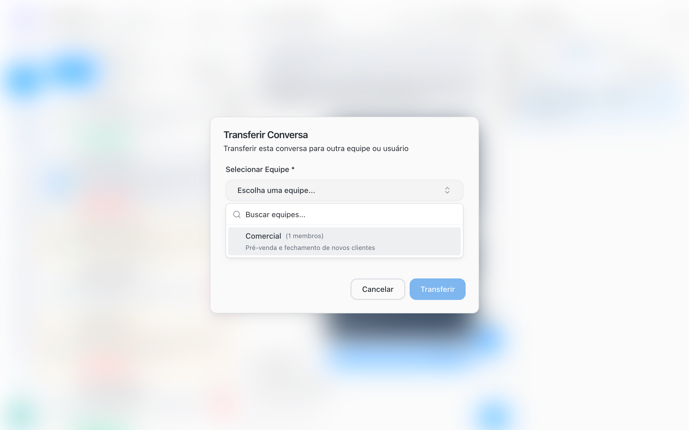
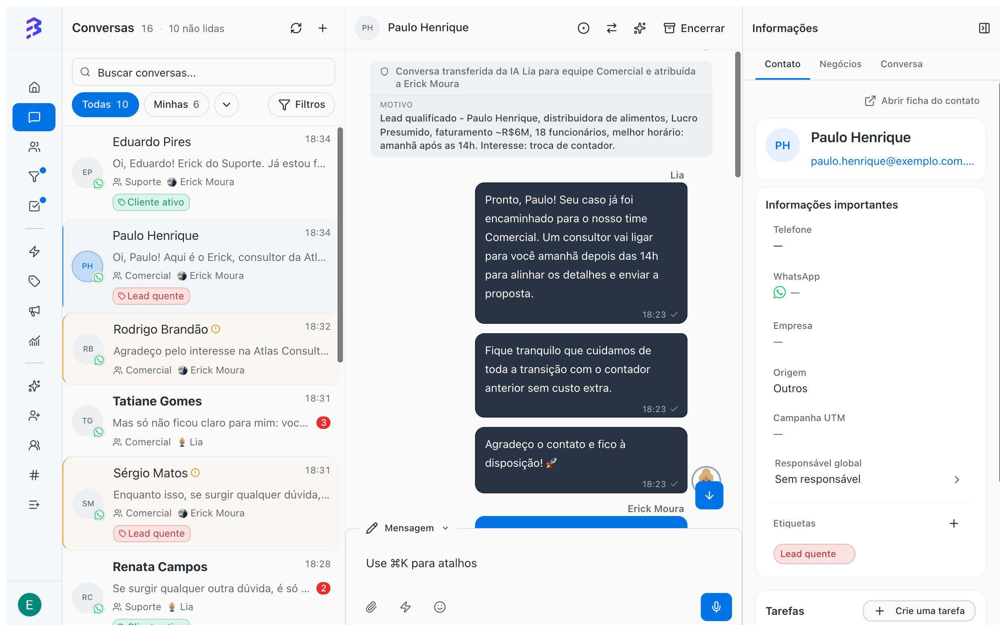

Transferir uma conversa passa o atendimento para quem pode resolver. É comum quando o cliente começa com uma área e precisa de outra: alguém do comercial que precisa de suporte técnico, ou um pedido de nota fiscal que pertence ao financeiro. Na BluBash há três tipos de transferência:

| Tipo | Quem faz | Quando usar |
| --- | --- | --- |
| **Para outra equipe ou atendente** | O atendente, pelo botão **Transferir** | O assunto pertence a outra área ou a outra pessoa. |
| **Para um agente de IA** | O atendente, pelo botão **Transferir para IA** | A parte humana terminou e a IA pode continuar, por exemplo para coletar dados ou encerrar. |
| **Da IA para a equipe** | O agente de IA, pela habilidade **Transferir para Equipe** | O cliente precisa de negociação, decisão ou atendimento humano. |

## Transferir para outra equipe ou atendente

<Frame>
  
</Frame>

<Steps>
  <Step title="Abra a conversa">
    Em **Conversas**, abra a conversa que você quer transferir.
  </Step>
  <Step title="Clique em Transferir">
    O botão com duas setas fica no topo da conversa. Ao passar o mouse, aparece **Transferir**. A janela **Transferir Conversa** é aberta.
  </Step>
  <Step title="Escolha a equipe">
    Em **Selecionar Equipe**, escolha a equipe de destino. O campo é obrigatório e mostra quantos membros cada equipe tem.
  </Step>
  <Step title="Escolha o atendente (opcional)">
    Em **Selecionar Usuário**, escolha uma pessoa da equipe. Para deixar a conversa com a equipe, sem pessoa definida, escolha **Nenhum usuário específico** (**Transferir apenas para a equipe**).
  </Step>
  <Step title="Informe o motivo (opcional)">
    Em **Motivo**, responda **Por que você está transferindo esta conversa?**. O motivo é interno: o contato não recebe esse texto.
  </Step>
  <Step title="Clique em Transferir">
    A conversa sai do seu atendimento e aparece para quem recebeu.
  </Step>
</Steps>

### O que acontece depois

- A conversa fica com o status **Transferida**.
- Se você escolheu uma pessoa, ela vê a conversa destacada com **Transferida para você - requer atenção**. Para responder, ela clica em **Atribuir a mim**.
- O histórico completo, as notas internas e as etiquetas do contato continuam na conversa.
- O contato não recebe aviso automático da transferência.

<Tip>
  Antes de transferir, deixe uma [nota interna](/pt-BR/conversations/internal-notes) com o resumo do caso e use o campo **Motivo**. Exemplo: "Cliente precisa da segunda via da nota fiscal de setembro. Já confirmei CNPJ e e-mail."
</Tip>

## Devolver a conversa para um agente de IA

Quando a parte humana termina, você pode passar a conversa para um agente de IA continuar.

<Steps>
  <Step title="Clique em Transferir para IA">
    O botão com ícone de brilho fica no topo da conversa, ao lado de **Transferir**.
  </Step>
  <Step title="Escolha o agente">
    A janela lista os agentes de IA ativos. Use **Buscar agentes...** se houver muitos. O agente escolhido aparece com a indicação **Assumirá esta conversa**.
  </Step>
  <Step title="Informe o motivo (opcional)">
    Descreva o que a IA deve continuar, por exemplo "coletar os documentos para a proposta".
  </Step>
  <Step title="Confirme">
    Clique em **Transferir para IA**. A conversa passa a ser conduzida pelo agente, e o campo de mensagem mostra **Agente de IA Ativo**.
  </Step>
</Steps>

<Note>
  Enquanto um agente de IA conduz a conversa, os botões **Transferir** e **Transferir para IA** ficam ocultos. Para transferir para outra equipe, primeiro clique em **Assumir Conversa**.
</Note>

[Transferir para a IA →](/pt-BR/ai-agents/handoff-to-ai)

## Como o agente de IA transfere para a equipe

Com a habilidade **Transferir para Equipe** configurada, o agente transfere a conversa quando identifica a situação que você descreveu, por exemplo "cliente pediu orçamento" ou "cliente quer falar com uma pessoa". A conversa chega à equipe como qualquer transferência, e a habilidade **Adicionar Nota** permite que o agente deixe um resumo antes.

<Frame>
  
</Frame>

[Configurar habilidades →](/pt-BR/ai-agents/configure-skills) · [Atendimento híbrido →](/pt-BR/ai-agents/hybrid-service)

## Boas práticas

- Transfira para uma pessoa quando você sabe quem resolve. Transfira só para a equipe quando qualquer pessoa da área pode atender.
- Escreva o motivo como se quem recebe não soubesse nada do caso.
- Não transfira para "passar adiante" um cliente difícil. Registre a situação em uma nota e envolva o gestor.
- Avise o cliente quando fizer sentido, por exemplo: "Vou passar seu atendimento para o financeiro, que continua com você em instantes."

## Problemas comuns

<AccordionGroup>
  <Accordion title="O botão Transferir não aparece">
    A conversa está com um agente de IA. Clique em **Assumir Conversa** e depois em **Transferir**.
  </Accordion>

  <Accordion title="Aparece Nenhuma equipe disponível para transferência">
    Não há outra equipe disponível para receber a conversa. Peça a um Administrador para revisar as equipes e seus canais.
  </Accordion>

  <Accordion title="Aparece Nenhum agente de IA ativo disponível">
    Nenhum agente de IA está ativo. Um Administrador precisa ativar um agente.

    [Ativar ou desativar um agente →](/pt-BR/ai-agents/activate-deactivate-agent)
  </Accordion>
</AccordionGroup>

## Próximos passos

<CardGroup cols={2}>
  <Card title="Notas internas" icon="sticky-note" href="/pt-BR/conversations/internal-notes">
    Passe contexto para a equipe sem que o cliente veja.
  </Card>

  <Card title="Encerrar uma conversa" icon="circle-check" href="/pt-BR/conversations/close-attendance">
    Finalize o atendimento quando o assunto estiver resolvido.
  </Card>
</CardGroup>
