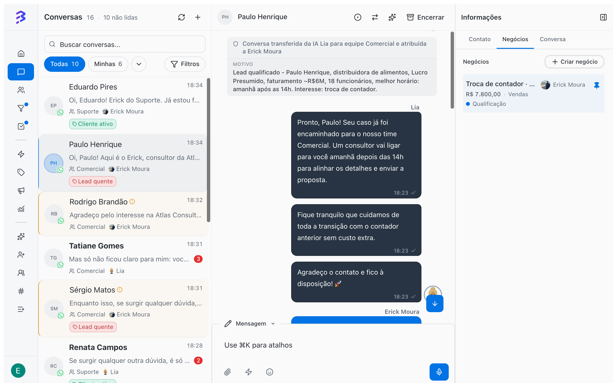

A BluBash é uma plataforma conversacional com CRM integrado e agentes de IA. A conversa é o ponto de partida: ela chega pelo WhatsApp, pelo Instagram ou pelo Webchat, o agente de IA atende, a equipe assume quando precisa, e da conversa nascem os negócios que você acompanha nos Pipelines. Entender a diferença entre esses objetos evita os erros mais comuns de quem vem de outros CRMs.

<Frame>
  
</Frame>

## Os objetos da plataforma

<CardGroup cols={2}>
  <Card title="Contato" icon="user">
    A pessoa ou empresa com quem você fala. Guarda telefone, WhatsApp, e-mail, usuário do Instagram, etiquetas, campos adicionais, responsáveis e todo o histórico.
  </Card>

  <Card title="Conversa" icon="message-circle">
    Um atendimento sobre um assunto, em um canal. Tem equipe, responsável, status e protocolo, e é encerrada quando o assunto termina.
  </Card>

  <Card title="Negócio" icon="briefcase">
    Uma oportunidade ou um processo em andamento com aquele contato. Tem valor, responsável, etapa, tarefas e histórico de movimentações.
  </Card>

  <Card title="Pipeline" icon="kanban">
    A sequência de etapas pela qual um negócio passa. Serve para qualquer processo: vendas, atendimento, implantação, cobrança, processos jurídicos.
  </Card>

  <Card title="Equipe" icon="users">
    Agrupa membros, canais e Pipelines. Define distribuição de conversas, SLA, calendário, regras de encerramento e avaliação de satisfação.
  </Card>

  <Card title="Canal" icon="radio-tower">
    A porta de entrada das conversas: um número de WhatsApp, uma conta do Instagram ou um widget de Webchat. Cada canal tem uma equipe padrão e, se você quiser, um agente de IA.
  </Card>
</CardGroup>

Um mesmo contato pode ter várias conversas ao longo do tempo, em canais diferentes, e vários negócios abertos ao mesmo tempo, cada um em um Pipeline.

## Conversa e negócio medem coisas diferentes

A BluBash usa duas réguas. Misturá-las é a principal causa de relatórios confusos.

| | Conversa | Negócio |
| --- | --- | --- |
| Responde à pergunta | O cliente está sendo bem atendido? | Em que ponto do processo esse cliente está? |
| Onde você acompanha | **Conversas** e **Relatórios e Insights** | **Pipelines** |
| Métricas | Volume, tempo de resolução, SLA, satisfação, qualidade | Etapa, valor, tempo na etapa, ganho ou perda |
| Quando termina | Quando o assunto é resolvido e você encerra | Quando é marcado como ganho ou perdido |

<Tip>
  Para saber quem está sem resposta, use a caixa de entrada de **Conversas**. Para saber quais processos estão parados, use os filtros do **Pipeline**.
</Tip>

## O ciclo de vida de uma conversa

| Status | O que significa |
| --- | --- |
| **Pendente** | A conversa chegou e ainda não foi assumida por um atendente. |
| **Ativa** | Um atendente ou o agente de IA está conduzindo a conversa. |
| **Transferida** | A conversa foi transferida para outra equipe ou atendente e aguarda que alguém a assuma. |
| **Aguardando Avaliação** | A conversa foi encerrada e a pesquisa de satisfação da equipe foi enviada ao contato. |
| **Encerrada** | O assunto foi resolvido. Para falar de novo com o contato, uma nova conversa é criada. |

## Atendimento híbrido: IA e equipe na mesma conversa

Cada conversa pode ter um agente de IA, um atendente ou os dois. Na lista de conversas, um ícone de brilho ao lado do nome indica **Conversa híbrida (usuário + IA)**. Enquanto o agente de IA conduz a conversa, o campo de mensagem mostra **Agente de IA Ativo** e o botão **Assumir Conversa**. Quando o atendente termina, ele pode usar **Transferir para IA** para devolver a conversa.

[Atendimento híbrido →](/pt-BR/ai-agents/hybrid-service)

## Três regras que evitam retrabalho

<AccordionGroup>
  <Accordion title="Derive o negócio em vez de movê-lo para outro Pipeline">
    Quando um processo termina em uma área e começa em outra (por exemplo, a venda fecha e o projeto começa), marque o negócio como **ganho** e deixe a derivação criar um novo negócio no Pipeline da próxima área. O resultado da primeira área fica registrado e o histórico continua disponível. Arrastar o negócio para outro Pipeline tira esse resultado dos relatórios.

    [Configurar a derivação entre Pipelines →](/pt-BR/pipelines/derive-deals)
  </Accordion>

  <Accordion title="Perdido com motivo, nunca uma etapa de descarte">
    "Lead desqualificado" ou "Sem interesse" não são etapas. Marque o negócio como **perdido** e escolha o motivo. Assim você sabe quantos negócios se perdem por cada motivo.

    [Ganho, perdido e motivos →](/pt-BR/pipelines/won-lost-reasons)
  </Accordion>

  <Accordion title="Uma conversa é um assunto">
    Resolveu o que o cliente precisava? Encerre a conversa. Se ele voltar com outro assunto, uma nova conversa começa. Isso mostra quantas vezes cada cliente procurou você e por quê, e mantém corretos o tempo de resolução e o SLA.

    [Quando e como encerrar uma conversa →](/pt-BR/conversations/close-attendance)
  </Accordion>
</AccordionGroup>

## IA desde o primeiro dia, com autonomia crescente

O agente de IA pode atender desde o primeiro dia. O que muda com o tempo é quanto ele faz sozinho.

<Steps>
  <Step title="Início: IA que responde e encaminha">
    O agente responde dúvidas frequentes, coleta os dados básicos, registra uma nota de resumo e transfere para a equipe. A equipe cria os negócios pela conversa.
  </Step>

  <Step title="Operação estável: IA que resolve">
    Com o treinamento ajustado pelas conversas reais, o agente passa a encerrar sozinho os atendimentos de rotina com a habilidade nativa **Encerrar conversa**, e a equipe fica com o que exige decisão.
  </Step>

  <Step title="Operação madura: IA integrada">
    Com **Requisição HTTP** e **Apps**, o agente consulta e atualiza sistemas externos durante a conversa, e a derivação entre Pipelines leva o cliente de uma área para a outra automaticamente.
  </Step>
</Steps>

<Info>
  Acompanhe a evolução no **Relatório de conversas**: o gráfico **Total de conversas ao longo do tempo** separa **Sem responsável**, **Só humanos**, **Só agentes de IA** e **Híbrido**. A **Análise de IA** da Visão 360° mostra a qualidade de cada atendimento.
</Info>

## Próximos passos

<CardGroup cols={2}>
  <Card title="Guia de implementação" icon="rocket" href="/pt-BR/implementation-guide">
    Configure a conta na ordem certa.
  </Card>

  <Card title="Perguntas frequentes" icon="circle-help" href="/pt-BR/faq">
    Dúvidas comuns sobre IA, atendimento, Pipelines e relatórios.
  </Card>
</CardGroup>
