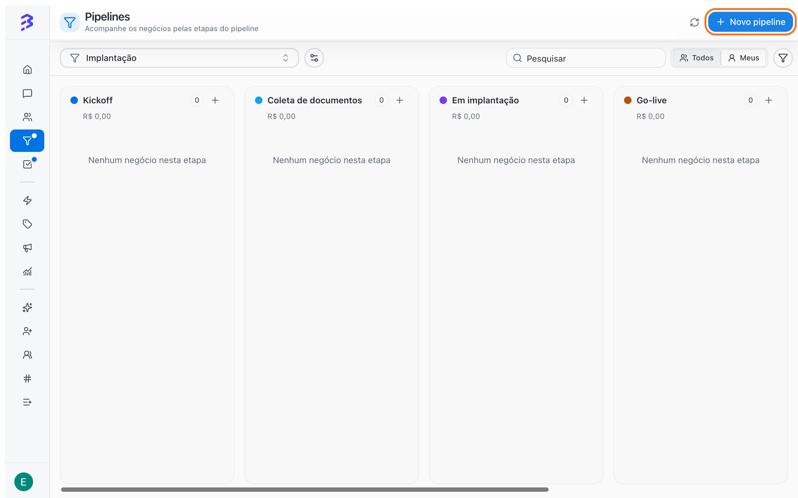
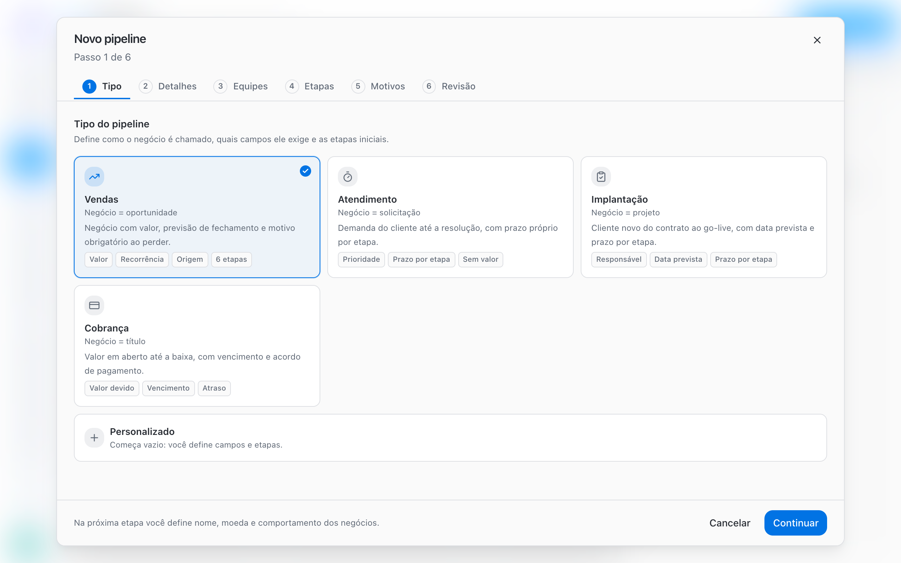
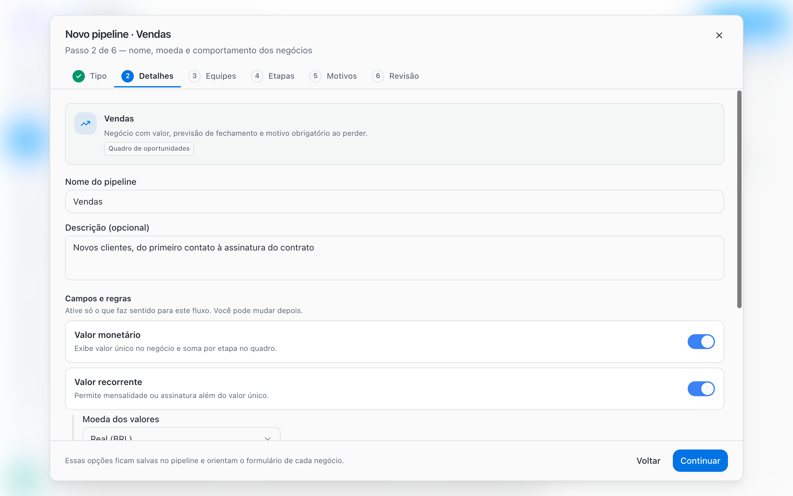
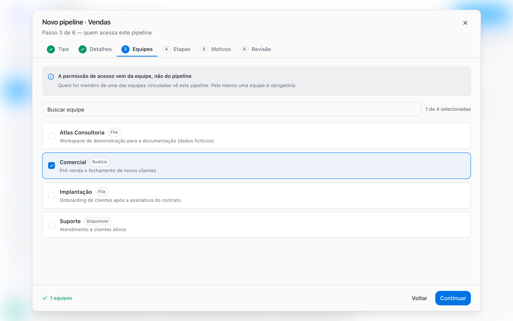
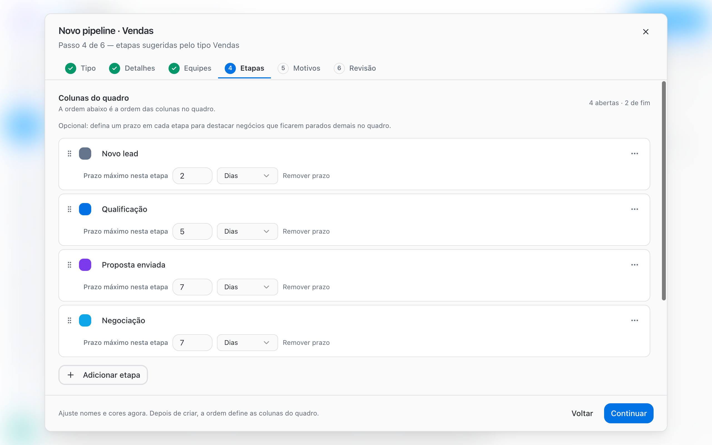
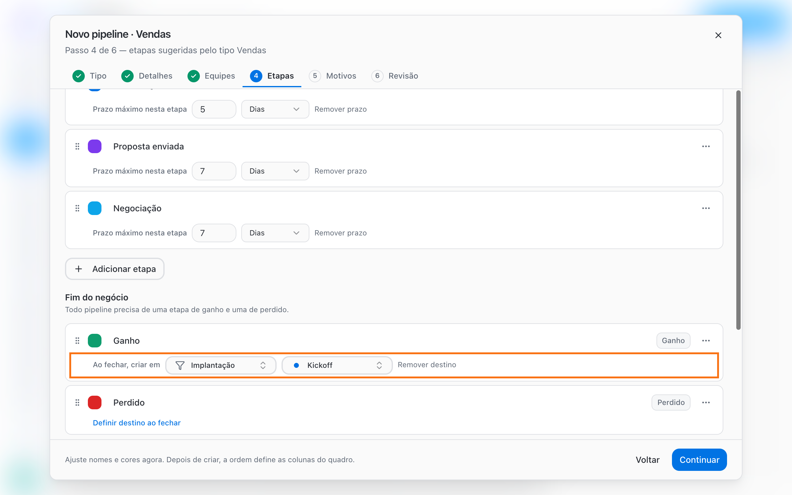
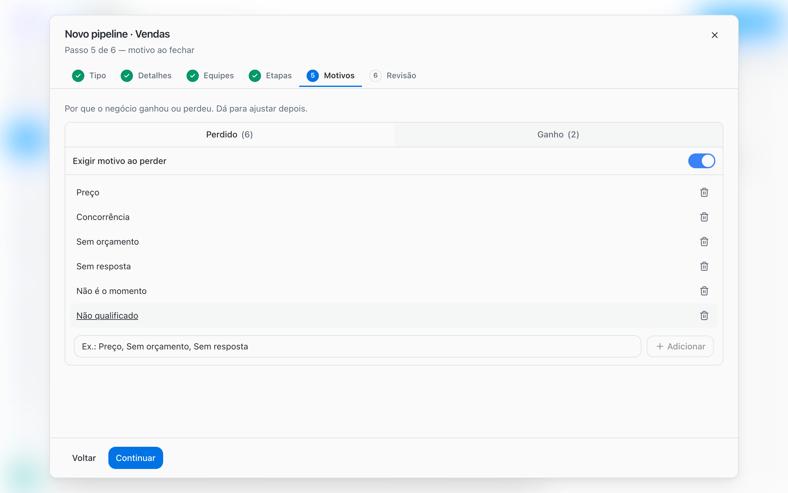
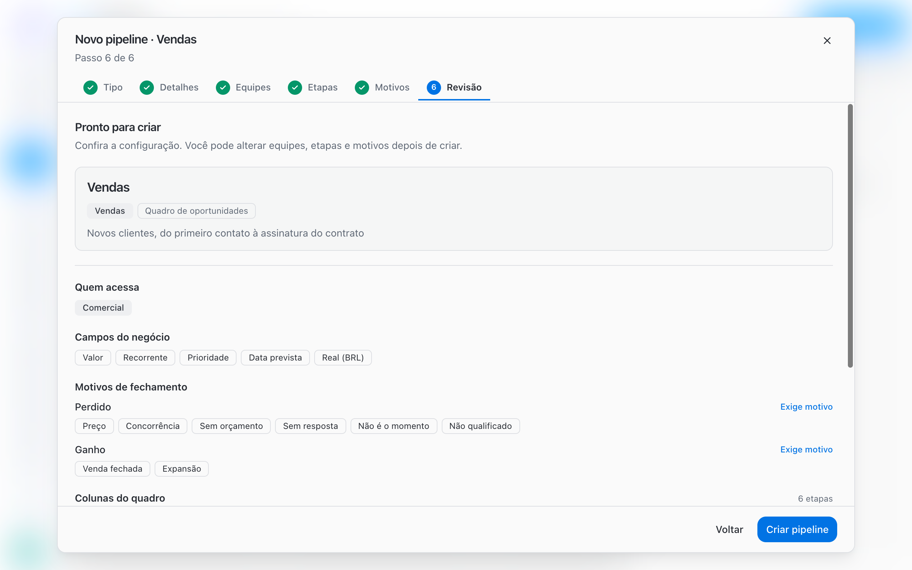

O assistente **Novo pipeline** tem seis passos: **Tipo**, **Detalhes**, **Equipes**, **Etapas**, **Motivos** e **Revisão**. Todas as escolhas podem ser alteradas depois, então você não precisa acertar tudo de primeira.

<Note>
  Criar e editar Pipelines exige o papel **Administrador** ou **Gerente**. Membros usam os Pipelines das suas equipes, mas não veem o botão **Novo pipeline**.
</Note>

## Antes de começar

- Crie as equipes que vão usar o Pipeline. O acesso ao Pipeline vem da equipe. [Criar e configurar equipes →](/pt-BR/account-settings/create-configure-teams)
- Liste as etapas reais do seu processo e o critério para um negócio entrar em cada uma.
- Defina os motivos de ganho e de perda com os nomes que a equipe já usa.

## Passo a passo

Acesse **Pipelines** no menu lateral e clique em **Novo pipeline**.

<Frame>
  
</Frame>

<Steps>
  <Step title="Tipo: escolha um template">
    Em **Tipo do pipeline**, escolha **Vendas**, **Atendimento**, **Implantação**, **Cobrança** ou **Personalizado**. O template define as etapas, os campos e os motivos iniciais. Você ajusta tudo nos próximos passos.

    | Template | O negócio representa | Ponto de partida |
    | --- | --- | --- |
    | **Vendas** | Oportunidade | Valor, recorrência e motivo obrigatório ao perder |
    | **Atendimento** | Solicitação | Prioridade e prazo por etapa, sem valor |
    | **Implantação** | Projeto | Data prevista e prazo por etapa |
    | **Cobrança** | Título | Valor devido e vencimento |
    | **Personalizado** | O que você definir | Começa vazio: você define campos e etapas |

    <Frame>
      
    </Frame>
  </Step>
  <Step title="Detalhes: nome, descrição e campos do negócio">
    Informe o **Nome do pipeline** (obrigatório) e, se quiser, uma **Descrição (opcional)** que explique para que serve e quem usa.

    Em **Campos e regras**, ative apenas o que faz sentido para o processo:

    | Opção | Para que serve |
    | --- | --- |
    | **Valor monetário** | Exibe um valor único no negócio e soma os valores por etapa no quadro |
    | **Valor recorrente** | Permite registrar mensalidade ou assinatura, além do valor único |
    | **Moeda dos valores** | Aparece quando um dos campos de valor está ativo: Real (BRL), Dólar (USD) ou Euro (EUR) |
    | **Prioridade** | Mostra Baixa, Média, Alta ou Urgente em cada negócio |
    | **Data prevista** | Mostra a data de conclusão ou vencimento do negócio |
    | **Campos Adicionais do negócio** | Escolhe quais campos personalizados de negócio do workspace aparecem neste Pipeline. Vazio significa nenhum |

    Se ainda não houver campos de negócio, use **Gerenciar campos do negócio** para criá-los.

    <Frame>
      
    </Frame>
  </Step>
  <Step title="Equipes: defina quem acessa">
    Selecione as equipes que vão usar o Pipeline. A permissão de acesso vem da equipe, não do Pipeline: quem é membro de uma equipe vinculada vê o Pipeline e seus negócios. Pelo menos uma equipe é obrigatória para continuar.

    <Frame>
      
    </Frame>
  </Step>
  <Step title="Etapas: colunas, prazos e destino ao fechar">
    Em **Colunas do quadro**, ajuste nomes, cores e a ordem das etapas. A ordem da lista é a ordem das colunas no quadro. Arraste para reordenar e use **Adicionar etapa** para incluir novas colunas.

    Em cada etapa aberta, clique em **Definir prazo nesta etapa** para informar um **Prazo máximo nesta etapa**, em **Dias** ou **Horas**. Quando um negócio passa desse tempo, o card fica destacado no quadro.

    <Frame>
      
    </Frame>

    Em **Fim do negócio** ficam as etapas de **Ganho** e **Perdido**. Todo Pipeline precisa de pelo menos uma etapa aberta, uma de Ganho e uma de Perdido. Para mudar a natureza de uma etapa, use **Tipo da etapa** no menu da etapa.

    Clique em **Definir destino ao fechar** em uma etapa de fim para que, ao fechar um negócio nela, a BluBash crie automaticamente um negócio em outro Pipeline.

    <Frame>
      
    </Frame>

    [Saiba mais sobre a derivação entre Pipelines →](/pt-BR/pipelines/derive-deals)
  </Step>
  <Step title="Motivos: por que o negócio ganhou ou perdeu">
    Cadastre os motivos de **Ganho** e de **Perdido** com nomes que a equipe já usa no dia a dia. Ative **Exigir motivo ao ganhar** e **Exigir motivo ao perder** para que ninguém feche um negócio sem registrar o motivo. Para exigir, a lista precisa ter pelo menos um motivo.

    <Frame>
      
    </Frame>

    <Tip>
      Inclua **Não qualificado** como motivo de perda. Assim você não precisa de uma etapa de descarte e consegue medir quantos leads não tinham perfil.
    </Tip>
  </Step>
  <Step title="Revisão: confira e crie">
    Em **Pronto para criar**, confira **Quem acessa**, **Colunas do quadro**, **Campos do negócio** e **Motivos de fechamento**. Clique em **Criar pipeline**. A configuração passa a valer no quadro imediatamente.

    <Frame>
      
    </Frame>
  </Step>
</Steps>

## Editar um Pipeline depois de criado

No quadro, clique em **Opções do pipeline**, ao lado do seletor de Pipeline:

| Opção | O que faz |
| --- | --- |
| **Editar pipeline** | Abre a configuração com as abas **Geral**, **Equipes**, **Etapas**, **Motivos** e **Excluir** |
| **Gerenciar etapas** | Abre direto a aba de etapas, para renomear, reordenar, definir prazos e destinos |
| **Reordenar pipelines** | Define a ordem dos Pipelines no seletor |
| **Excluir pipeline** | Remove o Pipeline do workspace |

Salve com **Salvar alterações** ou, na aba de etapas, com **Salvar etapas**.

## Limitações e cuidados

- **Excluir uma etapa com negócios**: a BluBash pede uma etapa aberta de destino e move os negócios antes de excluir (**Mover e excluir**). Etapas de Ganho ou Perdido não podem receber esses negócios.
- **Excluir um Pipeline**: só é possível quando não há negócios abertos. Você confirma digitando o nome do Pipeline, e a ação não pode ser desfeita.
- **Desvincular equipes**: se você não faz parte de uma equipe vinculada, só um Administrador pode desvinculá-la.
- **Sem equipe, sem quadro**: um Pipeline só aparece para quem é membro de pelo menos uma equipe vinculada.

## Boas práticas

- Comece por um template e remova o que não usa, em vez de montar tudo do zero.
- Configure prazos apenas nas etapas em que a demora é um problema real, como **Proposta enviada**.
- Revise as etapas depois de duas ou três semanas de uso, com base em onde os negócios ficam parados.

## Próximos passos

<CardGroup cols={2}>
  <Card title="Trabalhar com negócios" icon="briefcase" href="/pt-BR/pipelines/deals">
    Como criar, mover e acompanhar negócios no quadro e na conversa.
  </Card>

  <Card title="Ganho, Perdido e motivos" icon="flag" href="/pt-BR/pipelines/won-lost-reasons">
    Como configurar e usar os motivos de fechamento.
  </Card>
</CardGroup>
