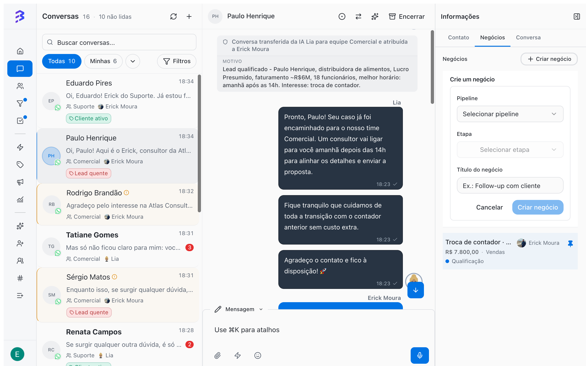
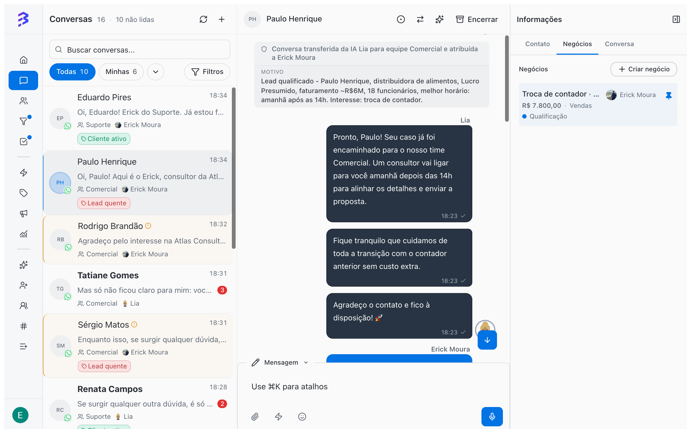
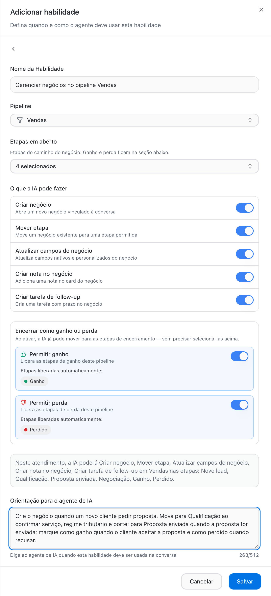
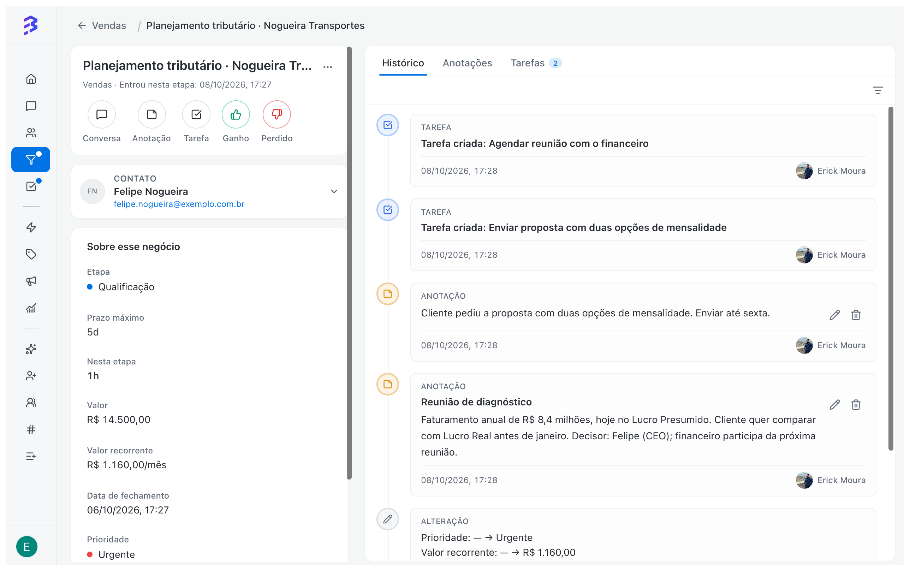

Um negócio representa uma oportunidade ou um processo em andamento com um contato: uma venda, uma implantação, uma solicitação, uma cobrança. Ele fica em uma etapa do Pipeline e guarda valor, responsável, prioridade, datas, anotações, tarefas e todo o histórico de movimentações.

## Criar um negócio

<Tabs>
  <Tab title="Pela conversa (recomendado)">
    Enquanto atende o cliente, abra o painel **Informações** à direita da conversa e vá até a aba **Negócios**.

    1. Clique em **Criar negócio**.
    2. Em **Selecionar pipeline**, escolha o Pipeline. Em **Selecionar etapa**, escolha a etapa em que o cliente está.
    3. Informe o **Título do negócio** e clique em **Criar negócio**.

    O negócio fica vinculado à conversa e você continua atendendo sem trocar de tela.

    <Frame>
      
    </Frame>
  </Tab>
  <Tab title="Pelo quadro">
    No Pipeline, clique em **\+** no topo da coluna da etapa ou em **Negócio** no fim da coluna.

    1. Em **Buscar contato…**, digite ao menos 3 letras do nome ou 4 dígitos do telefone e selecione o contato.
    2. Informe o **Título do negócio**.
    3. Clique em **Criar negócio**.

    Se você criar o negócio direto em uma coluna de **Ganho** ou **Perdido**, a BluBash pede o motivo de fechamento, como em qualquer fechamento.
  </Tab>
</Tabs>

<Frame>
  
</Frame>

### Pelo agente de IA

Com a habilidade **Gerenciar negócios**, o agente de IA cria o negócio sozinho durante a conversa, move de etapa conforme a qualificação avança, atualiza campos, registra notas, cria tarefas de follow-up e pode marcar como ganho ou perdido. Você define em qual Pipeline ele atua, quais etapas pode usar e o que pode fazer.

<Frame>
  
</Frame>

Cada movimentação feita pela IA fica no **Histórico** do negócio, como qualquer outra. [Configurar a habilidade Gerenciar negócios →](/pt-BR/ai-agents/configure-skills#gerenciar-negócios-nos-pipelines)

<Tip>
  Comece com a IA criando o negócio e movendo apenas nas etapas iniciais. Deixe ganho e perda com a equipe até confiar nas decisões do agente.
</Tip>

## Avançar etapas

- **No quadro**: clique e segure o card e arraste para a próxima coluna. Um clique simples abre o negócio.
- **Na ficha do negócio**: altere o campo **Etapa** em **Sobre esse negócio**.

Cada mudança de etapa fica registrada no **Histórico** com data e autor, por exemplo "Negócio movido de Qualificação para Proposta enviada".

Para fechar o negócio, mova para uma etapa de **Ganho** ou **Perdido**. [Veja como funcionam os motivos →](/pt-BR/pipelines/won-lost-reasons)

## O card no quadro

Cada card mostra o título do negócio, o contato, as etiquetas do contato e, conforme os campos ativos no Pipeline, valor, prioridade e vencimento.

| Indicação | Significado |
| --- | --- |
| **Hoje**, **em 3d**, **atrasado 2d** | Situação da data prevista ou de fechamento |
| **tempo 6d / 5d** | Tempo na etapa em relação ao prazo máximo. O card fica destacado quando passa do limite |
| Total no topo da coluna | Soma dos valores dos negócios da etapa, quando **Valor monetário** está ativo |

Colunas com muitos negócios mostram **Mostrando X de Y** e carregam o restante conforme você rola.

## A ficha do negócio

Clique em um card para abrir a ficha. Use **Abrir ficha do negócio** para vê-la em tela cheia e **Voltar ao quadro** para retornar.

<Frame>
  
</Frame>

| Área | O que você encontra |
| --- | --- |
| **Sobre esse negócio** | Pipeline, Etapa, Valor, Valor recorrente e Periodicidade, Responsável, Data de fechamento, Prioridade e Status. Campos vazios ficam recolhidos em **Mostrar N campos vazios** |
| Ações rápidas | **Conversa**, **Anotação**, **Tarefa**, as ações de fechamento e **Contato** |
| **Prazo da etapa** | **Prazo máximo** da etapa, tempo **Nesta etapa** e quando o negócio **Entrou nesta etapa** |
| **Duração do negócio** | Tempo do início ao fechamento |
| **Histórico** | Movimentações, alterações de campos, anotações e tarefas, com filtro **Todos**, **Anotações**, **Alterações** ou **Tarefas** |
| **Anotações** | Registros internos da equipe sobre o negócio |
| **Tarefas** | Próximos passos com prazo, vinculados ao negócio |
| **Mais opções** | **Mover negócio** para outro Pipeline e **Excluir negócio** |

### Ações rápidas

| Ação | O que faz |
| --- | --- |
| **Conversa** | Abre a conversa com o contato |
| **Anotação** | Cria uma anotação no negócio |
| **Tarefa** | Cria uma tarefa vinculada ao negócio |
| Ações de fechamento | Movem o negócio para a etapa de fim. O botão mostra o nome da etapa, como **Ganho** ou **Perdido** no template Vendas. Se o Pipeline tiver mais de uma etapa de Ganho ou de Perdido, o botão vira **Ganhar** ou **Perder** e abre a lista de etapas |
| **Contato** | Abre a ficha do contato |

### Anotações

Use **Anotação** para registrar o que foi combinado em reuniões, objeções e próximos passos. Informe um **Título (opcional)** e o texto e clique em **Criar anotação**. Anotações não são enviadas ao cliente, ficam no histórico do negócio e são visíveis para quem tem acesso ao Pipeline. Você pode editar ou apagar uma anotação depois.

### Tarefas

Use **Tarefa** para agendar o próximo passo: enviar a proposta, ligar para confirmar, cobrar um documento. A tarefa fica vinculada ao negócio e aparece também em **Tarefas**, no menu lateral. Use **Concluir tarefa** quando terminar e **Reabrir tarefa** se precisar voltar.

[Gerenciar tarefas →](/pt-BR/tasks/overview)

## Filtrar o quadro

| Filtro | Uso |
| --- | --- |
| **Todos** / **Meus** | **Meus** mostra só os negócios em que você é o responsável |
| **Responsável** | Negócios de uma pessoa específica (disponível na visão **Todos**) |
| **Etiquetas** | Negócios de contatos com as etiquetas selecionadas, inclusive as aplicadas pelo agente de IA |
| **Prioridade** | Baixa, Média, Alta ou Urgente |
| **Vencimento** | **Qualquer vencimento**, **Atrasados**, **Esta semana** ou **Sem data** |
| **Valor** | Faixa **Mín.** e **Máx.**, aplicada ao valor único ou recorrente |
| **Periodicidade** | Mensal, Trimestral, Semestral ou Anual, para valores recorrentes |
| **Pesquisar** | Busca negócios no Pipeline atual. Digite ao menos 3 letras ou 4 dígitos |

Use **Limpar filtros** para voltar à visão completa.

## Negócios parados

Quando uma etapa tem **Prazo máximo**, o card mostra há quanto tempo o negócio está nela em relação ao prazo e fica destacado quando passa do limite. Combine com o filtro **Vencimento → Atrasados** para revisar diariamente o que precisa de ação.

## Mover para outro Pipeline

Em **Mais opções → Mover negócio**, escolha o **Pipeline de destino** e a **Etapa de destino**. Use para corrigir um negócio criado no Pipeline errado. Para passar o cliente para a próxima área, prefira a [derivação →](/pt-BR/pipelines/derive-deals)

## Excluir um negócio

Em **Mais opções → Excluir negócio**, confirme a exclusão. A ação é permanente: os dados do negócio, as anotações, as tarefas vinculadas e o histórico deixam de ficar disponíveis. Para encerrar um negócio que não avançou, prefira **Perdido** com o motivo.

## Vários negócios para o mesmo contato

Um contato pode ter vários negócios abertos ao mesmo tempo, em Pipelines diferentes, cada um com etapa, valor e responsável próprios. Na conversa, a aba **Negócios** do painel **Informações** lista os negócios do contato aos quais você tem acesso. Na ficha do contato, a aba **Negócios** mostra o mesmo.

## Boas práticas

- Defina um responsável para cada negócio. Negócios sem responsável não aparecem na visão **Meus** de ninguém.
- Registre uma anotação a cada interação importante fora da conversa, como reuniões e ligações.
- Termine cada atualização com uma tarefa: todo negócio aberto deve ter um próximo passo com prazo.

## Próximos passos

<CardGroup cols={2}>
  <Card title="Ganho, Perdido e motivos" icon="flag" href="/pt-BR/pipelines/won-lost-reasons">
    Feche negócios com o motivo registrado.
  </Card>

  <Card title="Tarefas" icon="list-checks" href="/pt-BR/tasks/overview">
    Organize os próximos passos da equipe.
  </Card>
</CardGroup>
