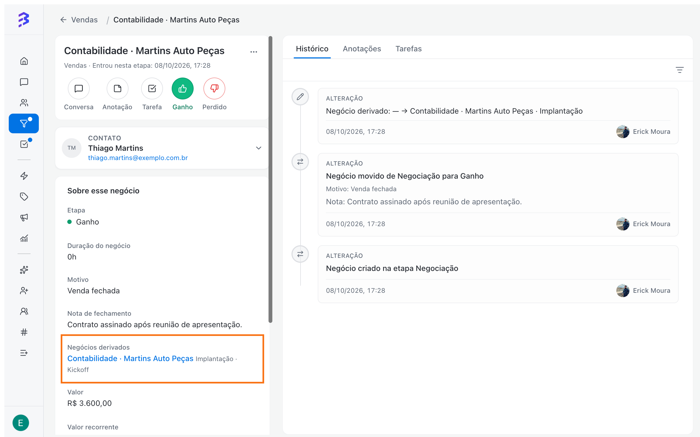
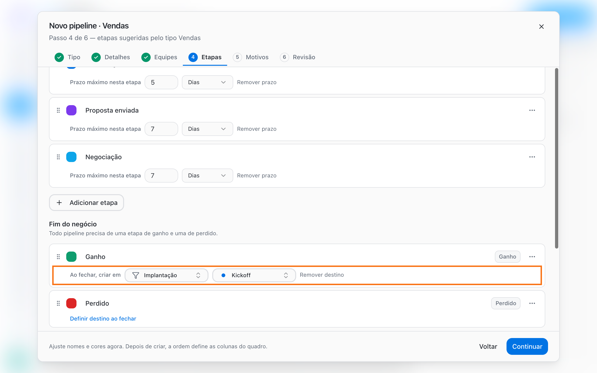

A derivação cria automaticamente um novo negócio em outro Pipeline quando um negócio é fechado. O negócio original fica registrado como **Ganho** (ou **Perdido**) no Pipeline de origem, e o novo negócio nasce no Pipeline da próxima área, com o mesmo contato e ligado à origem.

É a forma recomendada de passar um cliente de uma área para outra: Vendas para Implantação, Comercial para Jurídico, Implantação para Atendimento.

<Frame>
  
</Frame>

## Quando usar

| Situação | Configuração sugerida |
| --- | --- |
| Venda fechada precisa ser implantada | **Ganho** em Vendas cria negócio em Implantação, etapa Kickoff |
| Implantação concluída passa para o acompanhamento | **Concluído** em Implantação cria negócio em Atendimento |
| Cliente perdido deve ser trabalhado depois | **Perdido** em Vendas cria negócio em um Pipeline de reativação |

## Por que derivar em vez de mover

Você também pode mover um negócio para outro Pipeline em **Mais opções → Mover negócio**, mas os dois caminhos têm efeitos diferentes:

|  | Derivar ao fechar | Mover para outro Pipeline |
| --- | --- | --- |
| Pipeline de origem | O negócio fica como **Ganho** ou **Perdido**, com motivo | O negócio sai do Pipeline |
| Resultado da área de origem | Continua registrado | Deixa de aparecer na origem |
| Ligação entre os negócios | **Derivado de** e **Negócios derivados** | Um único negócio que muda de lugar |
| Esforço da equipe | Automático ao fechar | Manual, negócio por negócio |

<Tip>
  Use **Mover negócio** só para corrigir um negócio criado no Pipeline errado. Para passar o cliente para a próxima etapa da jornada, use a derivação.
</Tip>

## Configurar o destino ao fechar

<Note>
  Configurar etapas exige o papel **Administrador** ou **Gerente**. O Pipeline de destino precisa existir antes.
</Note>

<Steps>
  <Step title="Abra as etapas do Pipeline de origem">
    Em **Pipelines**, selecione o Pipeline (por exemplo, Vendas), abra **Opções do pipeline** e escolha **Gerenciar etapas**. Se estiver criando o Pipeline, use o passo **Etapas** do assistente.
  </Step>
  <Step title="Defina o destino na etapa de fim">
    Em **Fim do negócio**, na etapa **Ganho**, clique em **Definir destino ao fechar**. Em **Ao fechar, criar em**, escolha o **Pipeline de destino** e a **Etapa de destino**. O próprio Pipeline não aparece como destino.

    <Frame>
      
    </Frame>
  </Step>
  <Step title="Salve">
    Clique em **Salvar etapas** (ou continue o assistente até **Criar pipeline**). A partir daí, todo negócio que chegar a essa etapa gera o negócio derivado.
  </Step>
</Steps>

Para desligar a derivação, abra a etapa e clique em **Remover destino**.

<Info>
  As etapas de **Perdido** também aceitam um destino. Etapas abertas não têm essa opção.
</Info>

## O que acontece ao fechar um negócio

1. O atendente move o negócio para a etapa de fim (arrastando o card ou usando a ação rápida na ficha do negócio) e escolhe o motivo, se o Pipeline exigir.
2. A BluBash cria o novo negócio no Pipeline e na etapa de destino, com o mesmo contato.
3. Aparece o aviso **Negócio criado em [Pipeline]**, com a opção **Desfazer**. Ao desfazer, o negócio derivado é removido e o original continua fechado.
4. Na ficha do negócio original aparece **Negócios derivados**. Na ficha do novo negócio aparece **Derivado de**, com o link para a origem.

A partir daí, a equipe com acesso ao Pipeline de destino encontra o negócio na etapa configurada e segue o trabalho.

<Warning>
  Se a equipe de destino não tiver acesso ao Pipeline de origem, a ficha do novo negócio mostra apenas **Derivado de outro pipeline**, sem abrir o negócio original nem as anotações dele. Antes de fechar, registre o contexto importante e, depois da derivação, adicione uma anotação no novo negócio com o que a próxima área precisa saber.
</Warning>

## Exemplo: Vendas para Implantação

| Configuração | Valor |
| --- | --- |
| Pipeline de origem | Vendas |
| Etapa | Ganho |
| Pipeline de destino | Implantação |
| Etapa de destino | Kickoff |

Quando o closer marca a venda como ganha, o cliente aparece automaticamente em **Kickoff** no Pipeline de Implantação, e o Pipeline de Vendas continua mostrando a venda fechada. Se a equipe de Implantação usa um agente de IA, ele pode receber o cliente na conversa, pedir os documentos iniciais e transferir para a equipe quando estiver tudo pronto.

## Boas práticas

- Defina um destino só quando todo negócio daquela etapa precisa continuar em outra área. Para casos excepcionais, crie o negócio manualmente na conversa.
- Escolha como destino a primeira etapa do processo da próxima área.
- Use várias etapas de Ganho quando o mesmo Pipeline alimenta áreas diferentes. [Veja como →](/pt-BR/pipelines/won-lost-reasons)

## Próximos passos

<CardGroup cols={2}>
  <Card title="Trabalhar com negócios" icon="briefcase" href="/pt-BR/pipelines/deals">
    Ficha do negócio, anotações e tarefas.
  </Card>

  <Card title="Criar um Pipeline" icon="plus" href="/pt-BR/pipelines/create-pipeline">
    Monte o Pipeline de destino da próxima área.
  </Card>
</CardGroup>
