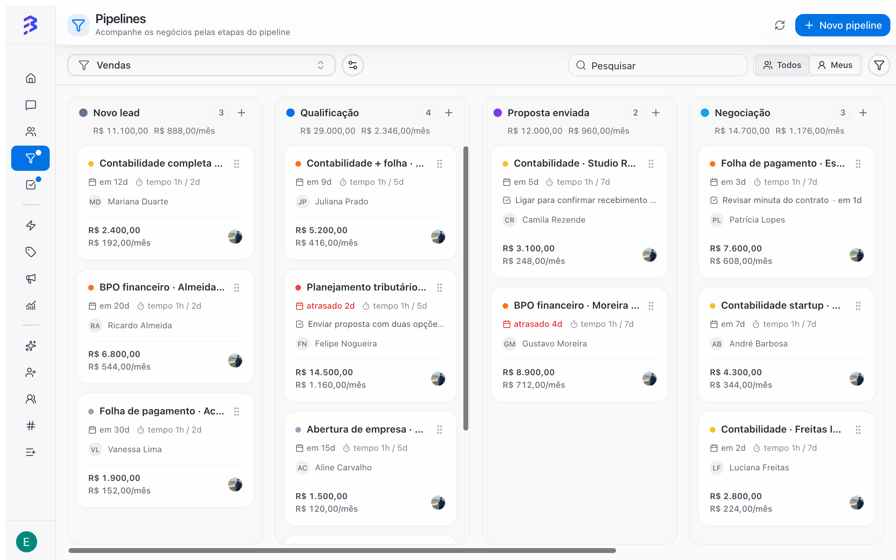

Um Pipeline é um quadro com etapas pelas quais seus negócios passam até terminar como **Ganho** ou **Perdido**. Ele serve para qualquer processo da empresa, não apenas vendas: implantação de clientes, solicitações de suporte, cobrança, processos jurídicos, recrutamento.

Na BluBash, o Pipeline fica ao lado das conversas. O agente de IA atende e qualifica o cliente no WhatsApp, no Instagram ou no Webchat, transfere para a equipe, e a equipe acompanha o restante do processo no quadro.

<Frame caption="Pipeline de Vendas com negócios em cada etapa">
  
</Frame>

<Frame caption="Quadro, filtros, ficha do negócio, motivos e derivação">
  <video autoPlay muted loop playsInline controls className="w-full aspect-video rounded-xl" src="/images/videos/pipelines.mp4"></video>
</Frame>

## Quando usar um Pipeline

Use um Pipeline sempre que o trabalho com um cliente tiver começo, meio e fim e você precisar saber em que ponto cada cliente está. Exemplos:

- **Vendas**: do primeiro contato até a venda fechada ou perdida.
- **Implantação**: do contrato assinado até o go-live.
- **Atendimento**: de uma solicitação aberta até a resolução.
- **Cobrança**: de um título em aberto até o pagamento.

Se a interação termina na própria conversa (uma dúvida respondida pelo agente de IA, por exemplo), não é preciso criar um negócio.

## Como um Pipeline se organiza

<CardGroup cols={2}>
  <Card title="Etapas" icon="columns-3">
    As colunas do quadro. Cada etapa aberta pode ter um prazo máximo. Quando o negócio passa do prazo, o card fica destacado.
  </Card>

  <Card title="Negócios" icon="briefcase">
    Os cards do quadro. Cada negócio pertence a um contato e guarda valor, responsável, prioridade, data de fechamento, anotações, tarefas e histórico.
  </Card>

  <Card title="Ganho e Perdido" icon="flag">
    As etapas de fim. Todo negócio termina em uma delas, com o motivo registrado quando o Pipeline exige.
  </Card>

  <Card title="Equipes" icon="users">
    Quem acessa o Pipeline. A permissão vem da equipe: quem é membro de uma equipe vinculada vê o Pipeline e seus negócios.
  </Card>
</CardGroup>

## Templates prontos

Ao criar um Pipeline, você escolhe um ponto de partida. Os templates são apenas sugestões de etapas, campos e motivos. Tudo pode ser alterado depois.

| Template | O negócio representa | Etapas sugeridas | Campos ativados |
| --- | --- | --- | --- |
| **Vendas** | Uma oportunidade | Novo lead, Qualificação, Proposta enviada, Negociação, Ganho, Perdido | Valor monetário, Valor recorrente, Data prevista, motivo obrigatório ao perder |
| **Atendimento** | Uma solicitação | Aberto, Em atendimento, Aguardando cliente, Resolvido, Cancelado | Prioridade |
| **Implantação** | Um projeto | Kickoff, Em implantação, Go-live, Concluído, Cancelado | Data prevista |
| **Cobrança** | Um título | Em aberto, Negociação, Pago, Inadimplente | Valor monetário, Data prevista |
| **Personalizado** | O que você definir | Novo, Ganho, Perdido | Nenhum |

[Veja o passo a passo da criação →](/pt-BR/pipelines/create-pipeline)

## Conversa e negócio são coisas diferentes

A **conversa** mede o atendimento: quem está sem resposta, quanto tempo o cliente esperou, se ficou satisfeito. O **negócio** mede o processo: em que etapa o cliente está, quanto vale e há quanto tempo está parado.

|  | Conversa | Negócio |
| --- | --- | --- |
| Onde fica | **Conversas** | **Pipelines** |
| Quem participa | Agente de IA e atendentes | Agente de IA, atendentes e gestores |
| Termina quando | A conversa é encerrada | O negócio chega a **Ganho** ou **Perdido** |
| Onde analisar | **Relatórios e Insights** | Quadro do Pipeline, filtros e motivos de fechamento |

No dia a dia, o agente de IA qualifica o cliente na conversa e, com a habilidade **Gerenciar negócios**, cria o negócio e o move pelas etapas do Pipeline sozinho. Quando a conversa exige uma pessoa, ele transfere para a equipe com um resumo, e o atendente segue do ponto em que a IA parou. A equipe também pode criar negócios sem sair da conversa. Um mesmo contato pode ter vários negócios abertos ao mesmo tempo, cada um em um Pipeline.

<Note>
  Você define em qual Pipeline a IA atua, quais etapas ela pode usar e se pode marcar ganho ou perda. [Configurar a habilidade Gerenciar negócios →](/pt-BR/ai-agents/configure-skills#gerenciar-negócios-nos-pipelines)
</Note>

## Quem pode fazer o quê

| Ação | Administrador | Gerente | Membro |
| --- | --- | --- | --- |
| Ver e usar os Pipelines das suas equipes | Sim | Sim | Sim |
| Criar, editar e excluir Pipelines | Sim | Sim | Não |

[Papéis e permissões →](/pt-BR/members/roles-permissions)

## Boas práticas

- Crie um Pipeline por processo, não por pessoa. Use a visão **Meus** para cada atendente ver apenas os próprios negócios.
- Mantenha poucas etapas, cada uma com um critério claro de entrada.
- Não crie etapas de descarte como "Sem interesse". Use **Perdido** com um motivo. [Entenda por quê →](/pt-BR/pipelines/won-lost-reasons)
- Passe o cliente de uma área para outra com a derivação, sem perder o resultado da área de origem.

[Entenda os conceitos da BluBash →](/pt-BR/key-concepts) · [Atendimento híbrido →](/pt-BR/ai-agents/hybrid-service)

## Próximos passos

<CardGroup cols={2}>
  <Card title="Criar um Pipeline" icon="plus" href="/pt-BR/pipelines/create-pipeline">
    Passo a passo do assistente de criação, do template à revisão.
  </Card>

  <Card title="Trabalhar com negócios" icon="briefcase" href="/pt-BR/pipelines/deals">
    Criar, mover, anotar e acompanhar negócios no dia a dia.
  </Card>

  <Card title="Ganho, Perdido e motivos" icon="flag" href="/pt-BR/pipelines/won-lost-reasons">
    Como fechar negócios e por que registrar o motivo.
  </Card>

  <Card title="Derivação entre Pipelines" icon="git-branch" href="/pt-BR/pipelines/derive-deals">
    Passe o negócio para a próxima área sem perder o histórico.
  </Card>
</CardGroup>
