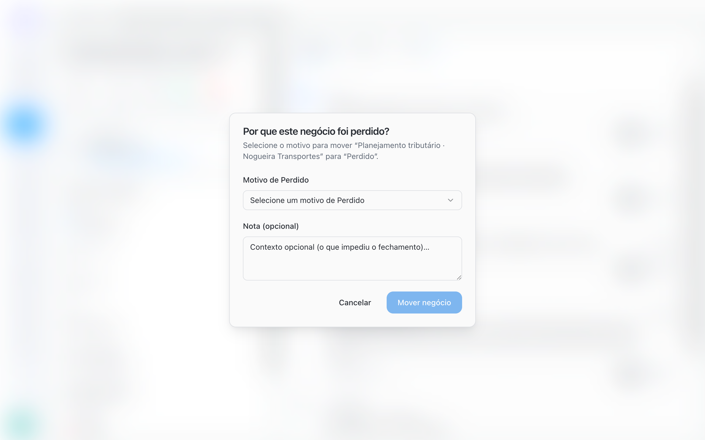
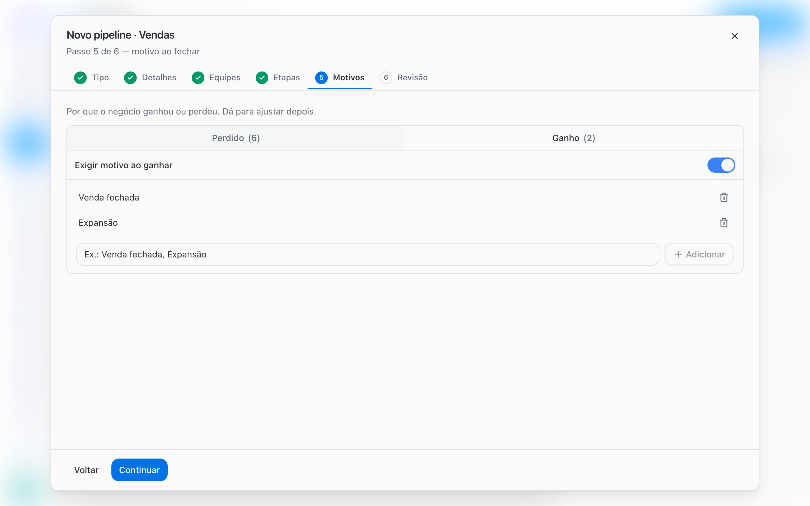

Todo negócio termina em uma etapa de **Ganho** ou de **Perdido**. Ao fechar, a pessoa escolhe o motivo da lista do Pipeline. Esse motivo fica no negócio e mostra o porquê de cada resultado: quantas vendas vieram de expansão, quantas se perderam por preço, quantos leads não tinham perfil.

## Fechar um negócio

Você pode fechar um negócio de três formas:

- **No quadro**: arraste o card até a coluna de **Ganho** ou **Perdido**.
- **Na ficha do negócio**: use as ações rápidas de fechamento. O botão mostra o nome da etapa de fim, como **Ganho** ou **Perdido**.
- **Na ficha do negócio**: altere o campo **Etapa** para uma etapa de fim.

Se o Pipeline exige motivo, a BluBash pergunta **Por que este negócio foi ganho?** ou **Por que este negócio foi perdido?**.

<Steps>
  <Step title="Escolha o motivo">
    Selecione o motivo em **Motivo de Ganho** ou **Motivo de Perdido**.
  </Step>
  <Step title="Explique o contexto">
    Em **Nota (opcional)**, escreva o que fechou o negócio ou o que impediu o fechamento.
  </Step>
  <Step title="Confirme">
    Clique em **Mover negócio**.
  </Step>
</Steps>

<Frame>
  
</Frame>

O motivo e a nota aparecem na ficha do negócio (**Motivo** e **Nota de fechamento**) e no **Histórico**.

<Info>
  Se a lista estiver vazia, a BluBash avisa que ainda não há motivos e indica onde cadastrá-los: **Opções do pipeline → Editar pipeline → Motivos**.
</Info>

## Não crie etapas de descarte

Uma etapa como "Lead desqualificado", "Sem interesse" ou "Descartado" não é uma etapa do processo: é um resultado. Mantê-la como coluna distorce o quadro e esconde o motivo da perda.

<Steps>
  <Step title="Cadastre o motivo">
    Adicione **Não qualificado** (ou o nome que sua equipe usa) aos motivos de **Perdido** do Pipeline.
  </Step>
  <Step title="Feche como Perdido">
    Quando o lead não tiver perfil, mova o negócio para **Perdido** e escolha **Não qualificado**.
  </Step>
  <Step title="Remova a etapa antiga">
    Se o Pipeline tinha uma etapa de descarte, exclua a etapa em **Gerenciar etapas**. A BluBash pede uma etapa aberta para onde mover os negócios dela. Depois, feche esses negócios como **Perdido** com o motivo certo.
  </Step>
</Steps>

<Tip>
  Deixe a triagem inicial com o agente de IA: ele responde os leads fora do perfil e transfere para a equipe apenas quem tem potencial. Assim, os motivos de perda refletem o que acontece depois da qualificação.
</Tip>

## Configurar os motivos de um Pipeline

Abra **Opções do pipeline → Editar pipeline** e vá até a aba **Motivos**. Na criação do Pipeline, a mesma configuração aparece no passo **Motivos**.

| Configuração | O que faz |
| --- | --- |
| Lista de **Ganho** | Motivos exibidos quando o negócio chega a uma etapa de Ganho |
| Lista de **Perdido** | Motivos exibidos quando o negócio chega a uma etapa de Perdido |
| **Adicionar** | Inclui um novo motivo na lista |
| Nome do motivo | Clique no nome para renomear |
| **Excluir motivo** | Remove o motivo da lista |
| **Exigir motivo ao ganhar** | Obriga a escolher um motivo ao ganhar |
| **Exigir motivo ao perder** | Obriga a escolher um motivo ao perder |

Para exigir motivo, a lista correspondente precisa ter pelo menos um motivo ativo. Motivos inativos aparecem com a marcação **inativo**.

<Frame>
  
</Frame>

## Motivos sugeridos pelos templates

| Template | Etapas de fim (Ganho / Perdido) | Motivos de Ganho | Motivos de Perdido |
| --- | --- | --- | --- |
| **Vendas** | Ganho / Perdido | Venda fechada, Expansão | Preço, Concorrência, Sem orçamento, Sem resposta, Não é o momento |
| **Atendimento** | Resolvido / Cancelado | Resolvido | Cancelado pelo cliente, Duplicado, Sem resposta |
| **Implantação** | Concluído / Cancelado | Implantação concluída | Cliente desistiu, Sem engajamento |
| **Cobrança** | Pago / Inadimplente | Pagamento regularizado | Inadimplência, Cancelamento |
| **Personalizado** | Ganho / Perdido | Nenhum | Nenhum |

No template **Vendas**, o motivo já vem obrigatório ao perder. Nos demais, ative a exigência se quiser.

<Tip>
  Use nomes que a equipe já fala no dia a dia e mantenha a lista curta. Entre cinco e oito motivos de perda costumam bastar. Listas longas fazem as pessoas escolherem qualquer opção.
</Tip>

## Mais de uma etapa de Ganho ou Perdido

Um Pipeline pode ter mais de uma etapa de Ganho, cada uma com seu destino. Exemplo em um escritório de advocacia:

| Etapa de Ganho | Destino ao fechar |
| --- | --- |
| Ganho · Dívida | Pipeline Gestão de passivos |
| Ganho · Processo | Pipeline Jurídico |

Para isso, adicione uma etapa, mude o **Tipo da etapa** para **Ganho** e configure o destino de cada uma. Com mais de uma etapa de fim do mesmo tipo, a ação rápida da ficha passa a se chamar **Ganhar** ou **Perder** e abre a lista para você escolher a etapa.

[Configurar a derivação →](/pt-BR/pipelines/derive-deals)

## Erros comuns

| Situação | Causa | Como resolver |
| --- | --- | --- |
| A BluBash não deixa ativar a exigência de motivo | A lista não tem motivo ativo | Adicione pelo menos um motivo à lista |
| O diálogo de motivo não aparece | A exigência está desativada para aquele tipo | Ative **Exigir motivo ao ganhar** ou **Exigir motivo ao perder** |
| Quase todos os negócios perdidos têm o mesmo motivo genérico | A lista tem uma opção vaga, como "Outros" | Troque por motivos específicos e use a nota para o contexto |

## Próximos passos

<CardGroup cols={2}>
  <Card title="Derivação entre Pipelines" icon="git-branch" href="/pt-BR/pipelines/derive-deals">
    Crie o próximo negócio automaticamente ao ganhar.
  </Card>

  <Card title="Trabalhar com negócios" icon="briefcase" href="/pt-BR/pipelines/deals">
    Ficha do negócio, filtros e tarefas.
  </Card>
</CardGroup>
