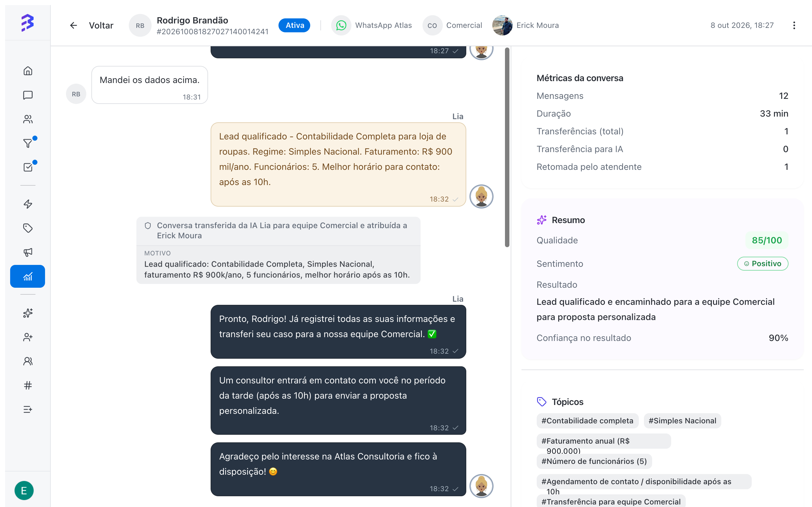
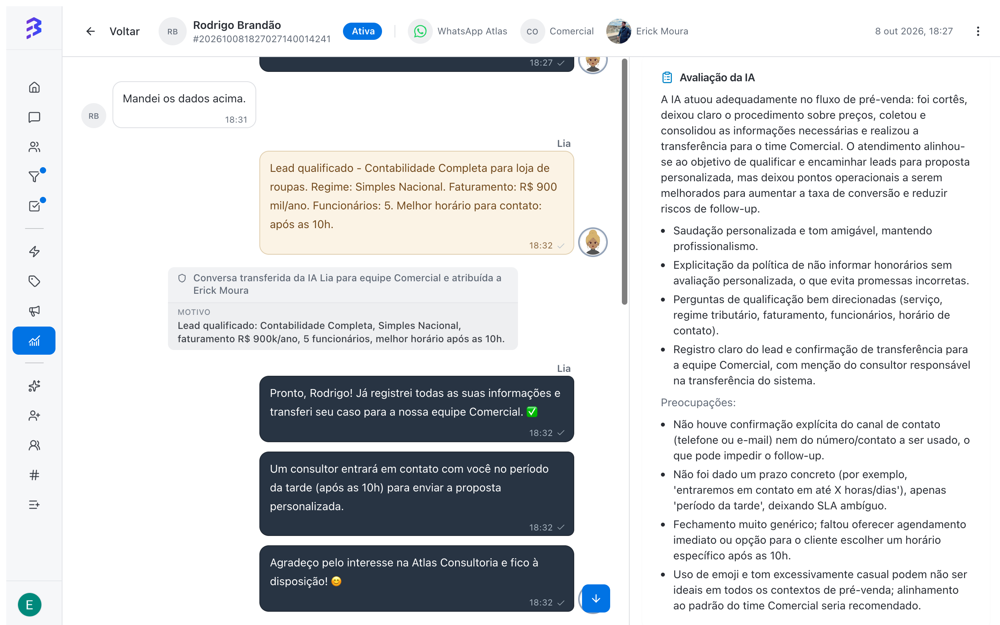

A **Visão 360°** reúne tudo sobre uma conversa em uma tela: as mensagens do cliente, do agente de IA e da equipe, as transferências e as métricas da conversa. A partir dela, gestores geram uma **Análise de IA** que avalia o atendimento, humano ou automatizado, e sugere melhorias.

<Frame>
  
</Frame>

## Quando usar

- Para revisar conversas atendidas só pelo agente de IA e confirmar que ele responde bem.
- Para entender por que uma conversa foi transferida ou terminou com cliente insatisfeito.
- Para preparar conversas de feedback com atendentes, com exemplos concretos.
- Para identificar riscos, como pedidos de dados pessoais sem registro de consentimento.

## Abrir a Visão 360°

<Steps>
  <Step title="Abra o relatório de conversas">
    Em **Relatórios e Insights**, clique em **Ver relatório** no card **Conversas**.
  </Step>
  <Step title="Mude para o modo Detalhado">
    Em **Modo de visualização**, escolha **Detalhado** e use os filtros para encontrar a conversa.
  </Step>
  <Step title="Clique na conversa">
    A Visão 360° abre com a conversa completa. Use **Voltar para lista** para retornar ao relatório.
  </Step>
</Steps>

<Note>
  A Visão 360° está disponível para **Administradores** e para **Gerentes**, nas conversas das equipes de que participam.
</Note>

## Abas da Visão 360°

| Aba | Conteúdo |
| --- | --- |
| **Mensagens** | A conversa completa, com as mensagens do cliente, do agente de IA e da equipe, as transferências e as notas internas |
| **Análise de IA** | As **Métricas da conversa** e a análise gerada pela IA |

### Métricas da conversa

| Métrica | O que mostra |
| --- | --- |
| **Mensagens** | Total de mensagens trocadas |
| **Transferências (total)** | Quantas vezes a conversa mudou de responsável |
| **Transferência para IA** | Transferências da equipe para um agente de IA |
| **Retomada pelo atendente** | Vezes em que um atendente assumiu a conversa que estava com a IA |
| **Duração** | Tempo entre a abertura e o encerramento, ou até agora |
| **Pesquisa de satisfação** | Nota da Avaliação de Satisfação, quando respondida |

## Gerar a análise de IA

Na aba **Análise de IA**, clique em **Gerar análise de IA**. A análise leva alguns instantes (**Analisando…**). Para refazer depois de novas mensagens, use **Gerar nova análise**.

| Item | O que mostra |
| --- | --- |
| **Qualidade** | Nota de 0 a 100, classificada como **Excelente**, **Bom**, **Regular** ou **Ruim** |
| **Sentimento** | **Positivo**, **Negativo**, **Neutro** ou **Misto**, e a **Evolução do sentimento** do início ao fim |
| **Resultado** | O desfecho da conversa, como **Resolvido**, **Não resolvido**, **Escalado**, **Abandonado** ou **Engajamento bem-sucedido**, com a **Confiança no resultado** |
| **Resumo** | O que aconteceu na conversa, em poucas linhas |
| **Tópicos** | Assuntos tratados, como preços, suporte ou vendas |
| **Intenções identificadas** | **Intenção principal** e **Sub-intenções** do cliente |
| **Motivo da transferência** | Por que a conversa passou do agente de IA para a equipe, quando houve transferência |
| **Avaliação da IA** | Como foi o atendimento: pontos positivos e **Preocupações** |
| **Riscos e conformidade** | Se a conversa **Possui riscos** e quais são os pontos de atenção |
| **Sugestões de coaching** | O que a equipe e o agente de IA podem melhorar |

<Frame>
  
</Frame>

## Exemplo: conversa híbrida

Na conversa acima, o agente de IA Lia qualificou um lead de contabilidade e transferiu para a equipe Comercial. A análise deu qualidade 85/100 e sentimento positivo, e apontou duas melhorias: confirmar telefone ou e-mail antes da transferência e informar um prazo concreto de retorno. As duas viram ajustes no treinamento e nas instruções do agente, e as conversas seguintes já saem melhores.

## Do diagnóstico à ação

| O que a análise mostrou | Ação recomendada |
| --- | --- |
| A IA não soube responder um assunto | Adicione o conteúdo ao treinamento do agente de IA |
| A IA transferiu cedo demais | Revise as instruções de transferência e a habilidade **Transferir para Equipe** |
| O atendente demorou ou não deu prazo | Use o caso em uma conversa de feedback e crie uma resposta rápida |
| Risco de conformidade | Revise o roteiro de coleta de dados com a equipe e com o agente de IA |

[Treinar o agente de IA →](/pt-BR/ai-agents/train-ai-agent) · [Configurar habilidades →](/pt-BR/ai-agents/configure-skills)

<Warning>
  A análise de riscos e conformidade é um alerta para revisão do gestor, não um parecer jurídico. Em conversas ainda em andamento, a análise considera apenas o que aconteceu até o momento. Para uma avaliação completa, gere a análise depois do encerramento.
</Warning>

## Boas práticas

- Analise uma amostra semanal de conversas atendidas só pela IA, não apenas as transferidas ou com nota baixa.
- Compare a avaliação da IA com a nota do cliente na Avaliação de Satisfação. Divergências costumam revelar problemas de processo.
- Transforme sugestões recorrentes em treinamento do agente de IA, respostas rápidas ou roteiros da equipe.

## Próximos passos

<CardGroup cols={2}>
  <Card title="Relatório de conversas" icon="messages-square" href="/pt-BR/reports/conversations-report">
    Encontre as conversas para analisar.
  </Card>

  <Card title="Treinar o agente de IA" icon="bot" href="/pt-BR/ai-agents/train-ai-agent">
    Aplique as melhorias apontadas pela análise.
  </Card>
</CardGroup>
