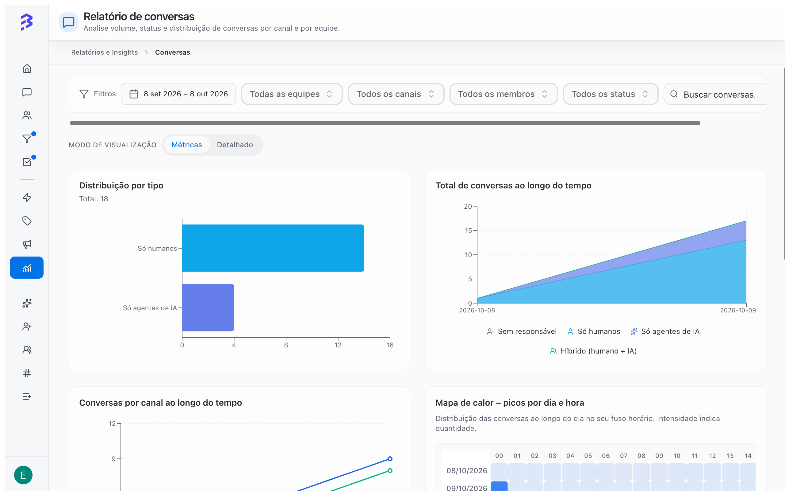
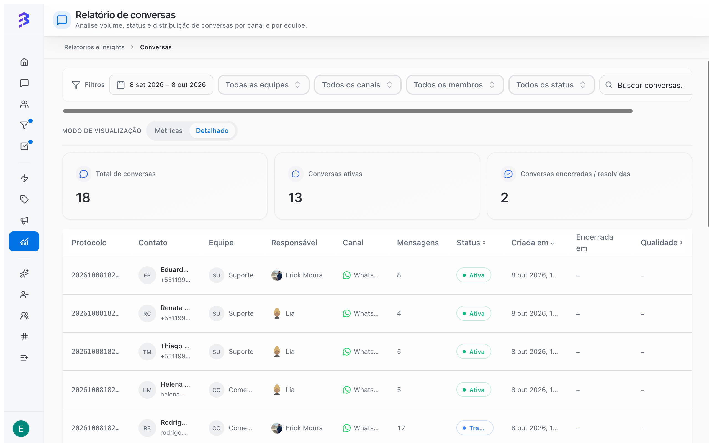

O **Relatório de conversas** responde quantas conversas chegaram, por qual canal, quem atendeu (agente de IA, equipe ou os dois) e em que horários. Ele também é a porta de entrada para a Visão 360° de cada conversa.

Para abrir, acesse **Relatórios e Insights** e clique em **Ver relatório** no card **Conversas**.

<Frame>
  
</Frame>

## Filtros

Os filtros ficam no topo e valem para os dois modos de visualização.

| Filtro | Opções |
| --- | --- |
| **Período** | **Hoje**, **Ontem**, **Últimos 7 dias**, **Últimos 30 dias**, **Últimos 60 dias**, **Últimos 90 dias** ou datas inicial e final |
| **Equipe** | **Todas as equipes** ou uma equipe específica |
| **Canal** | **Todos os canais** ou um canal específico (WhatsApp, Instagram, Webchat e outros) |
| **Membro** | **Todos os membros** ou uma pessoa específica |
| **Status** | **Todos os status** ou um status de conversa |
| Busca | **Buscar conversas...** para encontrar uma conversa específica |

Clique em **Atualizar** para recarregar os dados. Gerentes veem apenas as equipes de que participam e os canais dessas equipes.

## Indicadores do período

| Indicador | O que mostra |
| --- | --- |
| **Total de conversas** | Todas as conversas do período filtrado |
| **Conversas ativas** | Conversas ainda em andamento |
| **Conversas encerradas / resolvidas** | Conversas finalizadas no período |

## Modos de visualização

Use **Modo de visualização** para alternar entre:

- **Métricas**: gráficos e indicadores do período.
- **Detalhado**: tabela com uma linha por conversa.

### Gráficos do modo Métricas

| Gráfico | Para que usar |
| --- | --- |
| **Distribuição por tipo** | Quantas conversas foram **Só humanos**, **Só agentes de IA**, **Híbrido (humano + IA)** ou **Sem responsável** |
| **Total de conversas ao longo do tempo** | Tendência de volume, separada pelos mesmos tipos |
| **Conversas por canal ao longo do tempo** | Qual canal cresce ou cai |
| **Mapa de calor – picos por dia e hora** | Dias e horários com mais conversas, no seu fuso horário. Quanto mais intensa a cor, maior o volume |
| **Ranking de contatos por conversas** | Contatos que mais geraram conversas no período |

### Tabela do modo Detalhado

<Frame>
  
</Frame>

| Coluna | Conteúdo |
| --- | --- |
| **Protocolo** | Número de protocolo da conversa |
| **Contato** | Nome do contato |
| **Equipe** | Equipe da conversa, ou **Sem equipe** |
| **Responsável** | Quem atende: o agente de IA, nas conversas que ele ainda conduz, ou o atendente, nas conversas transferidas |
| **Canal** | Canal de entrada |
| **Mensagens** | Quantidade de mensagens |
| **Status** | Situação atual da conversa |
| **Criada em** e **Encerrada em** | Datas de abertura e encerramento |
| **Qualidade** | Nota da análise de IA, quando gerada |

Clique em uma linha para abrir a **Visão 360°** da conversa. [Visão 360° e análise de IA →](/pt-BR/reports/ai-audit)

## Como ler os tipos de conversa

| Tipo | Significado | O que observar |
| --- | --- | --- |
| **Só agentes de IA** | O agente de IA atendeu do início ao fim | Deve crescer conforme você treina o agente |
| **Híbrido (humano + IA)** | O agente de IA começou e a equipe continuou | Normal em vendas e casos complexos. Veja os motivos das transferências |
| **Só humanos** | Apenas a equipe atendeu | Canais ou equipes sem agente de IA vinculado |
| **Sem responsável** | A conversa chegou e ninguém assumiu | Deve ficar perto de zero |

<Tip>
  Acompanhe a fatia **Só agentes de IA** semana a semana. Se ela não cresce, revise o treinamento do agente com base nas conversas que ele transferiu. Os assuntos que mais chegam à equipe são os candidatos a virar treinamento.
</Tip>

<Tip>
  Use o mapa de calor para ajustar a escala: evite intervalos e reuniões da equipe nos horários de pico. Fora do expediente, o agente de IA garante a primeira resposta.
</Tip>

## Conversas sem responsável

**Sem responsável** indica conversas que chegaram e ficaram na fila sem ninguém assumir. Se o número cresce:

1. Revise o tipo de distribuição da equipe (**Rodízio**, **Disponível** ou **Fila**).
2. Confira quantas pessoas estão disponíveis nos horários de pico.
3. Vincule um agente de IA ao canal para dar a primeira resposta.

[Configurar equipes →](/pt-BR/account-settings/create-configure-teams) · [Transferir atendimento →](/pt-BR/conversations/transfer-attendance)

## Limitações

- O relatório considera as conversas das equipes e canais que você pode ver.
- A coluna **Qualidade** só tem valor para conversas em que a análise de IA foi gerada.
- O mapa de calor mostra os horários no seu fuso horário, que pode ser diferente do fuso configurado no **Calendário da Equipe**.

## Próximos passos

<CardGroup cols={2}>
  <Card title="Visão 360° e análise de IA" icon="scan-search" href="/pt-BR/reports/ai-audit">
    Abra uma conversa e avalie a qualidade do atendimento.
  </Card>

  <Card title="Treinar o agente de IA" icon="bot" href="/pt-BR/ai-agents/train-ai-agent">
    Use o que o relatório mostra para melhorar o agente.
  </Card>
</CardGroup>
