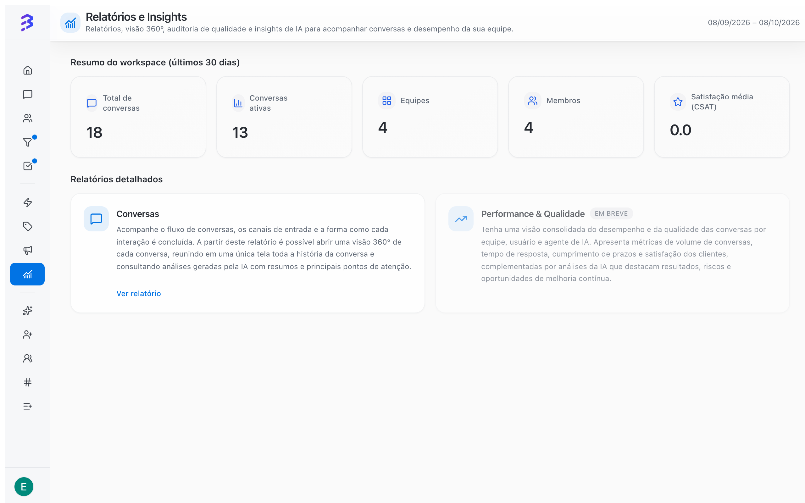

Em **Relatórios e Insights**, no menu lateral, você acompanha a operação de atendimento em três níveis: o resumo do workspace, os relatórios detalhados e a análise individual de cada conversa. Os números consideram todos os seus canais, como WhatsApp, Instagram e Webchat, e mostram o que foi atendido pelo agente de IA, pela equipe ou pelos dois.

<Frame>
  
</Frame>

## Quem tem acesso

| Papel | Acesso |
| --- | --- |
| **Administrador** | Todos os relatórios, de todas as equipes e canais |
| **Gerente** | Relatórios das equipes de que participa e dos canais dessas equipes |
| **Membro** | Sem acesso. Membros são focados em atendimento |

[Papéis e permissões →](/pt-BR/members/roles-permissions)

## Resumo do workspace

O topo da tela mostra o **Resumo do workspace (últimos 30 dias)**:

| Indicador | O que mostra |
| --- | --- |
| **Total de conversas** | Conversas no período |
| **Conversas ativas** | Conversas ainda em andamento |
| **Equipes** | Equipes do workspace |
| **Membros** | Pessoas do workspace |
| **Satisfação média (CSAT)** | Média das notas da Avaliação de Satisfação |

Enquanto o workspace ainda não tem conversas suficientes, a tela mostra **Ainda não há dados suficientes**. Use **Atualizar dados** depois que os primeiros atendimentos acontecerem.

## Relatórios disponíveis

<CardGroup cols={2}>
  <Card title="Relatório de conversas" icon="messages-square" href="/pt-BR/reports/conversations-report">
    Volume, status e distribuição das conversas entre IA, equipe e híbrido, por canal, equipe e período, com mapa de calor e ranking de contatos.
  </Card>

  <Card title="Visão 360° e análise de IA" icon="scan-search" href="/pt-BR/reports/ai-audit">
    Tudo sobre uma conversa em uma tela, com análise de qualidade, sentimento, riscos e sugestões de coaching.
  </Card>

  <Card title="Performance & Qualidade (em breve)" icon="gauge" href="/pt-BR/reports/performance-quality">
    Atendimento no prazo, satisfação, tempos e carga por equipe, atendente e agente de IA.
  </Card>
</CardGroup>

Em **Relatórios detalhados**, clique em **Ver relatório** no card **Conversas** para abrir o relatório de conversas. A partir dele você abre a Visão 360° de cada conversa.

## Duas réguas diferentes

Os relatórios medem o **atendimento** (conversas). O andamento dos **processos** (negócios) é acompanhado nos Pipelines, com os filtros de responsável, prioridade, vencimento e prazo por etapa.

| Pergunta | Onde responder |
| --- | --- |
| Quanto o agente de IA está atendendo sozinho? | Relatório de conversas, **Distribuição por tipo** e **Total de conversas ao longo do tempo** |
| A IA e a equipe estão atendendo bem? | Visão 360°, **Análise de IA** |
| Em que horários chegam mais conversas? | Relatório de conversas, **Mapa de calor – picos por dia e hora** |
| Quem está com conversas abertas? | Relatório de conversas, modo **Detalhado**, filtrado por membro e status |
| O cliente ficou satisfeito? | Resumo do workspace, **Satisfação média (CSAT)** |
| Quais negócios estão parados? | Pipelines, filtro **Vencimento → Atrasados** |
| Por que estamos perdendo vendas? | Motivos de **Perdido** nos negócios do Pipeline |

[Trabalhar com negócios →](/pt-BR/pipelines/deals)

## Antes de analisar os números

Os relatórios dependem de como a operação está configurada. Confira:

1. **Acompanhar meta de tempo** e **Prazo para resolver (horas)** em cada equipe.
2. **Calendário da Equipe** com o expediente real.
3. **Avaliação de Satisfação** ativada nas equipes que atendem clientes.
4. Regras para **encerrar** conversas. No agente de IA, ative a habilidade nativa **Encerrar conversa** para que ele finalize os atendimentos que resolveu. Conversas abertas indefinidamente distorcem os números de conversas ativas e de tempo.

[Configurar equipes →](/pt-BR/account-settings/create-configure-teams) · [Configurações do agente de IA →](/pt-BR/ai-agents/configure-agent-settings) · [Encerrar atendimento →](/pt-BR/conversations/close-attendance)

## Boas práticas

- Defina uma rotina: o resumo do workspace toda semana, a amostra de conversas na Visão 360° toda semana e o relatório de conversas no fechamento do mês.
- Compare períodos iguais, como semana com semana, para não confundir sazonalidade com mudança real.
- Transforme o que os relatórios mostram em ação: treinamento do agente de IA, ajuste de escala da equipe ou revisão de respostas rápidas.

## Próximos passos

<CardGroup cols={2}>
  <Card title="Relatório de conversas" icon="messages-square" href="/pt-BR/reports/conversations-report">
    Volume, canais, horários e quem atendeu.
  </Card>

  <Card title="Visão 360° e análise de IA" icon="scan-search" href="/pt-BR/reports/ai-audit">
    Avalie a qualidade de cada atendimento.
  </Card>
</CardGroup>
