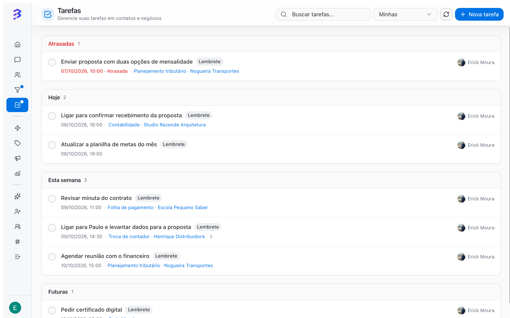

Tarefas são os próximos passos com prazo: retornar uma ligação, enviar uma proposta, cobrar um documento. Elas podem ser pessoais ou vinculadas a um contato e a um negócio, e ficam reunidas em **Tarefas**, no menu lateral.

<Frame>
  
</Frame>

## Quando usar

- Para compromissos que acontecem fora da conversa: ligação, reunião, envio de proposta.
- Para garantir que todo negócio aberto tenha um próximo passo com data.
- Para não perder o que o agente de IA combinou com o cliente antes de transferir a conversa.

## Onde criar uma tarefa

| Onde | Vínculo |
| --- | --- |
| **Tarefas → Nova tarefa** | Pessoal ou, se você escolher, com contato e negócio |
| Ficha do negócio → **Tarefa** | Já vinculada ao negócio e ao contato |
| Ficha do contato → aba **Tarefas** | Vinculada ao contato |

## Criar uma tarefa pela tela de Tarefas

<Steps>
  <Step title="Abra o formulário">
    Em **Tarefas**, clique em **Nova tarefa**.
  </Step>
  <Step title="Descreva e defina o prazo">
    Escreva o título da tarefa e, se quiser, defina a data de vencimento. Tarefas sem data ficam no grupo **Sem prazo**.
  </Step>
  <Step title="Vincule a um contato (opcional)">
    Em **Contato (opcional)**, busque o contato por nome ou telefone. Digite ao menos 3 caracteres ou 4 dígitos. Sem contato, a tarefa fica pessoal.
  </Step>
  <Step title="Vincule a um negócio (opcional)">
    Com o contato escolhido, selecione o **Negócio (opcional)**. Só aparecem os negócios abertos daquele contato. Escolha a opção **Nenhum** para vincular apenas ao contato.
  </Step>
  <Step title="Salve">
    Confirme a criação. A tarefa aparece no grupo correspondente ao prazo.
  </Step>
</Steps>

<Tip>
  Quando o agente de IA transfere um lead com o melhor horário de contato (por exemplo, "amanhã depois das 14h"), crie a tarefa da ligação na hora, já vinculada ao negócio. Assim o compromisso que a IA combinou com o cliente não se perde.
</Tip>

## Como as tarefas se organizam

As tarefas ficam agrupadas por prazo:

| Grupo | Conteúdo |
| --- | --- |
| **Atrasadas** | Prazo vencido e ainda não concluídas |
| **Hoje** | Vencem hoje |
| **Esta semana** | Vencem nos próximos dias desta semana |
| **Futuras** | Prazo depois desta semana |
| **Sem prazo** | Tarefas sem data |
| **Concluídas** | Já finalizadas |

Use **Buscar tarefas...** para encontrar uma tarefa pelo texto e **Atualizar** para recarregar a lista.

## Concluir, editar e excluir

- **Concluir**: marque a tarefa como concluída. Ela vai para **Concluídas**.
- **Reabrir**: se precisar voltar a uma tarefa concluída, reabra. Ela volta para o grupo do prazo.
- **Editar**: altere título, prazo, contato ou negócio.
- **Excluir**: remove a tarefa.

## Escopo: minhas, da equipe ou do workspace

| Escopo | Mostra | Quem vê a opção |
| --- | --- | --- |
| **Minhas** | Suas tarefas | Todos |
| **Equipes** | Tarefas das equipes de que você participa | Gerente e Administrador |
| **Workspace** | Todas as tarefas do workspace | Administrador |

<Tip>
  Comece o dia em **Tarefas** com o escopo **Minhas** e resolva primeiro o grupo **Atrasadas**. Gestores podem usar **Equipes** para ver onde há acúmulo.
</Tip>

## Tarefas e negócios

Tarefas criadas em um negócio aparecem na aba **Tarefas** da ficha e no **Histórico** do negócio, como **Tarefa criada**, **Tarefa concluída** e **Tarefa editada**. Ao abrir o negócio, você vê qual foi o último passo e qual é o próximo.

[Trabalhar com negócios →](/pt-BR/pipelines/deals)

## Boas práticas

- Escreva o título como uma ação: "Ligar para confirmar proposta", não "Proposta".
- Sempre defina um prazo. Tarefas sem prazo tendem a ficar esquecidas.
- Ao concluir uma tarefa de um negócio, crie a próxima. Todo negócio aberto deve ter um próximo passo.
- Registre o resultado em uma anotação do negócio. A tarefa diz o que fazer, a anotação diz o que aconteceu.

## Próximos passos

<CardGroup cols={2}>
  <Card title="Trabalhar com negócios" icon="briefcase" href="/pt-BR/pipelines/deals">
    Anotações, tarefas e histórico na ficha do negócio.
  </Card>

  <Card title="Histórico de atividades do contato" icon="history" href="/pt-BR/contacts/view-activity-timeline">
    Veja tudo o que aconteceu com um contato.
  </Card>
</CardGroup>
