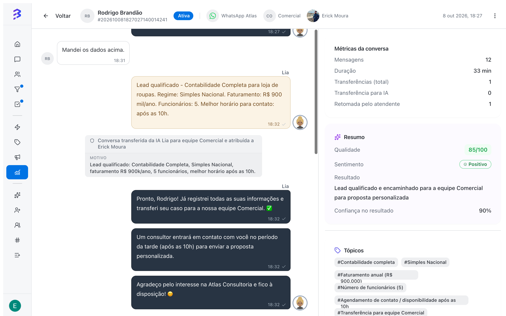
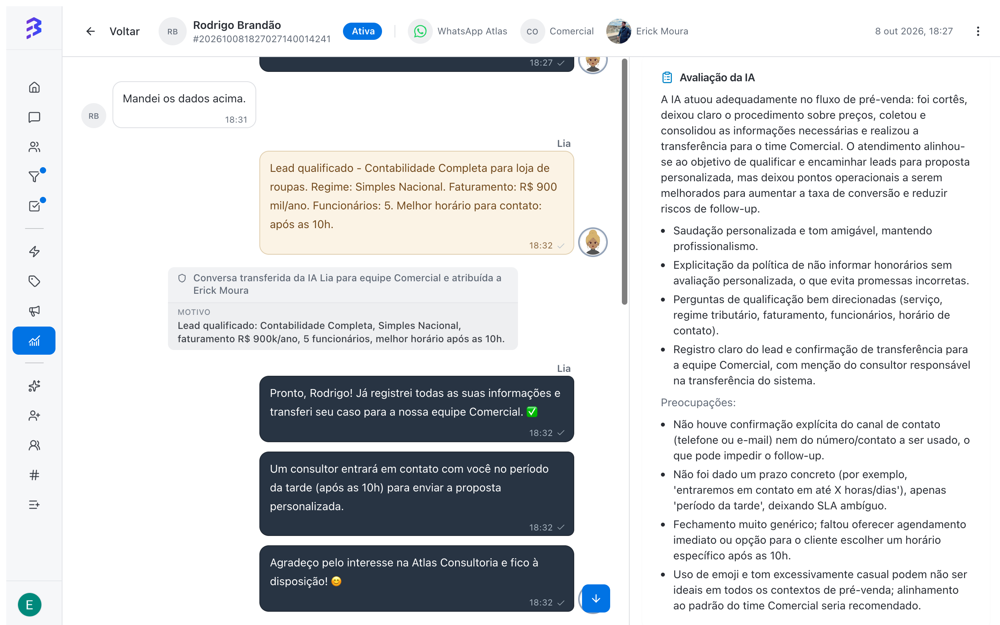

The **360° View** brings everything about a conversation together on one screen: messages from the customer, the AI agent and the team, transfers and conversation metrics. From there, managers generate an **AI Analysis** that evaluates the service, human or automated, and suggests improvements.

<Frame>
  
</Frame>

## When to use

- To review conversations handled only by the AI agent and confirm it answers well.
- To understand why a conversation was transferred or ended with an unhappy customer.
- To prepare feedback sessions with team members, using concrete examples.
- To spot risks, such as requests for personal data without a record of consent.

## Open the 360° View

<Steps>
  <Step title="Open the conversations report">
    In **Reports & Insights**, click **View report** on the **Conversations** card.
  </Step>
  <Step title="Switch to Detailed mode">
    In **View mode**, choose **Detailed** and use the filters to find the conversation.
  </Step>
  <Step title="Click the conversation">
    The 360° View opens with the full conversation. Use **Back to list** to return to the report.
  </Step>
</Steps>

<Note>
  The 360° View is available to **Admins** and to **Managers**, for conversations of the teams they belong to.
</Note>

## 360° View tabs

| Tab | Content |
| --- | --- |
| **Messages** | The full conversation, with messages from the customer, the AI agent and the team, transfers and internal notes |
| **AI Analysis** | The **Conversation metrics** and the AI-generated analysis |

### Conversation metrics

| Metric | What it shows |
| --- | --- |
| **Messages** | Total messages exchanged |
| **Transfers (total)** | How many times the conversation changed hands |
| **Transfer to AI** | Transfers from the team to an AI agent |
| **Taken back by agent** | Times a team member took over a conversation the AI was handling |
| **Duration** | Time from opening to closing, or until now |
| **Satisfaction survey** | The Satisfaction Survey score, when answered |

## Generate the AI analysis

On the **AI Analysis** tab, click **Generate AI analysis**. The analysis takes a few moments (**Analyzing…**). To redo it after new messages, use **Generate new analysis**.

| Item | What it shows |
| --- | --- |
| **Quality** | A score from 0 to 100, rated **Excellent**, **Good**, **Average** or **Poor** |
| **Sentiment** | **Positive**, **Negative**, **Neutral** or **Mixed**, and the **Sentiment evolution** from start to end |
| **Outcome** | How the conversation ended, such as **Resolved**, **Unresolved**, **Escalated**, **Abandoned** or **Successful engagement**, with the **Outcome confidence** |
| **Summary** | What happened in the conversation, in a few lines |
| **Topics** | Subjects covered, such as pricing, support or sales |
| **Identified intentions** | The customer's **Main intent** and **Sub-intents** |
| **Reason for transfer** | Why the conversation moved from the AI agent to the team, when there was a transfer |
| **AI evaluation** | How the service went: strengths and **Concerns** |
| **Risks & compliance** | Whether the conversation **Has risks** and which points need attention |
| **Coaching suggestions** | What the team and the AI agent can improve |

<Frame>
  
</Frame>

## Example: hybrid conversation

In the conversation above, the AI agent Lia qualified an accounting lead and transferred it to the Sales team. The analysis gave a quality of 85/100 and positive sentiment, and pointed out two improvements: confirm the phone number or email before the transfer, and give a concrete callback time. Both became adjustments to the agent's training and instructions, and the next conversations were better right away.

## From diagnosis to action

| What the analysis showed | Recommended action |
| --- | --- |
| The AI could not answer a topic | Add the content to the AI agent's training |
| The AI transferred too early | Review the transfer instructions and the **Transfer to Team** skill |
| The team member was slow or gave no timeline | Use the case in a feedback session and create a quick reply |
| Compliance risk | Review the data collection script with the team and the AI agent |

[Train the AI agent →](/ai-agents/train-ai-agent) · [Configure skills →](/ai-agents/configure-skills)

<Warning>
  The risks and compliance analysis is an alert for the manager to review, not a legal opinion. In conversations still in progress, the analysis only covers what has happened so far. For a complete evaluation, generate the analysis after the conversation is closed.
</Warning>

## Best practices

- Analyze a weekly sample of conversations handled only by the AI, not just transferred ones or those with low scores.
- Compare the AI evaluation with the customer's Satisfaction Survey score. Differences often reveal process problems.
- Turn recurring suggestions into AI agent training, quick replies or team scripts.

## Next steps

<CardGroup cols={2}>
  <Card title="Conversations report" icon="messages-square" href="/reports/conversations-report">
    Find the conversations to analyze.
  </Card>

  <Card title="Train the AI agent" icon="bot" href="/ai-agents/train-ai-agent">
    Apply the improvements the analysis points out.
  </Card>
</CardGroup>
