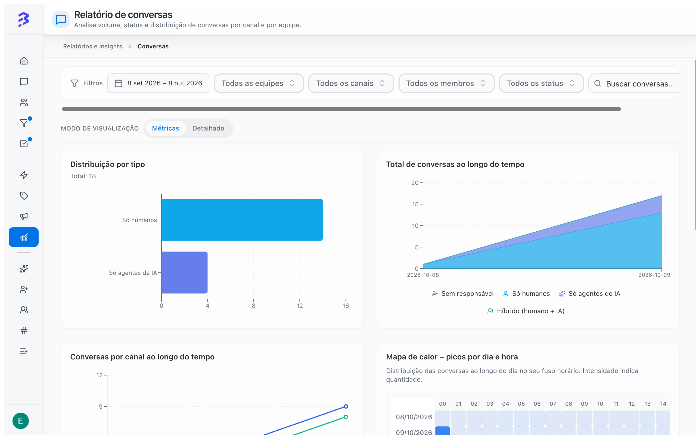
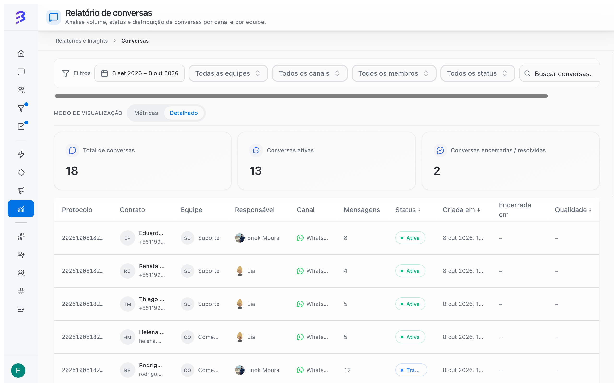

The **Conversations report** answers how many conversations arrived, through which channel, who handled them (AI agent, team or both) and at what times. It is also the entry point to the 360° View of each conversation.

To open it, go to **Reports & Insights** and click **View report** on the **Conversations** card.

<Frame>
  
</Frame>

## Filters

The filters sit at the top and apply to both view modes.

| Filter | Options |
| --- | --- |
| **Period** | **Today**, **Yesterday**, **Last 7 days**, **Last 30 days**, **Last 60 days**, **Last 90 days** or a start and end date |
| **Team** | **All teams** or a specific team |
| **Channel** | **All channels** or a specific channel (WhatsApp, Instagram, Webchat and others) |
| **Member** | **All members** or a specific person |
| **Status** | **All statuses** or a conversation status |
| Search | **Search conversations...** to find a specific conversation |

Click **Refresh** to reload the data. Managers only see the teams they belong to and those teams' channels.

## Period indicators

| Indicator | What it shows |
| --- | --- |
| **Total conversations** | All conversations in the filtered period |
| **Active conversations** | Conversations still in progress |
| **Closed / resolved** | Conversations closed in the period |

## View modes

Use **View mode** to switch between:

- **Metrics**: charts and indicators for the period.
- **Detailed**: a table with one row per conversation.

### Metrics mode charts

| Chart | What to use it for |
| --- | --- |
| **Distribution by type** | How many conversations were **Human only**, **AI agents only**, **Hybrid (human + AI)** or **Unassigned** |
| **Total conversations over time** | Volume trend, split by the same types |
| **Conversations by channel over time** | Which channel is growing or shrinking |
| **Peak heatmap – by day and hour** | Days and hours with the most conversations, in your time zone. The stronger the color, the higher the volume |
| Contact ranking | Contacts that generated the most conversations in the period |

### Detailed mode table

<Frame>
  
</Frame>

| Column | Content |
| --- | --- |
| **Protocol** | The conversation protocol number |
| **Contact** | Contact name |
| **Team** | The conversation's team, or **Unassigned** |
| **Responsible** | Who is handling it: the AI agent, in conversations it is still handling, or the team member, in transferred conversations |
| **Channel** | Entry channel |
| **Messages** | Number of messages |
| **Status** | Current status of the conversation |
| **Created at** and **Closed at** | Opening and closing dates |
| **Quality** | AI analysis score, when generated |

Click a row to open the conversation's **360° View**. [360° View and AI analysis →](/reports/ai-audit)

## How to read conversation types

| Type | Meaning | What to watch |
| --- | --- | --- |
| **AI agents only** | The AI agent handled it from start to finish | Should grow as you train the agent |
| **Hybrid (human + AI)** | The AI agent started and the team continued | Normal in sales and complex cases. Check the transfer reasons |
| **Human only** | Only the team handled it | Channels or teams without a linked AI agent |
| **Unassigned** | The conversation arrived and nobody took it | Should stay close to zero |

<Tip>
  Track the **AI agents only** share week by week. If it does not grow, review the agent's training based on the conversations it transferred. The topics that reach the team most often are the best candidates for new training.
</Tip>

<Tip>
  Use the heatmap to adjust schedules: avoid team breaks and meetings at peak times. Outside business hours, the AI agent guarantees the first response.
</Tip>

## Unassigned conversations

**Unassigned** shows conversations that arrived and stayed in the queue without anyone taking them. If the number grows:

1. Review the team's distribution type (**Round robin**, **Available** or **Queue**).
2. Check how many people are available at peak times.
3. Link an AI agent to the channel to give the first response.

[Configure teams →](/account-settings/create-configure-teams) · [Transfer a conversation →](/conversations/transfer-attendance)

## Limitations

- The report covers conversations from the teams and channels you can see.
- The **Quality** column only has a value for conversations where the AI analysis was generated.
- The heatmap shows hours in your time zone, which may differ from the time zone set in the **Team Calendar**.

## Next steps

<CardGroup cols={2}>
  <Card title="360° View and AI analysis" icon="scan-search" href="/reports/ai-audit">
    Open a conversation and evaluate the quality of the service.
  </Card>

  <Card title="Train the AI agent" icon="bot" href="/ai-agents/train-ai-agent">
    Use what the report shows to improve the agent.
  </Card>
</CardGroup>
