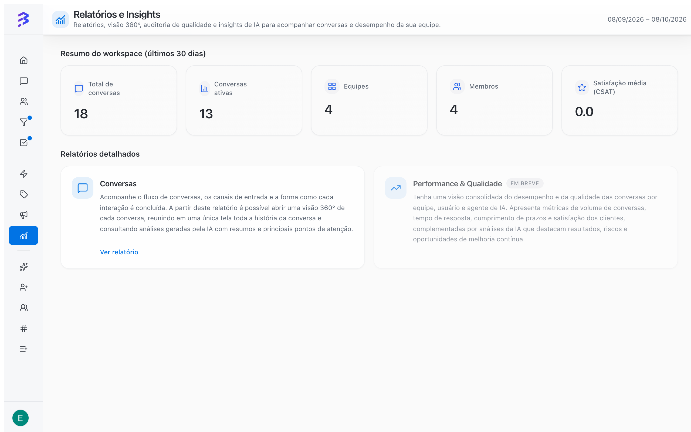

In **Reports & Insights**, in the sidebar, you track your service operation at three levels: the workspace overview, the detailed reports and the individual analysis of each conversation. The numbers cover all your channels, such as WhatsApp, Instagram and Webchat, and show what was handled by the AI agent, by your team or by both.

<Frame>
  
</Frame>

## Who has access

| Role | Access |
| --- | --- |
| **Admin** | All reports, for all teams and channels |
| **Manager** | Reports for the teams they belong to and those teams' channels |
| **Member** | No access. Members focus on serving customers |

[Roles and permissions →](/members/roles-permissions)

## Workspace overview

The top of the screen shows the **Workspace overview (last 30 days)**:

| Indicator | What it shows |
| --- | --- |
| **Total conversations** | Conversations in the period |
| **Active conversations** | Conversations still in progress |
| **Teams** | Teams in the workspace |
| **Members** | People in the workspace |
| **Average CSAT** | Average score from the Satisfaction Survey |

While the workspace does not have enough conversations yet, the screen shows **No data available yet**. Use **Refresh data** after the first conversations happen.

## Available reports

<CardGroup cols={2}>
  <Card title="Conversations report" icon="messages-square" href="/reports/conversations-report">
    Volume, status and split of conversations between AI, team and hybrid, by channel, team and period, with a heatmap and a contact ranking.
  </Card>

  <Card title="360° View and AI analysis" icon="scan-search" href="/reports/ai-audit">
    Everything about a conversation on one screen, with quality, sentiment, risk analysis and coaching suggestions.
  </Card>

  <Card title="Performance & Quality (coming soon)" icon="gauge" href="/reports/performance-quality">
    SLA, satisfaction, times and workload by team, team member and AI agent.
  </Card>
</CardGroup>

Under **Detailed reports**, click **View report** on the **Conversations** card to open the conversations report. From there you open the 360° View of each conversation.

## Two different yardsticks

Reports measure **service** (conversations). The progress of **processes** (deals) is tracked in Pipelines, with the owner, priority, due date and stage deadline filters.

| Question | Where to answer it |
| --- | --- |
| How much is the AI agent handling on its own? | Conversations report, **Distribution by type** and **Total conversations over time** |
| Are the AI and the team serving customers well? | 360° View, **AI Analysis** |
| At what times do most conversations arrive? | Conversations report, **Peak heatmap – by day and hour** |
| Who has open conversations? | Conversations report, **Detailed** mode, filtered by member and status |
| Was the customer satisfied? | Workspace overview, **Average CSAT** |
| Which deals are stalled? | Pipelines, **Due date → Overdue** filter |
| Why are we losing sales? | **Lost** reasons on the Pipeline deals |

[Work with deals →](/pipelines/deals)

## Before analyzing the numbers

Reports depend on how your operation is configured. Check:

1. **Track time goal** and **Time to resolve (hours)** on each team.
2. **Team Calendar** with the real business hours.
3. **Satisfaction Survey** turned on for teams that serve customers.
4. Rules for **closing** conversations. On the AI agent, turn on the native **Close conversation** skill so it closes the conversations it resolved. Conversations left open indefinitely distort the active conversation and time figures.

[Configure teams →](/account-settings/create-configure-teams) · [AI agent settings →](/ai-agents/configure-agent-settings) · [Close a conversation →](/conversations/close-attendance)

## Best practices

- Set a routine: the workspace overview every week, a sample of conversations in the 360° View every week and the conversations report at month end.
- Compare equal periods, such as week over week, so you do not mistake seasonality for real change.
- Turn what the reports show into action: AI agent training, team schedule adjustments or a review of quick replies.

## Next steps

<CardGroup cols={2}>
  <Card title="Conversations report" icon="messages-square" href="/reports/conversations-report">
    Volume, channels, peak times and who handled each conversation.
  </Card>

  <Card title="360° View and AI analysis" icon="scan-search" href="/reports/ai-audit">
    Evaluate the quality of each interaction.
  </Card>
</CardGroup>
