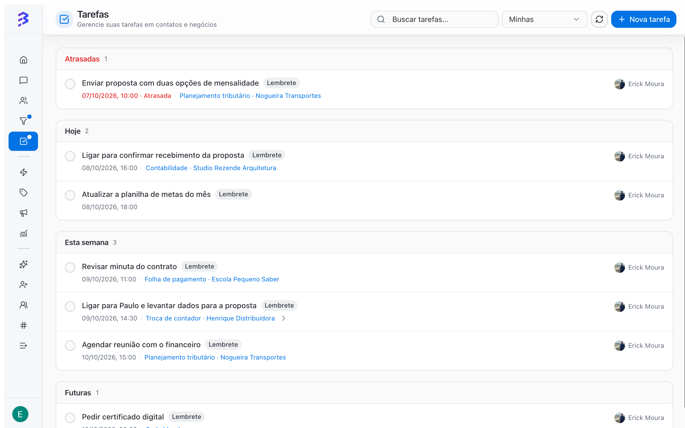

Tasks are next steps with a due date: return a call, send a proposal, request a document. They can be personal or linked to a contact and a deal, and they are gathered in **Tasks** in the sidebar.

<Frame>
  
</Frame>

## When to use

- For commitments that happen outside the conversation: a call, a meeting, sending a proposal.
- To make sure every open deal has a next step with a date.
- To keep track of what the AI agent agreed with the customer before transferring the conversation.

## Where to create a task

| Where | Link |
| --- | --- |
| **Tasks → New task** | Personal or, if you choose, with a contact and deal |
| Deal record → **Task** | Already linked to the deal and the contact |
| Contact record → **Tasks** tab | Linked to the contact |

## Create a task from the Tasks screen

<Steps>
  <Step title="Open the form">
    In **Tasks**, click **New task**.
  </Step>
  <Step title="Describe it and set the due date">
    Write the task title and, if you want, set the due date. Tasks without a date go to the **No due date** group.
  </Step>
  <Step title="Link a contact (optional)">
    In **Contact (optional)**, search for the contact by name or phone. Type at least 3 characters or 4 digits. With no contact, the task stays personal.
  </Step>
  <Step title="Link a deal (optional)">
    With a contact selected, choose the **Deal (optional)**. Only that contact's open deals appear. Choose the **None** option to link only the contact.
  </Step>
  <Step title="Save">
    Confirm the creation. The task appears in the group that matches its due date.
  </Step>
</Steps>

<Tip>
  When the AI agent transfers a lead with the best time to call (for example, "tomorrow after 2 p.m."), create the call task right away, linked to the deal. This way the commitment the AI made with the customer is not lost.
</Tip>

## How tasks are organized

Tasks are grouped by due date:

| Group | Content |
| --- | --- |
| **Overdue** | Past due and not completed |
| **Today** | Due today |
| **This week** | Due in the coming days of this week |
| **Later** | Due after this week |
| **No due date** | Tasks without a date |
| **Completed** | Already finished |

Use **Search tasks...** to find a task by text and **Refresh** to reload the list.

## Complete, edit and delete

- **Complete**: mark the task as completed. It moves to **Completed**.
- **Reopen**: if you need to go back to a completed task, reopen it. It returns to its due date group.
- **Edit**: change the title, due date, contact or deal.
- **Delete**: removes the task.

## Scope: mine, team or workspace

| Scope | Shows | Who sees the option |
| --- | --- | --- |
| **Mine** | Your tasks | Everyone |
| **Teams** | Tasks from the teams you belong to | Manager and Admin |
| **Workspace** | All tasks in the workspace | Admin |

<Tip>
  Start the day in **Tasks** with the **Mine** scope and clear the **Overdue** group first. Managers can use **Teams** to see where work is piling up.
</Tip>

## Tasks and deals

Tasks created on a deal appear in the **Tasks** tab of the record and in the deal **History**, as **Task created**, **Task completed** and **Task edited**. When you open the deal, you see the last step and the next one.

[Work with deals →](/pipelines/deals)

## Best practices

- Write the title as an action: "Call to confirm the proposal", not "Proposal".
- Always set a due date. Tasks without one tend to be forgotten.
- When you complete a deal task, create the next one. Every open deal should have a next step.
- Record the outcome in a deal note. The task says what to do, the note says what happened.

## Next steps

<CardGroup cols={2}>
  <Card title="Work with deals" icon="briefcase" href="/pipelines/deals">
    Notes, tasks and history on the deal record.
  </Card>

  <Card title="Contact activity timeline" icon="history" href="/contacts/view-activity-timeline">
    See everything that happened with a contact.
  </Card>
</CardGroup>
